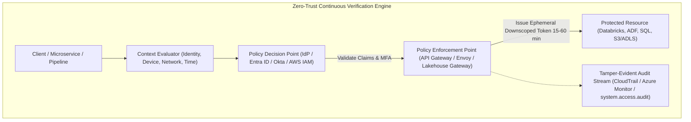
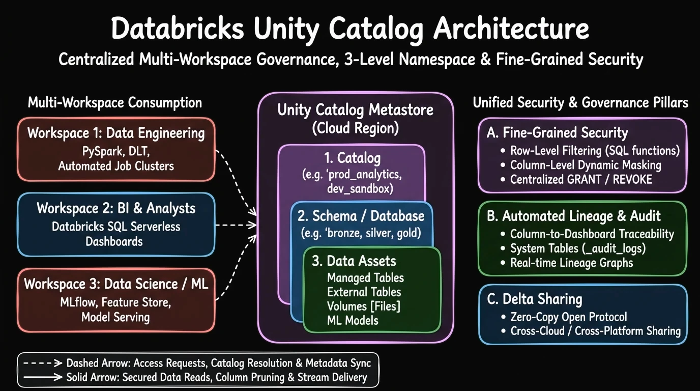
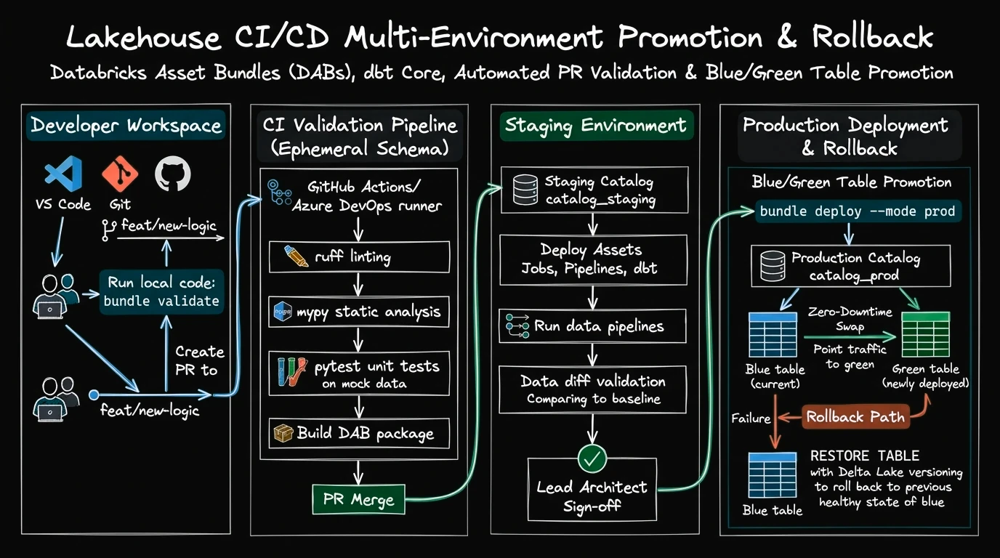

# 🔒 The Security Handbook

**Enterprise Security Patterns & Practices: Cloud Perimeter Defense, DevSecOps, ETL/ELT Governance, Databricks Unity Catalog, ADF, Python Cryptography, OIDC Workload Identity & Deployments**

[](https://github.com/santoshjammi29/security-handbook/actions)
[](https://csrc.nist.gov/pubs/sp/800/207/final)
[](https://azure.microsoft.com/)
[](https://www.databricks.com/)
[](https://docs.github.com/en/actions/deployment/security-hardening-your-deployments/about-security-hardening-with-openid-connect)
[](LICENSE)

*The definitive enterprise handbook and production reference for security engineering in modern data, cloud, and lakehouse platforms.*  
*Covering end-to-end zero-trust architecture, federated workload identities, dynamic data masking, envelope encryption, supply chain security, and emergency incident containment.*

[Curriculum Overview](#-curriculum-overview) • [Zero-Trust Architecture](#-zero-trust-cloud-architecture) • [Whiteboard Blueprints](#-master-whiteboard-architecture-blueprints) • [Modules Directory](#-curriculum-modules-overview) • [Production Runbooks](#-battle-tested-production-runbooks) • [Interview Matrix](#-4-tier-interview-preparation-matrix)

---

## 🎯 Overview & Mission

Modern cloud data platforms are high-value targets for cyber adversaries, ransomware operators, and malicious insiders. A single leaked service principal secret in a pull request, an unmasked social security number in an analytical dashboard, an unindexed S3 bucket, or an unvetted Python package can trigger multimillion-dollar regulatory fines (GDPR, SEC, HIPAA) and catastrophic brand damage.

This repository provides **10 comprehensive production modules, 4 architecture whitepapers, 6 battle-tested incident runbooks, and a 4-tier interview guide** covering:
- **Authentication & Workload Identity:** OpenID Connect (OIDC) federation, eliminating static cloud keys, OAuth 2.0 PKCE, and JWT lifecycle security.
- **Authorization & Entitlement Governance:** Attribute-Based Access Control (ABAC), Dynamic Data Masking (DDM), Row-Level Security (RLS), and Separation of Duties (SoD).
- **Cloud Perimeter & Network Isolation:** Private Link, Private Endpoints, No Public IP (NPIP) clusters, split-horizon DNS, and egress firewall rules.
- **Secrets Management & Cryptography:** FIPS 140-2 Level 3 HSMs, Envelope Encryption (DEK + KEK), AES-256-GCM authenticated encryption, and dual-secret zero-downtime rotation.
- **DevSecOps & Supply Chain Security:** SLSA Level 3, Cosign keyless artifact signing, SBOM generation (Syft/Trivy), and distroless non-root Docker builds.
- **Python Application Security:** SQL injection prevention with parameterized bindings, safe deserialization (anti-pickle), and constant-time HMAC validation.
- **ETL, ELT & Lakehouse Governance:** The Write-Audit-Publish (WAP) pattern, PII detection, deterministic tokenization, and cryptographic shredding for GDPR Article 17.
- **Azure Data Factory & Integration Security:** Managed Identities, Key Vault linked services, Managed VNet Integration Runtime, and Secure Input/Output log masking.
- **Databricks Unity Catalog Governance:** 3-tier namespaces, downscoped temporary storage tokens, cluster access modes, and Personal Access Token (PAT) lockdown.
- **Incident Response & Postmortems:** NIST SP 800-61r2 incident response, forensic querying of Databricks system tables (`system.access.audit`), and 72-hour breach disclosure protocols.

---

## 🏛️ Zero-Trust Cloud Architecture

Under the **NIST SP 800-207 Zero-Trust Architecture**, network location provides zero implicit trust. Every single request is authenticated, authorized, encrypted, and continuously audited:



---

## 🖼️ Master Whiteboard Architecture Blueprints

The repository incorporates publication-grade architectural whiteboard blueprints mirrored under [`assets/whiteboards/`](assets/whiteboards) and cataloged with comprehensive 5-persona breakdowns, failure modes, and engine internals in [`docs/whiteboard_diagrams/README.md`](docs/whiteboard_diagrams/README.md) and [`whiteboards/handbook_whiteboard_blueprints.md`](whiteboards/handbook_whiteboard_blueprints.md):

- 🖼️ **[Master Whiteboard Blueprints Hub](whiteboards/handbook_whiteboard_blueprints.md)**: Complete whiteboard architecture diagrams detailing perimeter isolation, identity federation, encryption hierarchies, and zero-trust boundaries.
- 📊 **[Spark Architecture & Tuning Cheatsheet](assets/whiteboards/spark_architecture_catalyst_cheatsheet.jpg)**: High-resolution visual cheatsheet covering cluster topology, Catalyst compiler phases, and memory tiers.
- 🔀 **[Join Strategies Decision Matrix](assets/whiteboards/spark_join_strategies_decision_matrix.jpg)**: Visual flowchart and decision tree for distributed joins and broadcast thresholds.
- ⚡ **[Skew & Memory Spill Triage](assets/whiteboards/spark_performance_skew_spill_triage.jpg)**: Step-by-step diagnostic workflow for data skew, spill to disk, and OOM triage.

### 📐 Visual Security & Governance Blueprints Showcase (4x2 Grid)

<table width="100%">
  <tr>
    <td width="50%" valign="top">
      <a href="docs/whiteboard_diagrams/README.md#unity-catalog-governance">
        
      </a>
      <br><strong>Databricks Unity Catalog 3-Tier Security & Governance</strong><br>
      <em>3-level namespaces, decoupled storage credentials, downscoped temporary tokens, and centralized audit logging across workspaces.</em>
    </td>
    <td width="50%" valign="top">
      <a href="docs/whiteboard_diagrams/README.md#lakehouse-access-masking">
        
      </a>
      <br><strong>Lakehouse Access & Dynamic Column Masking Lifecycle</strong><br>
      <em>ABAC policy evaluation, dynamic row filters, SHA-256 column tokenization, and Catalyst physical plan rule injection.</em>
    </td>
  </tr>
  <tr>
    <td width="50%" valign="top">
      <a href="docs/whiteboard_diagrams/README.md#purview-governance-catalog">
        
      </a>
      <br><strong>Microsoft Purview Enterprise Governance & Sensitivity Labels</strong><br>
      <em>Automated classification rules, PII boundary labeling, cross-engine lineage scanning, and decoupled Purview RBAC.</em>
    </td>
    <td width="50%" valign="top">
      <a href="docs/whiteboard_diagrams/README.md#lakehouse-bcdr-failover">
        
      </a>
      <br><strong>Lakehouse Business Continuity, Ransomware Recovery & Multi-Region DR</strong><br>
      <em>Active-passive failover, Delta Time Travel restoration (`RESTORE TABLE`), immutable WORM storage locks, and RPO/RTO SLAs.</em>
    </td>
  </tr>
  <tr>
    <td width="50%" valign="top">
      <a href="docs/whiteboard_diagrams/README.md#lakehouse-cicd-promotion">
        
      </a>
      <br><strong>DevSecOps CI/CD Promotion & Keyless OIDC Identity</strong><br>
      <em>Ephemeral token negotiation, SLSA Level 3 supply chain security, Cosign artifact signing, and policy-as-code gate checks.</em>
    </td>
    <td width="50%" valign="top">
      <a href="docs/whiteboard_diagrams/README.md#governed-agentic-rag">
        
      </a>
      <br><strong>Governed Agentic RAG & Enterprise AI Security Perimeter</strong><br>
      <em>Vector search access boundaries, tenant data isolation, prompt injection defenses, and audit telemetry.</em>
    </td>
  </tr>
  <tr>
    <td width="50%" valign="top">
      <a href="docs/whiteboard_diagrams/README.md#data-mesh-enterprise">
        
      </a>
      <br><strong>Data Mesh Federated Governance & Security Contracts</strong><br>
      <em>Domain-oriented ownership boundaries, Open Data Contract Standard (ODCS), and federated policy enforcement.</em>
    </td>
    <td width="50%" valign="top">
      <a href="docs/whiteboard_diagrams/README.md#data-quality-wap">
        
      </a>
      <br><strong>Write-Audit-Publish (WAP) & Automated Quarantine Protection</strong><br>
      <em>Isolated staging branches, pre-publish cryptographic integrity verification, and automated quarantine routing.</em>
    </td>
  </tr>
</table>

> 🔍 **Explore all 52 blueprints with 5-persona breakdowns, failure modes, and engine internals in [docs/whiteboard_diagrams/README.md](docs/whiteboard_diagrams/README.md)**.

---

## 🧠 Core Curriculum Concepts & Topics (37 Security & Governance Topics Covered)

> 💡 **Enterprise Knowledge Base Integration**: Core zero-trust, identity, encryption, and governance primitives implemented throughout the security handbook, cross-linked with the [Modern Data Engineering Systems Encyclopedia (921 Topics)](https://moderndataengineer.uk/concepts), arranged in increasing order of difficulty. Browse the full curriculum in [`topics/README.md`](topics/README.md).

### 📑 Security & Governance Topics Directory at a Glance

| Security Pillar | Topic Count | Key Core Primitives Covered | Status |
|:---|:---:|:---|:---:|
| 🔐 **Zero-Trust Identity & Secrets** | **7** | Databricks Secrets, Key Vault Scopes, Airflow Secrets, Token Bucket | ✅ Documented |
| 🌐 **Perimeter & Network Isolation** | **3** | Managed VNets, Managed Private Endpoints, Private Link | ✅ Documented |
| 🏛️ **Unity Catalog & Access Control** | **11** | 3-Level Namespaces, Dynamic Row Filters & Column Masks, ABAC | ✅ Documented |
| 📜 **Lineage, Audit & Governance** | **16** | OpenLineage, System Tables, Purview Metadata, Bi-Temporal Auditing | ✅ Documented |

<details>
<summary><b>🔐 Zero-Trust Identity, Authentication & Secrets Management (7 Topics)</b> — <i>Click to expand topic index (sorted by difficulty)</i></summary>

| # | Topic / Concept | Level | Architectural Definition & Core Principle |
|:---:|---|:---:|---|
| 1 | **Secrets Management** | 🟢<br>Easy | The secure credential management framework in Databricks (Secret Scopes backed by Azure Key Vault or encrypted storage) used to securely inject tokens, API keys, and connection strings at runtime. |
| 2 | **Airflow Connection Secrets Backend** | 🟡<br>Intermediate | Storing Airflow database and API connections in cloud secret managers (HashiCorp Vault, AWS Secrets Manager). |
| 3 | **Databricks Secret Scopes (Azure Key Vault)** | 🟡<br>Intermediate | Secure credential storage backed by cloud key vaults, accessed in notebooks via `dbutils.secrets.get()`. |
| 4 | **Databricks Secrets** | 🟡<br>Intermediate | A Databricks-managed key-value secret store that securely injects sensitive values (API keys, connection strings, passwords) into notebooks and job runs without exposing them as plaintext. |
| 5 | **Token Bucket Algorithm** | 🟡<br>Intermediate | A rate limiting algorithm that models a bucket holding a maximum of N tokens, where tokens are added at a fixed rate and each request consumes one token, allowing controlled burst traffic. |
| 6 | **Token Bucket Rate Limiting Algorithm** | 🟡<br>Intermediate | An algorithm that meters API requests by accumulating tokens at a constant rate up to a bucket capacity. |
| 7 | **Custom Secret Backends** | 🟣<br>Architect | Custom Secret Backends enable Airflow to retrieve Connections and Variables directly from enterprise secret management systems at runtime without storing secrets in the metadata database. |

</details>

<details>
<summary><b>🌐 Cloud Network Isolation & Perimeter Defense (3 Topics)</b> — <i>Click to expand topic index (sorted by difficulty)</i></summary>

| # | Topic / Concept | Level | Architectural Definition & Core Principle |
|:---:|---|:---:|---|
| 1 | **Managed Private Endpoints** | 🟡<br>Intermediate | Private IP addresses provisioned inside the ADF Managed Virtual Network to secure connections to Azure resources. |
| 2 | **Managed Virtual Network (Managed VNet)** | 🟡<br>Intermediate | A secure networking feature that runs ADF Integration Runtimes inside a dedicated private network boundary, connecting to services via Private Endpoints. |
| 3 | **ADF Managed Private Endpoint Provisioning & Timeout Bypass** | 🟣<br>Architect | Enterprise network security architecture managing lifecycle, approval protocols, and timeout bypass for private endpoints inside ADF Managed Virtual Networks. |

</details>

<details>
<summary><b>🏛️ Unity Catalog, Fine-Grained Access Control & Dynamic Data Masking (11 Topics)</b> — <i>Click to expand topic index (sorted by difficulty)</i></summary>

| # | Topic / Concept | Level | Architectural Definition & Core Principle |
|:---:|---|:---:|---|
| 1 | **Unity Catalog** | 🟢<br>Easy | Unity Catalog is Databricks' centralized, multi-cloud governance solution providing unified access control, data auditing, lineage tracking, and discovery across all workspace assets. |
| 2 | **Attribute-Based Dynamic Column Masking (ABAC)** | 🟡<br>Intermediate | A runtime security policy engine that evaluates user attributes (role, department, clearance) to conditionally mask, hash, or redact sensitive column values without duplicating tables. |
| 3 | **Dynamic Views for Security** | 🟡<br>Intermediate | Security-hardened SQL views that evaluate user context functions (`CURRENT_USER()`, `IS_MEMBER()`) at runtime to provide row-level filtering and column-level masking without duplicating data. |
| 4 | **Row-Level Security (RLS)** | 🟡<br>Intermediate | A security feature that restricts database row access for specific users based on active role filters. |
| 5 | **Unity Catalog Volumes (Managed vs. External)** | 🟡<br>Intermediate | A Unity Catalog securable object that extends centralized catalog governance, audit trails, and SQL permissions to unstructured and semi-structured files. |
| 6 | **Unity Catalog 3-Level Namespace & Attribute-Based Access Control (ABAC)** | 🔴<br>Advanced | Unified lakehouse governance with catalog.schema.table namespace and tag-based dynamic masking policies. |
| 7 | **Unity Catalog Fine-Grained Access Control** | 🔴<br>Advanced | Fine-Grained Access Control in Unity Catalog enforces cell-level security via Row Filters and Column Masks defined with standard SQL functions. |
| 8 | **Object-Level Security (OLS) & Dynamic RLS at Scale** | 🟣<br>Architect | Fine-grained security architecture enforcing dynamic row filters and complete column/table metadata obfuscation across enterprise user bases. |
| 9 | **Unity Catalog Dynamic Column Masking & Row Filters** | 🟣<br>Architect | Declarative SQL-based fine-grained access control policies enforced transparently at the Unity Catalog metadata layer. |
| 10 | **Unity Catalog Dynamic Row Filters & Column Masks** | 🟣<br>Architect | Fine-grained SQL access control mechanisms in Unity Catalog that dynamically redact columns or filter table rows based on the querying user's group membership. |
| 11 | **Unity Catalog Enterprise Governance** | 🟣<br>Architect | The enterprise governance operating model for Unity Catalog encompassing account-level identity management, catalog segregation, classification tagging, and regulatory audit compliance. |

</details>

<details>
<summary><b>📜 Data Lineage, Auditing & Regulatory Governance (16 Topics)</b> — <i>Click to expand topic index (sorted by difficulty)</i></summary>

| # | Topic / Concept | Level | Architectural Definition & Core Principle |
|:---:|---|:---:|---|
| 1 | **Data Quality Evidence with Lineage** | 🟢<br>Easy | A record connecting a quality check result to the data version, pipeline run, rules, and upstream inputs that produced it. |
| 2 | **Data Lineage** | 🟡<br>Intermediate | The automated, real-time metadata tracking engine in Unity Catalog that captures column-level and table-level data flow lineage across queries, notebooks, workflows, and dashboards. |
| 3 | **OpenLineage Operational Telemetry Standard** | 🟡<br>Intermediate | An open standard for automated collection of end-to-end dataset lineage, pipeline job execution metadata, and runtime assertions across data platforms. |
| 4 | **OpenLineage Standard Operational Run Facets** | 🟡<br>Intermediate | An open standard specification that captures job execution events, input/output dataset schemas, row counts, and error states emitted during pipeline runs. |
| 5 | **Unity Catalog Lineage Tracking** | 🟡<br>Intermediate | Automated capture of column-level and table-level data flow across queries, jobs, and dashboards. |
| 6 | **Audit Logging** | 🔴<br>Advanced | Audit Logging captures, records, and exports detailed security audit trails of all user and system activities occurring across Databricks workspaces and Unity Catalog. |
| 7 | **Delta Lake VACUUM & Retention Governance** | 🔴<br>Advanced | The maintenance command in Delta Lake that removes uncommitted and historical Parquet data files that are older than the specified retention threshold. |
| 8 | **Purview Metadata Enrichment & Non-Destructive Cataloging** | 🔴<br>Advanced | The architectural principle ensuring that metadata enrichment, classifications, and business definitions applied in Microsoft Purview do not modify source Fabric storage objects. |
| 9 | **Unity Catalog System Tables** | 🔴<br>Advanced | Unity Catalog System Tables are analytical Delta tables hosted in the system catalog that expose operational metadata, cost telemetry, query history, and data lineage. |
| 10 | **Column-Level Encryption & Tokenization (FPE)** | 🟣<br>Architect | Cryptographic data protection mechanisms that encrypt or tokenize sensitive PII attributes while preserving original data formats and enabling analytical queries. |
| 11 | **Data Mesh Federated Governance** | 🟣<br>Architect | A decentralized data governance framework balancing domain autonomy with standardized enterprise interoperability policies. |
| 12 | **Data Mesh Federated Governance & Data Product Contracts (ODCS)** | 🟣<br>Architect | Decentralized domain ownership with centralized automated compliance and declarative schema contracts. |
| 13 | **FinOps Cost Attribution Matrix for Shared Catalogs** | 🟣<br>Architect | The allocation framework that attributes compute, storage, and egress spend back to specific business units and data products across shared enterprise lakehouse infrastructure. |
| 14 | **Governance with Unity Catalog + Purview** | 🟣<br>Architect | The enterprise governance integration between Databricks Unity Catalog and Microsoft Purview, unifying lakehouse metadata with company-wide data governance. |
| 15 | **Temporal Tables & Point-In-Time Bi-Temporal Auditing** | 🟣<br>Architect | System-versioned relational table architecture automatically recording the full history of data modifications with UTC period start/end timestamps. |
| 16 | **Unity Catalog System Tables for Lakehouse FinOps** | 🟣<br>Architect | Centrally governed, read-only analytical schemas providing real-time telemetry on compute usage, billing, audit access, and lineage across an entire account. |

</details>

---

## 📚 Curriculum Modules Overview

The curriculum is organized into **10 comprehensive production modules**:

| # | Module & Domain | Key Focus & Production Implementations | Status |
|:---:|:---|:---|:---:|
| **01** | **[Authentication, OIDC & Zero-Trust](modules/01_authn_oidc_and_zero_trust/README.md)** | OIDC workload identity federation, eliminating static cloud keys, OAuth 2.0 PKCE, and JWT lifecycle security. | ✅ Documented |
| **02** | **[Authorization, RBAC, ABAC & Governance](modules/02_authz_rbac_abac_and_governance/README.md)** | RBAC vs ABAC vs ReBAC, Separation of Duties (SoD), Dynamic Data Masking (DDM), and Row-Level Security (RLS). | ✅ Documented |
| **03** | **[Cloud Networking & Perimeter Defense](modules/03_cloud_networking_and_perimeter_defense/README.md)** | Private Link, Private Endpoints, Databricks No Public IP (NPIP), split-horizon DNS, and egress firewall lockdown. | ✅ Documented |
| **04** | **[Secrets Management & Encryption](modules/04_secrets_management_and_encryption/README.md)** | Envelope Encryption (DEK + KEK), Customer-Managed Keys (CMK / BYOK), HSM FIPS 140-2 Level 3, and dual-secret rotation. | ✅ Documented |
| **05** | **[DevSecOps, CI/CD & Supply Chain](modules/05_devsecops_cicd_and_supply_chain/README.md)** | SLSA Level 3, Cosign keyless artifact signing, SBOM generation (Syft/Trivy), and distroless non-root Docker builds. | ✅ Documented |
| **06** | **[Python Secure Coding & Cryptography](modules/06_python_secure_coding_and_cryptography/README.md)** | SQL injection defense with parameterized bindings, safe deserialization (anti-pickle), and AES-256-GCM AEAD. | ✅ Documented |
| **07** | **[ETL, ELT & Data Pipeline Security](modules/07_etl_elt_and_pipeline_security/README.md)** | Write-Audit-Publish (WAP) pattern, PII detection, deterministic tokenization, and cryptographic shredding for GDPR. | ✅ Documented |
| **08** | **[ADF & Managed Integration Security](modules/08_adf_and_azure_pipeline_security/README.md)** | Managed Identities, Key Vault linked services, Managed VNet Integration Runtime, and Secure Input/Output log masking. | ✅ Documented |
| **09** | **[Databricks & Lakehouse Security Mastery](modules/09_databricks_unity_catalog_security/README.md)** | Unity Catalog 3-tier namespaces, downscoped temporary storage tokens, cluster access modes, and PAT lockdown. | ✅ Documented |
| **10** | **[Incident Triage, Auditing & Compliance](modules/10_incident_triage_auditing_and_compliance/README.md)** | NIST SP 800-61r2 incident response, forensic querying of `system.access.audit`, and 72-hour breach disclosure protocols. | ✅ Documented |

---

## 🏛️ Architectural Deep Dives

In-depth technical architecture whitepapers:

- **[01. Zero-Trust Cloud & Data Perimeter Defense](architectures/01_zero_trust_cloud_and_data_perimeter_architecture.md)**: Network boundary isolation, Private Link, split-horizon DNS, and egress firewall filtering.
- **[02. Unity Catalog & Lakehouse Governance Internals](architectures/02_unity_catalog_and_lakehouse_governance_internals.md)**: 3-tier namespaces, decoupled storage credentials, downscoped token negotiation, and Catalyst query optimizer masking.
- **[03. Cryptography, Envelope Encryption & Key Lifecycle](architectures/03_cryptography_envelope_encryption_and_key_management.md)**: AES-256-GCM, Envelope Encryption (DEK + KEK), Customer-Managed Keys (CMK / BYOK), and cryptographic shredding.
- **[04. DevSecOps Pipelines & Workload Identity Federation](architectures/04_devsecops_pipeline_and_workload_identity_federation.md)**: OIDC token exchange, eliminating static secrets, SLSA Level 3, Cosign keyless signing, and policy-as-code.

---

## 🚨 Battle-Tested Production Runbooks

The repository includes enterprise-grade operational runbooks for emergency security response:

| Runbook | Title | Critical Failure Mode Addressed |
| :--- | :--- | :--- |
| **[Runbook 01](runbooks/01_compromised_credential_and_secret_revocation_triage.md)** | **Compromised Credential & Secret Revocation Triage** | Leaked service principal client secrets, exposed IAM keys, active session termination, and CloudTrail forensic auditing. |
| **[Runbook 02](runbooks/02_storage_account_data_exfiltration_and_public_exposure.md)** | **Storage Account Exposure & Data Exfiltration Triage** | Publicly accessible S3 buckets / ADLS Gen2 accounts, immediate network cutoff, and egress blast radius analysis. |
| **[Runbook 03](runbooks/03_databricks_unauthorized_data_access_and_pat_breach.md)** | **Databricks Unauthorized Access & PAT Breach Triage** | Compromised Personal Access Tokens, rogue cluster termination, and forensic querying of `system.access.audit`. |
| **[Runbook 04](runbooks/04_data_pipeline_ssrf_and_sql_injection_remediation.md)** | **Data Pipeline SSRF & SQL Injection Remediation** | Server-Side Request Forgery against IMDS (`169.254.169.254`), domain allowlisting, and parameterized query refactoring. |
| **[Runbook 05](runbooks/05_ransomware_and_tampered_lakehouse_disaster_recovery.md)** | **Ransomware & Tampered Lakehouse Disaster Recovery** | Malicious table deletion, Delta Lake Time Travel restoration (`RESTORE TABLE`), and immutable WORM / Object Lock recovery. |
| **[Runbook 06](runbooks/06_zero_downtime_certificate_and_secret_rotation.md)** | **Zero-Downtime Certificate & Secret Rotation** | Dual-secret rotation protocol for database credentials, mTLS certificate renewal, and zero-downtime rollover. |

---

## 🎓 4-Tier Interview Preparation Matrix

Prepare for technical security screens from Junior Data Engineer to Principal Security Architect:

1. **[Tier 1: Junior Security & Cloud Foundations](interview/01_junior_security_and_cloud_foundations.md)**: AuthN vs AuthZ, symmetric vs asymmetric encryption, SQL injection, basic IAM, and least privilege.
2. **[Tier 2: Mid-Level Data Security Engineer](interview/02_mid_level_data_security_engineer.md)**: OIDC workload identity federation, Private Endpoints, dynamic data masking, Key Vault in ADF, and anti-pickle deserialization.
3. **[Tier 3: Senior Cloud & Lakehouse Security Architect](interview/03_senior_cloud_and_lakehouse_security_architect.md)**: Unity Catalog downscoped tokens, envelope encryption mechanics, crypto-shredding, Cosign keyless signing, and WAP gating.
4. **[Tier 4: Principal Security Architect & CISO Defense](interview/04_principal_security_architect_and_ciso_defense.md)**: STRIDE threat modeling, GDPR Article 33 72-hour breach notification, cross-tenant data sharing, and FAIR risk quantification.
5. **[50-Card Rapid-Fire Technical Security Flashcard Deck](interview/05_flashcards_deck_50.md)**: Rapid-fire revision covering identity, networking, cryptography, pipelines, lakehouse governance, and compliance.

---

## 🛠️ Repository Structure

```
security-handbook/
├── README.md                                  # Master repository documentation
├── LICENSE                                    # MIT Open Source License
├── pyproject.toml                             # Python package & pytest configuration
├── requirements.txt                           # Optional development dependencies
├── TAXONOMY.md                                # Modern Data Engineering concepts taxonomy
├── .github/
│   └── workflows/
│       └── ci.yml                             # Automated GitHub Actions test runner
├── tests/
│   ├── test_runbooks_and_architectures.py     # Integrity assertion test suite
│   └── conftest.py                            # Pytest configuration
├── scripts/
│   └── run_tests.py                           # Lightweight test suite runner
├── modules/                                   # 10 Core Production Security Modules
│   ├── 01_authn_oidc_and_zero_trust/          # OIDC, Zero-Trust, OAuth 2.0 PKCE, JWTs
│   ├── 02_authz_rbac_abac_and_governance/     # RBAC, ABAC, SoD, Dynamic Data Masking
│   ├── 03_cloud_networking_and_perimeter_defense/ # Private Link, NPIP, Split-Horizon DNS
│   ├── 04_secrets_management_and_encryption/  # Envelope Encryption (DEK/KEK), CMK, HSM
│   ├── 05_devsecops_cicd_and_supply_chain/    # SLSA Level 3, Cosign, Distroless Docker
│   ├── 06_python_secure_coding_and_cryptography/ # SQL injection, Anti-Pickle, AES-256-GCM
│   ├── 07_etl_elt_and_pipeline_security/      # WAP pattern, PII detection, Crypto-shredding
│   ├── 08_adf_and_azure_pipeline_security/    # Managed Identity, Managed VNet IR, Secure Output
│   ├── 09_databricks_unity_catalog_security/  # 3-tier namespaces, Downscoped tokens, PAT lockdown
│   └── 10_incident_triage_auditing_and_compliance/ # NIST response, system.access.audit, GDPR
├── runbooks/                                  # 6 Battle-tested production incident playbooks
├── interview/                                 # 4-Tier interview question bank & flashcards
└── architectures/                             # 4 Deep-dive architectural whitepapers
```

---

## 🌐 Ecosystem Interlinking & Sister Repositories

The Modern Data Engineering Lakehouse Ecosystem is an integrated suite of 14 production-grade, specialized repositories anchored by the **[Modern Data Engineer Platform](https://github.com/santoshjammi29/moderndataengineer)**. Use this cross-reference matrix to navigate directly between complementary implementations across our repositories:

| Repository | Focus & Domain | Tightly Coupled Cross-Reference & Integration Points |
| :--- | :--- | :--- |
| **[The Databricks Handbook](https://github.com/santoshjammi29/databricks-handbook)** | 105 Databricks Production Recipes & Unity Catalog | • **Unity Catalog Governance**: Translating security policies into production Delta tables and serverless DBSQL warehouses.<br>• **Storage Credentials**: Configuring storage credentials and external locations for secure cloud data lakes. |
| **[The PySpark Handbook](https://github.com/santoshjammi29/pyspark-handbook)** | Apache Spark 3.5+, Catalyst & Arrow UDFs | • **Secure UDF Execution**: Sandboxed Python UDFs and Arrow execution without arbitrary code vulnerabilities.<br>• **Local Spill Encryption**: Enabling encrypted scratch disks and RPC communication across Spark clusters. |
| **[The SQL Handbook](https://github.com/santoshjammi29/sql-handbook)** | 105 SQL Production Exercises & Query Plans | • **Dynamic Data Masking**: ANSI SQL mask functions and row-level security predicates.<br>• **Audit Ledgers**: Append-only tamper-evident double-entry ledgers in relational databases. |
| **[The dbt Handbook](https://github.com/santoshjammi29/dbt-handbook)** | Analytics Engineering, dbt Mesh & Contracts | • **Data Contracts**: Enforcing schema constraints and column privacy contracts in CI/CD before publishing marts.<br>• **Secure Views**: Defining authorized and masked views in dbt models. |
| **[DataOps & CI/CD Handbook](https://github.com/santoshjammi29/dataops-cicd-handbook)** | GitOps, Terraform & Platform Engineering | • **OIDC Infrastructure**: Provisioning cloud federated credentials and managing secrets in Terraform/Bicep.<br>• **Automated SAST/DAST**: Running pre-commit hooks and static security scans in automated CI/CD pipelines. |
| **[Streaming Handbook](https://github.com/santoshjammi29/streaming-handbook)** | Kafka KRaft, Apache Flink & Event Architecture | • **mTLS & SASL Encryption**: Securing distributed Kafka brokers with client certificate validation.<br>• **Encrypted Payloads**: End-to-end event payload encryption in stateful stream processing. |
| **[System Design Handbook](https://github.com/santoshjammi29/data-system-design-handbook)** | Distributed Storage, Table Formats & BCDR | • **WORM Storage**: Immutable object locking against ransomware across Delta Lake and Apache Iceberg.<br>• **BCDR & Failover**: Cross-region disaster recovery and encrypted replication. |
| **[Azure Cheat Sheet](https://github.com/santoshjammi29/azure-cheat-sheet)** | Fabric OneLake, Synapse & Azure Infrastructure | • **Managed VNet Networking**: Private Endpoints and NSG configurations for ADF and Microsoft Fabric.<br>• **Azure Key Vault**: Hardware Security Module (HSM) setup and key rotation policies. |
| **[Azure Databricks Blueprints](https://github.com/santoshjammi29/azure-databricks-project-blueprints)** | 3 Enterprise Reference Architectures | • **Real-time Fraud Security**: Tokenized customer attributes and encrypted event streams in AML pipelines.<br>• **Production IAM**: Role-based access control and Unity Catalog dynamic masking in retail lakehouses. |
| **[Banking Risk Lakehouse](https://github.com/santoshjammi29/enterprise-banking-risk-alm-lakehouse)** | Regulated Financial Lakehouse (BCBS 239 & IFRS 9) | • **Regulatory Compliance**: Meeting European Central Bank (ECB) and BCBS 239 auditability standards.<br>• **Customer PII Isolation**: Segregated financial risk models with strict role-based data isolation. |
| **[Spark Experiments](https://github.com/santoshjammi29/spark-experiments)** | Empirical Skew, Salting & Spill Laboratory | • **Execution Memory Security**: Benchmarking encrypted memory spills and data serialization overhead. |
| **[Interview Handbook](https://github.com/santoshjammi29/data-engineering-interview-handbook)** | Architectural Defense Playbooks & Concepts | • **Pillar 14 Defense**: Security, identity governance, zero-trust perimeters, and regulatory compliance scenarios. |
| **[Modern Data Engineer Hub](https://github.com/santoshjammi29/moderndataengineer)** | Central Edge Presentation Platform | • **Interactive Whiteboard Viewer**: Pan, zoom, and inspect all 52 blueprints at [moderndataengineer.uk/whiteboards](https://moderndataengineer.uk/whiteboards).<br>• **Concept Encyclopedia**: 921 verified topics across security, governance, and distributed systems. |

---

## 🤝 Contributing & License

Contributions, new security runbooks, and cloud architecture patterns are welcome!  
Distributed under the **MIT License**. See [`LICENSE`](LICENSE) for details.  
Created and maintained with ❤️ by [Santosh Jammi](https://github.com/santoshjammi29).


---

## 🗺️ Interactive Curriculum Roadmap & Contributing

- **[Interactive Roadmap & Checkbox Tracker](ROADMAP.md)**: Track your personal progress across all 4 Mastery Tiers (`Level 100` to `Level 400`).
- **[Curriculum Taxonomy & Standards](TAXONOMY.md)**: Canonical controlled vocabulary, pillar mappings, and evidence standards.
- **[Contributing Guidelines](CONTRIBUTING.md)**: Authoring standards enforcing the Code-Test-Doc Triad and Anti-Pattern comparisons.
- **[Live Platform Hub](https://moderndataengineer.uk)**: Access the full 11,280+ record search engine, mindmaps, and vector PDF downloads.
