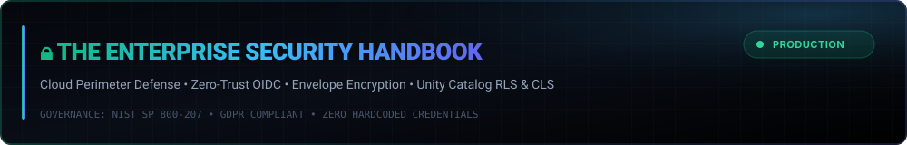
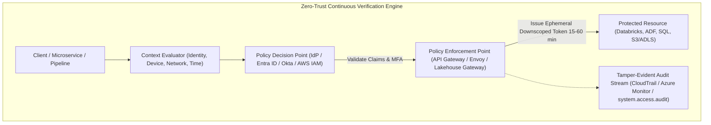
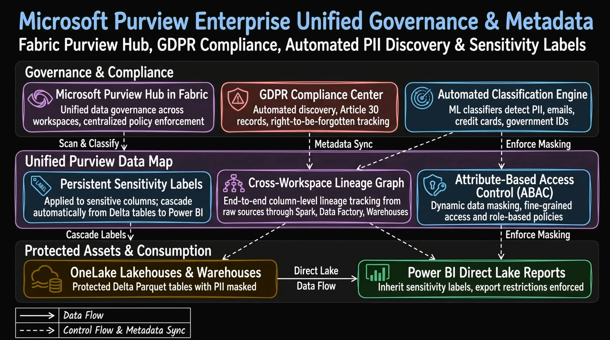
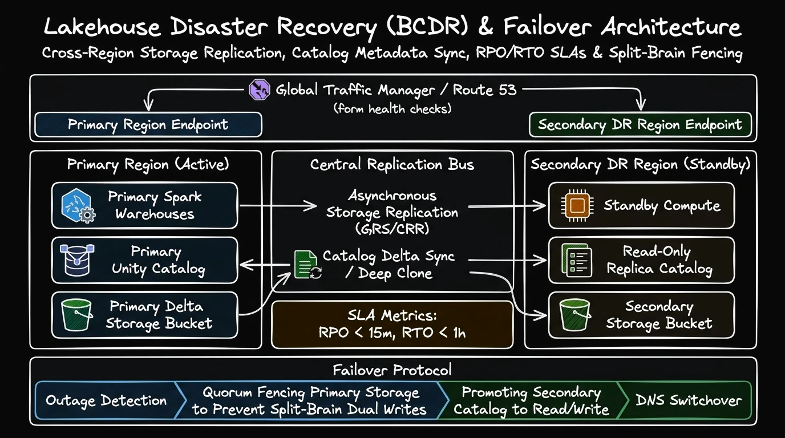
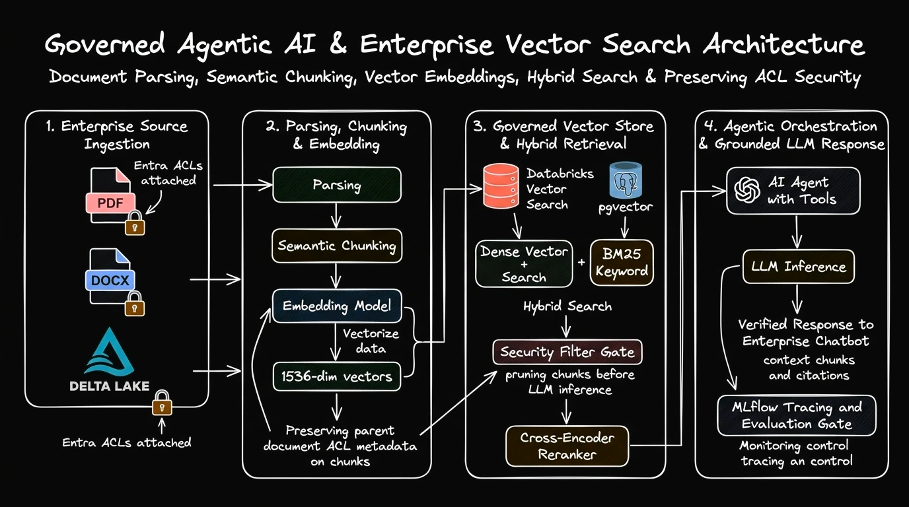

<p align="center">
  
</p>

# 🔒 The Security Handbook

**Enterprise Security Patterns & Practices: Cloud Perimeter Defense, DevSecOps, ETL/ELT Governance, Databricks Unity Catalog, ADF, Python Cryptography, OIDC Workload Identity & Deployments**

[](https://github.com/santoshjammi29/security-handbook/actions)
[](https://csrc.nist.gov/pubs/sp/800/207/final)
[](https://azure.microsoft.com/)
[](https://www.databricks.com/)
[](https://docs.github.com/en/actions/deployment/security-hardening-your-deployments/about-security-hardening-with-openid-connect)
[](LICENSE)

*The definitive enterprise handbook and production reference for security engineering in modern data, cloud, and lakehouse platforms.*  
*Covering end-to-end zero-trust architecture, federated workload identities, dynamic data masking, envelope encryption, supply chain security, and emergency incident containment.*

[Curriculum Overview](#-curriculum-overview) • [Zero-Trust Architecture](#-zero-trust-cloud-architecture) • [Whiteboard Blueprints](#-master-whiteboard-architecture-blueprints) • [Modules Directory](#-curriculum-modules-overview) • [Production Runbooks](#-battle-tested-production-runbooks) • [Interview Matrix](#-4-tier-interview-preparation-matrix)

---

## 🎯 Overview & Mission

Modern cloud data platforms are high-value targets for cyber adversaries, ransomware operators, and malicious insiders. A single leaked service principal secret in a pull request, an unmasked social security number in an analytical dashboard, an unindexed S3 bucket, or an unvetted Python package can trigger multimillion-dollar regulatory fines (GDPR, SEC, HIPAA) and catastrophic brand damage.

This repository provides **10 comprehensive production modules, 4 architecture whitepapers, 6 battle-tested incident runbooks, and a 4-tier interview guide** covering:
- **Authentication & Workload Identity:** OpenID Connect (OIDC) federation, eliminating static cloud keys, OAuth 2.0 PKCE, and JWT lifecycle security.
- **Authorization & Entitlement Governance:** Attribute-Based Access Control (ABAC), Dynamic Data Masking (DDM), Row-Level Security (RLS), and Separation of Duties (SoD).
- **Cloud Perimeter & Network Isolation:** Private Link, Private Endpoints, No Public IP (NPIP) clusters, split-horizon DNS, and egress firewall rules.
- **Secrets Management & Cryptography:** FIPS 140-2 Level 3 HSMs, Envelope Encryption (DEK + KEK), AES-256-GCM authenticated encryption, and dual-secret zero-downtime rotation.
- **DevSecOps & Supply Chain Security:** SLSA Level 3, Cosign keyless artifact signing, SBOM generation (Syft/Trivy), and distroless non-root Docker builds.
- **Python Application Security:** SQL injection prevention with parameterized bindings, safe deserialization (anti-pickle), and constant-time HMAC validation.
- **ETL, ELT & Lakehouse Governance:** The Write-Audit-Publish (WAP) pattern, PII detection, deterministic tokenization, and cryptographic shredding for GDPR Article 17.
- **Azure Data Factory & Integration Security:** Managed Identities, Key Vault linked services, Managed VNet Integration Runtime, and Secure Input/Output log masking.
- **Databricks Unity Catalog Governance:** 3-tier namespaces, downscoped temporary storage tokens, cluster access modes, and Personal Access Token (PAT) lockdown.
- **Incident Response & Postmortems:** NIST SP 800-61r2 incident response, forensic querying of Databricks system tables (`system.access.audit`), and 72-hour breach disclosure protocols.

---

## 🚀 Quickstart & Security Verification

Clone the repository and execute the automated security verification suite in under 60 seconds:

```bash
# 1. Clone the repository
git clone https://github.com/santoshjammi29/security-handbook.git
cd security-handbook

# 2. Set up virtual environment
python3 -m venv .venv
source .venv/bin/activate
pip install -r requirements.txt

# 3. Execute automated test and verification suite
python3 scripts/run_tests.py
```

---

## 🏛️ Zero-Trust Cloud Architecture

Under the **NIST SP 800-207 Zero-Trust Architecture**, network location provides zero implicit trust. Every single request is authenticated, authorized, encrypted, and continuously audited:



---

## 🖼️ Master Whiteboard Architecture Blueprints

The repository incorporates publication-grade architectural whiteboard blueprints mirrored under [`assets/whiteboards/`](assets/whiteboards) and cataloged with comprehensive 5-persona breakdowns, failure modes, and engine internals in [`docs/whiteboard_diagrams/README.md`](docs/whiteboard_diagrams/README.md) and [`whiteboards/handbook_whiteboard_blueprints.md`](whiteboards/handbook_whiteboard_blueprints.md):

- 🖼️ **[Master Whiteboard Blueprints Hub](whiteboards/handbook_whiteboard_blueprints.md)**: Complete whiteboard architecture diagrams detailing perimeter isolation, identity federation, encryption hierarchies, and zero-trust boundaries.
- 📊 **[Spark Architecture & Tuning Cheatsheet](assets/whiteboards/spark_architecture_catalyst_cheatsheet.jpg)**: High-resolution visual cheatsheet covering cluster topology, Catalyst compiler phases, and memory tiers.
- 🔀 **[Join Strategies Decision Matrix](assets/whiteboards/spark_join_strategies_decision_matrix.jpg)**: Visual flowchart and decision tree for distributed joins and broadcast thresholds.
- ⚡ **[Skew & Memory Spill Triage](assets/whiteboards/spark_performance_skew_spill_triage.jpg)**: Step-by-step diagnostic workflow for data skew, spill to disk, and OOM triage.

### 📐 Visual Security & Governance Blueprints Showcase (4x2 Grid)

<table width="100%">
  <tr>
    <td width="50%" valign="top">
      <a href="docs/whiteboard_diagrams/README.md#unity-catalog-governance">
        
      </a>
      <br><strong>Databricks Unity Catalog 3-Tier Security & Governance</strong><br>
      <em>3-level namespaces, decoupled storage credentials, downscoped temporary tokens, and centralized audit logging across workspaces.</em>
    </td>
    <td width="50%" valign="top">
      <a href="docs/whiteboard_diagrams/README.md#lakehouse-access-masking">
        
      </a>
      <br><strong>Lakehouse Access & Dynamic Column Masking Lifecycle</strong><br>
      <em>ABAC policy evaluation, dynamic row filters, SHA-256 column tokenization, and Catalyst physical plan rule injection.</em>
    </td>
  </tr>
  <tr>
    <td width="50%" valign="top">
      <a href="docs/whiteboard_diagrams/README.md#purview-governance-catalog">
        
      </a>
      <br><strong>Microsoft Purview Enterprise Governance & Sensitivity Labels</strong><br>
      <em>Automated classification rules, PII boundary labeling, cross-engine lineage scanning, and decoupled Purview RBAC.</em>
    </td>
    <td width="50%" valign="top">
      <a href="docs/whiteboard_diagrams/README.md#lakehouse-bcdr-failover">
        
      </a>
      <br><strong>Lakehouse Business Continuity, Ransomware Recovery & Multi-Region DR</strong><br>
      <em>Active-passive failover, Delta Time Travel restoration (`RESTORE TABLE`), immutable WORM storage locks, and RPO/RTO SLAs.</em>
    </td>
  </tr>
  <tr>
    <td width="50%" valign="top">
      <a href="docs/whiteboard_diagrams/README.md#lakehouse-cicd-promotion">
        
      </a>
      <br><strong>DevSecOps CI/CD Promotion & Keyless OIDC Identity</strong><br>
      <em>Ephemeral token negotiation, SLSA Level 3 supply chain security, Cosign artifact signing, and policy-as-code gate checks.</em>
    </td>
    <td width="50%" valign="top">
      <a href="docs/whiteboard_diagrams/README.md#governed-agentic-rag">
        
      </a>
      <br><strong>Governed Agentic RAG & Enterprise AI Security Perimeter</strong><br>
      <em>Vector search access boundaries, tenant data isolation, prompt injection defenses, and audit telemetry.</em>
    </td>
  </tr>
  <tr>
    <td width="50%" valign="top">
      <a href="docs/whiteboard_diagrams/README.md#data-mesh-enterprise">
        
      </a>
      <br><strong>Data Mesh Federated Governance & Security Contracts</strong><br>
      <em>Domain-oriented ownership boundaries, Open Data Contract Standard (ODCS), and federated policy enforcement.</em>
    </td>
    <td width="50%" valign="top">
      <a href="docs/whiteboard_diagrams/README.md#data-quality-wap">
        
      </a>
      <br><strong>Write-Audit-Publish (WAP) & Automated Quarantine Protection</strong><br>
      <em>Isolated staging branches, pre-publish cryptographic integrity verification, and automated quarantine routing.</em>
    </td>
  </tr>
</table>

> 🔍 **Explore all 52 blueprints with 5-persona breakdowns, failure modes, and engine internals in [docs/whiteboard_diagrams/README.md](docs/whiteboard_diagrams/README.md)**.

---

## 📚 Curriculum Modules Overview

The curriculum is organized into **10 comprehensive production modules**:

| # | Module & Domain | Key Focus & Production Implementations | Status |
|:---:|:---|:---|:---:|
| **01** | **[Authentication, OIDC & Zero-Trust](modules/01_authn_oidc_and_zero_trust/README.md)** | OIDC workload identity federation, eliminating static cloud keys, OAuth 2.0 PKCE, and JWT lifecycle security. | ✅ Documented |
| **02** | **[Authorization, RBAC, ABAC & Governance](modules/02_authz_rbac_abac_and_governance/README.md)** | RBAC vs ABAC vs ReBAC, Separation of Duties (SoD), Dynamic Data Masking (DDM), and Row-Level Security (RLS). | ✅ Documented |
| **03** | **[Cloud Networking & Perimeter Defense](modules/03_cloud_networking_and_perimeter_defense/README.md)** | Private Link, Private Endpoints, Databricks No Public IP (NPIP), split-horizon DNS, and egress firewall lockdown. | ✅ Documented |
| **04** | **[Secrets Management & Encryption](modules/04_secrets_management_and_encryption/README.md)** | Envelope Encryption (DEK + KEK), Customer-Managed Keys (CMK / BYOK), HSM FIPS 140-2 Level 3, and dual-secret rotation. | ✅ Documented |
| **05** | **[DevSecOps, CI/CD & Supply Chain](modules/05_devsecops_cicd_and_supply_chain/README.md)** | SLSA Level 3, Cosign keyless artifact signing, SBOM generation (Syft/Trivy), and distroless non-root Docker builds. | ✅ Documented |
| **06** | **[Python Secure Coding & Cryptography](modules/06_python_secure_coding_and_cryptography/README.md)** | SQL injection defense with parameterized bindings, safe deserialization (anti-pickle), and AES-256-GCM AEAD. | ✅ Documented |
| **07** | **[ETL, ELT & Data Pipeline Security](modules/07_etl_elt_and_pipeline_security/README.md)** | Write-Audit-Publish (WAP) pattern, PII detection, deterministic tokenization, and cryptographic shredding for GDPR. | ✅ Documented |
| **08** | **[ADF & Managed Integration Security](modules/08_adf_and_azure_pipeline_security/README.md)** | Managed Identities, Key Vault linked services, Managed VNet Integration Runtime, and Secure Input/Output log masking. | ✅ Documented |
| **09** | **[Databricks & Lakehouse Security Mastery](modules/09_databricks_unity_catalog_security/README.md)** | Unity Catalog 3-tier namespaces, downscoped temporary storage tokens, cluster access modes, and PAT lockdown. | ✅ Documented |
| **10** | **[Incident Triage, Auditing & Compliance](modules/10_incident_triage_auditing_and_compliance/README.md)** | NIST SP 800-61r2 incident response, forensic querying of `system.access.audit`, and 72-hour breach disclosure protocols. | ✅ Documented |

---

## 🏛️ Architectural Deep Dives

In-depth technical architecture whitepapers:

- **[01. Zero-Trust Cloud & Data Perimeter Defense](architectures/01_zero_trust_cloud_and_data_perimeter_architecture.md)**: Network boundary isolation, Private Link, split-horizon DNS, and egress firewall filtering.
- **[02. Unity Catalog & Lakehouse Governance Internals](architectures/02_unity_catalog_and_lakehouse_governance_internals.md)**: 3-tier namespaces, decoupled storage credentials, downscoped token negotiation, and Catalyst query optimizer masking.
- **[03. Cryptography, Envelope Encryption & Key Lifecycle](architectures/03_cryptography_envelope_encryption_and_key_management.md)**: AES-256-GCM, Envelope Encryption (DEK + KEK), Customer-Managed Keys (CMK / BYOK), and cryptographic shredding.
- **[04. DevSecOps Pipelines & Workload Identity Federation](architectures/04_devsecops_pipeline_and_workload_identity_federation.md)**: OIDC token exchange, eliminating static secrets, SLSA Level 3, Cosign keyless signing, and policy-as-code.

---

## 🚨 Battle-Tested Production Runbooks

The repository includes enterprise-grade operational runbooks for emergency security response:

| Runbook | Title | Critical Failure Mode Addressed |
| :--- | :--- | :--- |
| **[Runbook 01](runbooks/01_compromised_credential_and_secret_revocation_triage.md)** | **Compromised Credential & Secret Revocation Triage** | Leaked service principal client secrets, exposed IAM keys, active session termination, and CloudTrail forensic auditing. |
| **[Runbook 02](runbooks/02_storage_account_data_exfiltration_and_public_exposure.md)** | **Storage Account Exposure & Data Exfiltration Triage** | Publicly accessible S3 buckets / ADLS Gen2 accounts, immediate network cutoff, and egress blast radius analysis. |
| **[Runbook 03](runbooks/03_databricks_unauthorized_data_access_and_pat_breach.md)** | **Databricks Unauthorized Access & PAT Breach Triage** | Compromised Personal Access Tokens, rogue cluster termination, and forensic querying of `system.access.audit`. |
| **[Runbook 04](runbooks/04_data_pipeline_ssrf_and_sql_injection_remediation.md)** | **Data Pipeline SSRF & SQL Injection Remediation** | Server-Side Request Forgery against IMDS (`169.254.169.254`), domain allowlisting, and parameterized query refactoring. |
| **[Runbook 05](runbooks/05_ransomware_and_tampered_lakehouse_disaster_recovery.md)** | **Ransomware & Tampered Lakehouse Disaster Recovery** | Malicious table deletion, Delta Lake Time Travel restoration (`RESTORE TABLE`), and immutable WORM / Object Lock recovery. |
| **[Runbook 06](runbooks/06_zero_downtime_certificate_and_secret_rotation.md)** | **Zero-Downtime Certificate & Secret Rotation** | Dual-secret rotation protocol for database credentials, mTLS certificate renewal, and zero-downtime rollover. |

---

## 🎓 4-Tier Interview Preparation Matrix

Prepare for technical security screens from Junior Data Engineer to Principal Security Architect:

1. **[Tier 1: Junior Security & Cloud Foundations](interview/01_junior_security_and_cloud_foundations.md)**: AuthN vs AuthZ, symmetric vs asymmetric encryption, SQL injection, basic IAM, and least privilege.
2. **[Tier 2: Mid-Level Data Security Engineer](interview/02_mid_level_data_security_engineer.md)**: OIDC workload identity federation, Private Endpoints, dynamic data masking, Key Vault in ADF, and anti-pickle deserialization.
3. **[Tier 3: Senior Cloud & Lakehouse Security Architect](interview/03_senior_cloud_and_lakehouse_security_architect.md)**: Unity Catalog downscoped tokens, envelope encryption mechanics, crypto-shredding, Cosign keyless signing, and WAP gating.
4. **[Tier 4: Principal Security Architect & CISO Defense](interview/04_principal_security_architect_and_ciso_defense.md)**: STRIDE threat modeling, GDPR Article 33 72-hour breach notification, cross-tenant data sharing, and FAIR risk quantification.
5. **[50-Card Rapid-Fire Technical Security Flashcard Deck](interview/05_flashcards_deck_50.md)**: Rapid-fire revision covering identity, networking, cryptography, pipelines, lakehouse governance, and compliance.

---

## 🧠 Core Curriculum Concepts & Topics (263 Topics Covered)

> 💡 **Enterprise Knowledge Base Integration**: This repository implements **263 production topics** from the [Modern Data Engineering Systems Encyclopedia (921 Topics)](https://moderndataengineer.uk/concepts), grouped by **Relevant Functional Sections** and then by **Difficulty Level**. All sections are **collapsible and collapsed by default** for effortless navigation. Browse the full curriculum in [`topics/README.md`](topics/README.md).

### 📑 Topics Directory at a Glance

| Pillar / Module | Topic Count | Functional Sections Covered | Status |
|:---|:---:|:---|:---:|
| ⚡ **Databricks Platform, Unity Catalog & Delta Lake 3.x** | **132** | Unity Catalog 3-Tier Governance & Security, Workspace, Serverless Compute & FinOps, Workflows, DLT & Lakeflow Pipelines, and 2 more | ✅ Collapsible Deck |
| 🏛️ **Distributed Systems Design & Fault Tolerance** | **68** | Distributed Theorems & Trade-Offs, Event-Driven Topologies & Decoupled Ingestion, Caching Topologies & Synchronization, and 1 more | ✅ Collapsible Deck |
| 🚀 **General Data Engineering, Dimensional Modeling & Governance** | **63** | ETL Architecture, CDC & Idempotency, Dimensional Modeling & Kimball Standards | ✅ Collapsible Deck |

<details>
<summary><b>⚡ Databricks Platform, Unity Catalog & Delta Lake 3.x (132 Topics across 5 Sections)</b> — <i>Click to expand module</i></summary>

<details>
<summary>&nbsp;&nbsp;📂 <b>Section: Unity Catalog 3-Tier Governance & Security (42 Topics)</b></summary>

<details>
<summary>&nbsp;&nbsp;&nbsp;&nbsp;🟢 Easy: <b>🟢 Easy (Level 100) (7 Topics)</b></summary>

| # | Topic / Concept | Level | Architectural Definition & Core Principle |
|:---:|---|:---:|---|
| 1 | **Cluster Policy** | `🟢 Easy` | A Cluster Policy is an administrative governance rule set that restricts the configuration options available to users when provisioning compute clusters. |
| 2 | **Data Explorer** | `🟢 Easy` | Data Explorer is the visual UI tool in the Databricks Workspace used to discover, manage, inspect, and grant permissions on Unity Catalog data assets. |
| 3 | **Databricks Workspace** | `🟢 Easy` | A Databricks Workspace is a software-as-a-service (SaaS) environment that provides a unified collaborative interface for data engineers, data scientists, and analysts to access compute, notebooks, and storage. |
| 4 | **Metastore** | `🟢 Easy` | A Metastore is the central metadata repository that catalogs schema definitions, table partition locations, data types, and access privileges for data stored in the lakehouse. |
| 5 | **Three-Level Namespace** | `🟢 Easy` | The standard 3-tier logical namespace (`catalog.schema.table_or_view`) introduced by Unity Catalog to structure enterprise data assets, manage permissions, and enforce data mesh boundaries. |
| 6 | **Unity Catalog** | `🟢 Easy` | Unity Catalog is Databricks' centralized, multi-cloud governance solution providing unified access control, data auditing, lineage tracking, and discovery across all workspace assets. |
| 7 | **Volumes** | `🟢 Easy` | Governed Unity Catalog storage abstractions that provide secure access, governance, and audit lineage for non-tabular files including raw CSVs, unstructured text, images, and machine learning models. |

</details>

<details>
<summary>&nbsp;&nbsp;&nbsp;&nbsp;🟡 Intermediate: <b>🟡 Intermediate (Level 200) (11 Topics)</b></summary>

| # | Topic / Concept | Level | Architectural Definition & Core Principle |
|:---:|---|:---:|---|
| 1 | **Compute Policies & Cluster Governance** | `🟡 Intermediate` | Administrative governance guardrails that enforce compute provisioning boundaries—including allowed VM types, max worker limits, spot instance allocations, and idle auto-termination. |
| 2 | **Data Lineage** | `🟡 Intermediate` | The automated, real-time metadata tracking engine in Unity Catalog that captures column-level and table-level data flow lineage across queries, notebooks, workflows, and dashboards. |
| 3 | **Delta UniForm & Multi-Engine Interoperability** | `🟡 Intermediate` | Delta Lake Universal Format (UniForm), which automatically translates and maintains Apache Iceberg and Apache Hudi metadata alongside Delta logs, enabling multi-engine query access without data duplication. |
| 4 | **Dynamic Views for Security** | `🟡 Intermediate` | Security-hardened SQL views that evaluate user context functions (`CURRENT_USER()`, `IS_MEMBER()`) at runtime to provide row-level filtering and column-level masking without duplicating data. |
| 5 | **External Locations & Storage Credentials** | `🟡 Intermediate` | Unity Catalog securable objects that encapsulate cloud identity credentials (IAM roles, Managed Identities) and associate them with specific object storage URLs for governed external table access. |
| 6 | **Managed vs. External Tables: Architecture Tradeoffs** | `🟡 Intermediate` | The strategic trade-offs between Unity Catalog managed tables (lifecycle managed by Databricks, Predictive Optimization enabled) and external tables (custom storage locations, multi-engine access). |
| 7 | **Permission Model & Inheritance** | `🟡 Intermediate` | The hierarchical access control model in Unity Catalog where security privileges granted on parent securable objects (Catalogs) automatically cascade down to Schemas, Tables, and Views. |
| 8 | **System Tables for Operations** | `🟡 Intermediate` | Centrally governed, audit-grade operational telemetry tables in Unity Catalog (`system.billing`, `system.compute`, `system.access`) used for cost tracking, cluster audit logs, and FinOps analytics. |
| 9 | **Unity Catalog Lineage Tracking** | `🟡 Intermediate` | Automated capture of column-level and table-level data flow across queries, jobs, and dashboards. |
| 10 | **Unity Catalog Volumes (Managed vs. External)** | `🟡 Intermediate` | A Unity Catalog securable object that extends centralized catalog governance, audit trails, and SQL permissions to unstructured and semi-structured files. |
| 11 | **Vector Search** | `🟡 Intermediate` | Databricks Vector Search is a serverless vector database integrated into Unity Catalog that stores and indexes vector embeddings for real-time similarity search and RAG applications. |

</details>

<details>
<summary>&nbsp;&nbsp;&nbsp;&nbsp;🔴 Advanced: <b>🔴 Advanced (Level 300) (9 Topics)</b></summary>

| # | Topic / Concept | Level | Architectural Definition & Core Principle |
|:---:|---|:---:|---|
| 1 | **Audit Logging** | `🔴 Advanced` | Audit Logging captures, records, and exports detailed security audit trails of all user and system activities occurring across Databricks workspaces and Unity Catalog. |
| 2 | **Databricks DBU Allocation via system.billing.usage** | `🔴 Advanced` | The system catalog telemetry table in Unity Catalog that records minute-by-minute Databricks Unit (DBU) consumption across all workspaces, jobs, and users. |
| 3 | **Lakehouse Federation** | `🔴 Advanced` | Lakehouse Federation allows Unity Catalog to query external operational and analytical databases (Snowflake, BigQuery, PostgreSQL, MySQL, SQL Server) in place without moving data. |
| 4 | **Multi-Workspace Architecture** | `🔴 Advanced` | Enterprise platform deployment topology evaluating single-workspace versus multi-workspace designs for team isolation, regulatory compliance boundaries, and multi-region governance. |
| 5 | **Predictive Optimization** | `🔴 Advanced` | Predictive Optimization is an automated AI-driven service in Databricks that intelligently schedules OPTIMIZE and VACUUM maintenance operations on Unity Catalog managed tables. |
| 6 | **Row Filters & Column Masks** | `🔴 Advanced` | Applying row-level and column-level security directly to tables via SQL UDFs. |
| 7 | **SCIM Provisioning** | `🔴 Advanced` | SCIM (System for Cross-domain Identity Management) Provisioning automatically synchronizes users, service principals, and security groups from enterprise identity providers to Databricks. |
| 8 | **Unity Catalog Fine-Grained Access Control** | `🔴 Advanced` | Fine-Grained Access Control in Unity Catalog enforces cell-level security via Row Filters and Column Masks defined with standard SQL functions. |
| 9 | **Unity Catalog System Tables** | `🔴 Advanced` | Unity Catalog System Tables are analytical Delta tables hosted in the system catalog that expose operational metadata, cost telemetry, query history, and data lineage. |

</details>

<details>
<summary>&nbsp;&nbsp;&nbsp;&nbsp;🟣 Architect: <b>🟣 Staff Architect (Level 400) (15 Topics)</b></summary>

| # | Topic / Concept | Level | Architectural Definition & Core Principle |
|:---:|---|:---:|---|
| 1 | **Data Mesh on Databricks** | `🟣 Architect` | An architectural implementation of the Data Mesh paradigm on Databricks, treating data as a product owned by decentralized domain teams governed by Unity Catalog. |
| 2 | **Databricks + dbt Integration** | `🟣 Architect` | The production architecture pairing dbt with Databricks SQL Serverless and Unity Catalog, leveraging the dbt-databricks adapter for high-performance lakehouse transformations. |
| 3 | **Databricks Genie Compound AI** | `🟣 Architect` | A natural language conversational interface translating business questions into certified SQL over Unity Catalog metric views. |
| 4 | **Databricks Lakeflow Connectors** | `🟣 Architect` | Native managed SaaS and database ingestion connectors for Salesforce, Workday, ServiceNow, and SQL databases into Unity Catalog. |
| 5 | **Databricks Split-Plane Cloud Architecture** | `🟣 Architect` | A dual-plane cloud security model that segregates management/control infrastructure from distributed compute execution and persistent customer storage. |
| 6 | **Databricks Unity Catalog Architecture** | `🟣 Architect` | The centralized governance, metadata, and fine-grained access control layer for all data and AI assets across multiple Databricks workspaces in a cloud tenant. |
| 7 | **DBU Cost Governance** | `🟣 Architect` | The architectural framework and operational policies used to monitor, allocate, forecast, and optimize Databricks Unit (DBU) consumption and cloud infrastructure costs. |
| 8 | **Governance with Unity Catalog + Purview** | `🟣 Architect` | The enterprise governance integration between Databricks Unity Catalog and Microsoft Purview, unifying lakehouse metadata with company-wide data governance. |
| 9 | **Mosaic AI Vector Search Continuous Delta Sync** | `🟣 Architect` | A serverless vector database integrated with Unity Catalog that automatically synchronizes vector embeddings with underlying Delta tables in real time. |
| 10 | **Multi-Cloud Databricks Deployment** | `🟣 Architect` | An enterprise deployment pattern operating Databricks across multiple cloud providers (AWS, Azure, GCP) while maintaining unified governance and consistent CI/CD pipelines. |
| 11 | **Unity Catalog Dynamic Column Masking & Row Filters** | `🟣 Architect` | Declarative SQL-based fine-grained access control policies enforced transparently at the Unity Catalog metadata layer. |
| 12 | **Unity Catalog Dynamic Row Filters & Column Masks** | `🟣 Architect` | Fine-grained SQL access control mechanisms in Unity Catalog that dynamically redact columns or filter table rows based on the querying user's group membership. |
| 13 | **Unity Catalog Enterprise Governance** | `🟣 Architect` | The enterprise governance operating model for Unity Catalog encompassing account-level identity management, catalog segregation, classification tagging, and regulatory audit compliance. |
| 14 | **Unity Catalog Multi-Workspace Topology** | `🟣 Architect` | An enterprise architecture design that connects multiple environment- or business-unit-specific workspaces to a single regional Unity Catalog metastore. |
| 15 | **Unity Catalog System Tables for Lakehouse FinOps** | `🟣 Architect` | Centrally governed, read-only analytical schemas providing real-time telemetry on compute usage, billing, audit access, and lineage across an entire account. |

</details>

</details>

<details>
<summary>&nbsp;&nbsp;📂 <b>Section: Delta Lake 3.x ACID Mechanics & Transaction Log (10 Topics)</b></summary>

<details>
<summary>&nbsp;&nbsp;&nbsp;&nbsp;🟢 Easy: <b>🟢 Easy (Level 100) (4 Topics)</b></summary>

| # | Topic / Concept | Level | Architectural Definition & Core Principle |
|:---:|---|:---:|---|
| 1 | **ACID Transactions** | `🟢 Easy` | The set of transactional guarantees (Atomicity, Consistency, Isolation, Durability) enforced by Delta Lake on top of cloud object storage using an append-only transaction log and optimistic concurrency control. |
| 2 | **Delta Lake (Databricks)** | `🟢 Easy` | Delta Lake is an open-source storage framework that brings ACID transactions, scalable metadata handling, and unified streaming and batch data processing to Apache Spark and data lakes. |
| 3 | **Shallow vs. Deep Clones** | `🟢 Easy` | Delta Lake table cloning capabilities that either create zero-copy metadata pointers to source data files (SHALLOW CLONE) or create fully independent physical table copies (DEEP CLONE). |
| 4 | **Transaction Log (`_delta_log`)** | `🟢 Easy` | The ordered, append-only directory of JSON commit files and Parquet checkpoints (`_delta_log`) that serves as the single source of truth for all metadata, schema versions, and physical file operations in a Delta table. |

</details>

<details>
<summary>&nbsp;&nbsp;&nbsp;&nbsp;🟡 Intermediate: <b>🟡 Intermediate (Level 200) (4 Topics)</b></summary>

| # | Topic / Concept | Level | Architectural Definition & Core Principle |
|:---:|---|:---:|---|
| 1 | **Databricks SQL Warehouse** | `🟡 Intermediate` | A Databricks SQL Warehouse is a specialized compute resource optimized for SQL workloads, business intelligence queries, and high-concurrency analytical dashboards. |
| 2 | **Delta Time Travel** | `🟡 Intermediate` | Delta Time Travel is the ability to query point-in-time historical snapshots of a Delta table using historical commit versions or timestamps. |
| 3 | **Shallow Clone vs Deep Clone** | `🟡 Intermediate` | Delta Cloning creates copies of a table: Shallow Clone copies only metadata references with zero data duplication, whereas Deep Clone creates a fully independent physical copy of data and metadata. |
| 4 | **VACUUM Command** | `🟡 Intermediate` | The VACUUM command permanently deletes historical data files from cloud storage that are no longer referenced by the active Delta table log and exceed a retention threshold. |

</details>

<details>
<summary>&nbsp;&nbsp;&nbsp;&nbsp;🔴 Advanced: <b>🔴 Advanced (Level 300) (1 Topics)</b></summary>

| # | Topic / Concept | Level | Architectural Definition & Core Principle |
|:---:|---|:---:|---|
| 1 | **Databricks Serverless SQL Warehouse** | `🔴 Advanced` | A fully managed, instant-starting compute tier in Databricks optimized for high-concurrency SQL and BI queries running inside Databricks-managed compute planes. |

</details>

<details>
<summary>&nbsp;&nbsp;&nbsp;&nbsp;🟣 Architect: <b>🟣 Staff Architect (Level 400) (1 Topics)</b></summary>

| # | Topic / Concept | Level | Architectural Definition & Core Principle |
|:---:|---|:---:|---|
| 1 | **Stream-to-Table Commit Boundary** | `🟣 Architect` | The consistency boundary between a streaming engine's checkpoint progress and the durable commit visible in its table sink. |

</details>

</details>

<details>
<summary>&nbsp;&nbsp;📂 <b>Section: Physical Layout, Liquid Clustering & Deletion Vectors (12 Topics)</b></summary>

<details>
<summary>&nbsp;&nbsp;&nbsp;&nbsp;🟢 Easy: <b>🟢 Easy (Level 100) (1 Topics)</b></summary>

| # | Topic / Concept | Level | Architectural Definition & Core Principle |
|:---:|---|:---:|---|
| 1 | **Delta Lake Liquid Clustering vs Hive Partitioning** | `🟢 Easy` | A physical data layout protocol that dynamically groups data along multiple columns without the rigidity, small-file explosion, or partition skew of traditional Hive directory trees. |

</details>

<details>
<summary>&nbsp;&nbsp;&nbsp;&nbsp;🟡 Intermediate: <b>🟡 Intermediate (Level 200) (6 Topics)</b></summary>

| # | Topic / Concept | Level | Architectural Definition & Core Principle |
|:---:|---|:---:|---|
| 1 | **Cluster Sizing & Autoscaling** | `🟡 Intermediate` | The operational strategy of balancing cluster node memory-to-core ratios and autoscaling worker limits to optimize workload parallelism while controlling cloud infrastructure spending. |
| 2 | **OPTIMIZE & File Compaction** | `🟡 Intermediate` | A Delta Lake table maintenance command that bin-packs small files (1MB–10MB) into optimal larger files (~1GB) to reduce cloud object storage API overhead and significantly accelerate analytical query scanning performance. |
| 3 | **OPTIMIZE Command** | `🟡 Intermediate` | The OPTIMIZE command compacts fragmented small Parquet files in a Delta table into larger, query-efficient files (typically ~1GB in size). |
| 4 | **VACUUM & Storage Lifecycle** | `🟡 Intermediate` | A Delta Lake table maintenance command that permanently purges unreferenced physical data files older than a configured retention safety threshold (default 7 days) to reclaim object storage capacity. |
| 5 | **Write Optimization** | `🟡 Intermediate` | Delta Lake write-time optimizations—such as `optimizeWrite` and auto-compaction—that dynamically coalesce and size Parquet data files during ingestion to avoid small-file fragmentation. |
| 6 | **Z-Ordering** | `🟡 Intermediate` | Z-Ordering is a multidimensional clustering technique that colocates related information in the same set of Parquet files to maximize file skipping during SQL queries. |

</details>

<details>
<summary>&nbsp;&nbsp;&nbsp;&nbsp;🔴 Advanced: <b>🔴 Advanced (Level 300) (3 Topics)</b></summary>

| # | Topic / Concept | Level | Architectural Definition & Core Principle |
|:---:|---|:---:|---|
| 1 | **Delta Table Properties & Configuration** | `🔴 Advanced` | Configurable table-level metadata properties in Delta Lake that govern engine behavior, including Change Data Feed enablement, Deletion Vector activation, column mapping mode, and checkpoint frequency. |
| 2 | **Liquid Clustering** | `🔴 Advanced` | Delta Lake 3.x's next-generation data layout engine (`CLUSTER BY`) that organizes data along space-filling curves to optimize multi-dimensional query pruning without hive partitioning or write amplification. |
| 3 | **MERGE Write Amplification** | `🔴 Advanced` | The storage I/O performance penalty in copy-on-write architectures where updating a single row forces the engine to rewrite the entire underlying Parquet file. |

</details>

<details>
<summary>&nbsp;&nbsp;&nbsp;&nbsp;🟣 Architect: <b>🟣 Staff Architect (Level 400) (2 Topics)</b></summary>

| # | Topic / Concept | Level | Architectural Definition & Core Principle |
|:---:|---|:---:|---|
| 1 | **Delta Lake Deletion Vectors** | `🟣 Architect` | A storage optimization technique in Delta Lake that marks deleted or updated rows using lightweight bitmap index files instead of rewriting entire Parquet data files. |
| 2 | **Delta Lake Liquid Clustering Architecture** | `🟣 Architect` | A modern, dynamic data layout architecture that organizes Delta Lake Parquet files along a space-filling Hilbert curve without rigid Hive directory hierarchies. |

</details>

</details>

<details>
<summary>&nbsp;&nbsp;📂 <b>Section: Workflows, DLT & Lakeflow Pipelines (18 Topics)</b></summary>

<details>
<summary>&nbsp;&nbsp;&nbsp;&nbsp;🟢 Easy: <b>🟢 Easy (Level 100) (4 Topics)</b></summary>

| # | Topic / Concept | Level | Architectural Definition & Core Principle |
|:---:|---|:---:|---|
| 1 | **Databricks Job** | `🟢 Easy` | A Databricks Job is a scheduled or triggered execution unit that runs non-interactive code (notebooks, JARs, Python scripts, dbt models) on automated compute clusters. |
| 2 | **Databricks Workflow** | `🟢 Easy` | Databricks Workflows is the fully managed, native orchestration service within Databricks that designs, schedules, and monitors multi-task Directed Acyclic Graphs (DAGs). |
| 3 | **Job Cluster** | `🟢 Easy` | A Job Cluster is an ephemeral, dedicated compute cluster automatically provisioned by Databricks to execute a specific automated workload and terminated immediately upon completion. |
| 4 | **Parameterization: Widgets, Job Parameters, Task Values** | `🟢 Easy` | The runtime parameterization suite in Databricks—including notebook widgets, job-level parameters, and inter-task dynamic task values—used to construct dynamic and reusable workflows. |

</details>

<details>
<summary>&nbsp;&nbsp;&nbsp;&nbsp;🟡 Intermediate: <b>🟡 Intermediate (Level 200) (6 Topics)</b></summary>

| # | Topic / Concept | Level | Architectural Definition & Core Principle |
|:---:|---|:---:|---|
| 1 | **DBU Cost Model & Billing** | `🟡 Intermediate` | The consumption-based billing framework where platform workloads consume Databricks Units (DBUs) based on compute SKU tiers (All-Purpose, Automated Jobs, SQL Serverless, and Lakeflow). |
| 2 | **Delta Live Tables (DLT)** | `🟡 Intermediate` | Delta Live Tables (DLT) is a declarative ETL framework in Databricks that simplifies data pipeline development by managing dependencies, infrastructure scaling, and data quality enforcement. |
| 3 | **Expectations (Quality Rules)** | `🟡 Intermediate` | Declarative data quality rules in Lakeflow pipelines (`EXPECT`, `EXPECT OR DROP`, `EXPECT OR FAIL`) that audit record integrity and maintain automated telemetry on data quality metrics. |
| 4 | **Incremental Processing Patterns** | `🟡 Intermediate` | Data pipeline design architectures that ingest and transform only new or modified data since the prior execution checkpoint, leveraging Auto Loader, Change Data Feed, and streaming watermarks. |
| 5 | **Streaming Tables vs. Materialized Views** | `🟡 Intermediate` | The architectural distinction in Lakeflow between append-only Streaming Tables for continuous incremental ingestion and stateful Materialized Views for precomputed analytical query acceleration. |
| 6 | **Task Dependencies, Retries & Conditional Logic** | `🟡 Intermediate` | Workflow orchestration primitives in Lakeflow Jobs that define multi-task DAG dependencies, conditional branch routing, retry policies, and SLA timeout limits. |

</details>

<details>
<summary>&nbsp;&nbsp;&nbsp;&nbsp;🔴 Advanced: <b>🔴 Advanced (Level 300) (7 Topics)</b></summary>

| # | Topic / Concept | Level | Architectural Definition & Core Principle |
|:---:|---|:---:|---|
| 1 | **CDC Processing: AUTO CDC INTO** | `🔴 Advanced` | Declarative CDC processing primitives in Lakeflow pipelines that automatically reconcile out-of-order change logs and maintain SCD Type 1 or SCD Type 2 dimension tables. |
| 2 | **Databricks Delta Live Tables (DLT) Expectations** | `🔴 Advanced` | Declarative data quality rules (`@dlt.expect`, `@dlt.expect_or_drop`, `@dlt.expect_or_fail`) embedded into streaming pipelines. |
| 3 | **DLT Expectations** | `🔴 Advanced` | DLT Expectations are declarative data quality assertions applied to Delta Live Tables that validate incoming records and govern pipeline behavior upon data quality violations. |
| 4 | **Error Handling & Dead Letter Patterns** | `🔴 Advanced` | A resilient pipeline design pattern that routes malformed or schema-violating records into quarantined Dead-Letter Queue (DLQ) tables for offline inspection without aborting the pipeline. |
| 5 | **Join Performance Diagnosis** | `🔴 Advanced` | When a join is the bottleneck: reading shuffle sizes, spill metrics, and task skew in Spark UI for join stages. |
| 6 | **Performance Troubleshooting Methodology** | `🔴 Advanced` | A structured diagnostic workflow for identifying lakehouse performance bottlenecks by analyzing Spark UI stages, query execution plans, shuffle spill, data skew, and cluster resource utilization. |
| 7 | **Serverless DLT** | `🔴 Advanced` | Serverless DLT executes Delta Live Tables pipelines on instant, fully managed serverless compute clusters operated within the Databricks cloud control plane. |

</details>

<details>
<summary>&nbsp;&nbsp;&nbsp;&nbsp;🟣 Architect: <b>🟣 Staff Architect (Level 400) (1 Topics)</b></summary>

| # | Topic / Concept | Level | Architectural Definition & Core Principle |
|:---:|---|:---:|---|
| 1 | **Lakeflow Spark Declarative Pipelines (DLT)** | `🟣 Architect` | A declarative framework for building, testing, and operating reliable lakehouse ETL pipelines with managed orchestration, state, and data quality expectations. |

</details>

</details>

<details>
<summary>&nbsp;&nbsp;📂 <b>Section: Workspace, Serverless Compute & FinOps (50 Topics)</b></summary>

<details>
<summary>&nbsp;&nbsp;&nbsp;&nbsp;🟢 Easy: <b>🟢 Easy (Level 100) (10 Topics)</b></summary>

| # | Topic / Concept | Level | Architectural Definition & Core Principle |
|:---:|---|:---:|---|
| 1 | **All-Purpose Cluster** | `🟢 Easy` | An All-Purpose Cluster is a shared interactive compute cluster designed for collaborative exploratory data analysis, interactive notebook development, and ad-hoc querying. |
| 2 | **Choosing Compute for Jobs** | `🟢 Easy` | The architectural decision framework for matching workloads to compute tiers: Serverless (zero startup delay, auto-managed), Classic Automated Jobs clusters (custom libraries), or All-Purpose clusters. |
| 3 | **Databricks Notebook** | `🟢 Easy` | A Databricks Notebook is a web-based interactive development document combining live executable code cells, interactive visualizations, and narrative markdown documentation. |
| 4 | **Databricks Repos** | `🟢 Easy` | Databricks Repos (now known as Git Folders) provides visual and programmatic Git version control integration directly inside the Databricks Workspace. |
| 5 | **DBFS (Databricks File System)** | `🟢 Easy` | DBFS (Databricks File System) is a distributed file system abstraction layer mounted over cloud object storage (S3 bucket, Azure container, GCS bucket) accessible across the workspace. |
| 6 | **dbutils** | `🟢 Easy` | Databricks Utilities (dbutils) is a built-in Python and Scala library that provides programmatic helper methods for file system operations, secret management, notebook workflows, and UI widgets. |
| 7 | **Magic Commands** | `🟢 Easy` | Magic Commands are special prefix directives (%python, %sql, %scala, %r, %sh, %fs) entered at the beginning of a notebook cell to alter the execution runtime or execute system utilities. |
| 8 | **Notebook Development Patterns** | `🟢 Easy` | Software engineering methodologies for Databricks notebooks, contrasting modular Python packages, Git Folders, and Databricks Connect against legacy `%run` script chaining. |
| 9 | **Secrets Management** | `🟢 Easy` | The secure credential management framework in Databricks (Secret Scopes backed by Azure Key Vault or encrypted storage) used to securely inject tokens, API keys, and connection strings at runtime. |
| 10 | **Serverless Compute Economics** | `🟢 Easy` | The FinOps cost and operational efficiency model of Databricks Serverless Compute, which eliminates idle capacity costs and cold-start latency through instant provisioning and per-workload DBU billing. |

</details>

<details>
<summary>&nbsp;&nbsp;&nbsp;&nbsp;🟡 Intermediate: <b>🟡 Intermediate (Level 200) (16 Topics)</b></summary>

| # | Topic / Concept | Level | Architectural Definition & Core Principle |
|:---:|---|:---:|---|
| 1 | **AI Functions for Data Engineers** | `🟡 Intermediate` | Built-in SQL functions (`ai_query()`, `ai_classify()`, `ai_extract()`) in Databricks SQL that invoke foundation LLMs directly within batch and streaming queries for automated data enrichment. |
| 2 | **Auto Loader** | `🟡 Intermediate` | Auto Loader is an optimized ingestion engine in Databricks that incrementally and efficiently ingests raw data files from cloud storage as they arrive without state tracking overhead. |
| 3 | **Change Data Feed (CDF)** | `🟡 Intermediate` | Change Data Feed (CDF) is a Delta Lake feature that captures and exposes row-level change events (inserts, updates, deletes) committed to a Delta table. |
| 4 | **Column Statistics & File Pruning** | `🟡 Intermediate` | Per-file min/max statistics collected for the first 32 columns by default (managed tables with Predictive Optimization choose columns intelligently). |
| 5 | **Databricks Feature Store** | `🟡 Intermediate` | The Databricks Feature Store is a centralized catalog that enables data scientists to discover, share, and reuse ML features with guaranteed online/offline consistency. |
| 6 | **Databricks Secret Scopes (Azure Key Vault)** | `🟡 Intermediate` | Secure credential storage backed by cloud key vaults, accessed in notebooks via `dbutils.secrets.get()`. |
| 7 | **Databricks Workspace File Sync (Repos)** | `🟡 Intermediate` | Bi-directional Git integration synchronizing branch code directly into Databricks workspace directories. |
| 8 | **Information Schema & Metadata Queries** | `🟡 Intermediate` | Querying `system.information_schema.tables`, `.columns`, `.table_privileges` to discover and audit catalog contents. |
| 9 | **Medallion Architecture on Databricks** | `🟡 Intermediate` | The Medallion Architecture is a lakehouse data design pattern that logically organizes data into Bronze (raw ingestion), Silver (cleaned/conformed), and Gold (curated business marts) quality layers. |
| 10 | **MLflow Model Registry** | `🟡 Intermediate` | The MLflow Model Registry provides a centralized model store, set of APIs, and UI to collaboratively manage the full lifecycle of MLflow models from development to production deployment. |
| 11 | **MLflow Tracking** | `🟡 Intermediate` | MLflow Tracking is an enterprise logging API and UI for recording machine learning experiment runs, hyperparameters, evaluation metrics, code versions, and serialized model artifacts. |
| 12 | **Monitoring, Alerting & SQL Alerts** | `🟡 Intermediate` | Automated operational monitoring and alert mechanisms in Databricks SQL that periodically evaluate query thresholds and dispatch notifications via Slack, PagerDuty, or Webhooks. |
| 13 | **Photon Engine** | `🟡 Intermediate` | Databricks' native, high-performance vectorized query execution engine written in C++ that leverages hardware SIMD acceleration and CPU cache locality to dramatically accelerate SQL and DataFrame workloads. |
| 14 | **Query Profile & Execution Plans** | `🟡 Intermediate` | Reading the DBSQL Query Profile (visual plan, statistics, bottleneck identification). |
| 15 | **Serverless vs Provisioned Auto-scaling Compute Economics** | `🟡 Intermediate` | The unit cost and utilization modeling comparing pay-per-second serverless execution runtimes against fixed, provisioned auto-scaling VM cluster pools. |
| 16 | **Service Principals & Managed Identity** | `🟡 Intermediate` | Using service principals for automated jobs instead of personal credentials. |

</details>

<details>
<summary>&nbsp;&nbsp;&nbsp;&nbsp;🔴 Advanced: <b>🔴 Advanced (Level 300) (11 Topics)</b></summary>

| # | Topic / Concept | Level | Architectural Definition & Core Principle |
|:---:|---|:---:|---|
| 1 | **Databricks Asset Bundles (DABs)** | `🔴 Advanced` | Databricks Asset Bundles (DABs) is an Infrastructure-as-Code (IaC) framework that allows developers to define, test, and deploy entire Databricks projects using version-controlled YAML configurations. |
| 2 | **Databricks Asset Bundles Multi-Environment Promotion** | `🔴 Advanced` | A declarative Infrastructure-as-Code (IaC) packaging framework that defines jobs, pipelines, notebooks, and permissions as versioned YAML for automated CI/CD promotion. |
| 3 | **Databricks Auto Loader (cloudFiles)** | `🔴 Advanced` | An optimized streaming source format in Databricks (`cloudFiles`) that incrementally and efficiently processes billions of new data files arriving in cloud storage without state file explosion. |
| 4 | **Databricks Connect v2** | `🔴 Advanced` | Databricks Connect v2 is a client library built on Spark Connect that allows developers to run PySpark code from local IDEs directly against remote Databricks compute clusters. |
| 5 | **Databricks Genie Spaces (Lakehouse AI)** | `🔴 Advanced` | An AI-powered conversational interface in Databricks that allows non-technical business stakeholders to query Lakehouse Delta tables using natural language. |
| 6 | **Databricks Structured Streaming** | `🔴 Advanced` | Databricks Structured Streaming is a scalable stream processing engine built on Spark SQL that processes continuous data streams with micro-batch or continuous processing semantics. |
| 7 | **Delta Lake Schema Enforcement vs. Evolution** | `🔴 Advanced` | Schema Enforcement prevents data corruption by blocking appends that deviate from table schema, while Schema Evolution allows controlled addition of new columns during write operations. |
| 8 | **Delta Sharing** | `🔴 Advanced` | Delta Sharing is an open, cross-platform protocol for securely sharing live data tables, schemas, and AI models across organizations and clouds without data duplication. |
| 9 | **SCD Type 1 & Type 2 Patterns** | `🔴 Advanced` | Dimensional modeling techniques in Delta Lake that either overwrite current dimension attribute values (SCD Type 1) or preserve historical state transitions using effective date ranges and active flags (SCD Type 2). |
| 10 | **Serverless Compute (Databricks)** | `🔴 Advanced` | Serverless Compute is an on-demand, fully managed compute architecture in Databricks that boots clusters in seconds and scales resources instantaneously within Databricks-managed cloud accounts. |
| 11 | **Spark Connect** | `🔴 Advanced` | Spark Connect is a decoupled client-server architecture for Apache Spark that enables thin clients and IDEs to execute Spark DataFrame queries via a lightweight gRPC protocol. |

</details>

<details>
<summary>&nbsp;&nbsp;&nbsp;&nbsp;🟣 Architect: <b>🟣 Staff Architect (Level 400) (13 Topics)</b></summary>

| # | Topic / Concept | Level | Architectural Definition & Core Principle |
|:---:|---|:---:|---|
| 1 | **CI/CD for Databricks with DABs** | `🟣 Architect` | The continuous integration and continuous deployment (CI/CD) architecture for Databricks using Databricks Asset Bundles (DABs) and Git automation pipelines. |
| 2 | **Databricks Asset Bundles (DABs) Infrastructure-as-Code** | `🟣 Architect` | A declarative Infrastructure-as-Code (IaC) standard for authoring, testing, deploying, and version-controlling Databricks data and AI projects. |
| 3 | **Databricks Asset Bundles (DABs) Multi-Target CI/CD** | `🟣 Architect` | The official Infrastructure-as-Code (IaC) standard for authoring, version-controlling, testing, and deploying Databricks Lakehouse workflows and pipelines across environments. |
| 4 | **Databricks Clean Rooms** | `🟣 Architect` | A secure multi-party collaboration environment allowing organizations to query shared datasets without exposing raw data. |
| 5 | **Databricks for Data Products** | `🟣 Architect` | The methodology and platform architecture for engineering, publishing, documenting, and monetizing curated data products on Databricks. |
| 6 | **Databricks Lakehouse vs Snowflake** | `🟣 Architect` | The enterprise architectural evaluation comparing Databricks' open, compute-flexible lakehouse platform against Snowflake's proprietary, SQL-centric cloud data warehouse platform. |
| 7 | **Databricks MLOps Platform** | `🟣 Architect` | An end-to-end Machine Learning Operations (MLOps) architecture on Databricks encompassing automated feature engineering, experiment tracking, model registry, and serverless model serving. |
| 8 | **Databricks Serverless Compute Architecture** | `🟣 Architect` | A cloud compute model where Databricks manages an instant warm pool of virtual machines in the Databricks compute plane, eliminating cluster startup latency. |
| 9 | **Databricks Serverless Compute Plane** | `🟣 Architect` | A fully managed, instant-start compute tier running inside Databricks-managed cloud subscriptions with pre-warmed container fleets and sub-second elasticity. |
| 10 | **Databricks Workflows vs Airflow** | `🟣 Architect` | The architectural decision framework comparing native Databricks Workflows with external general-purpose orchestrators like Apache Airflow. |
| 11 | **Disaster Recovery for Databricks** | `🟣 Architect` | The disaster recovery (DR) architecture for Databricks ensuring business continuity, minimal RPO, and near-zero RTO during regional cloud infrastructure outages. |
| 12 | **Petabyte-Scale ELT on Databricks** | `🟣 Architect` | The architectural principles and tuning strategies required to ingest, transform, and merge petabyte-scale data volumes on Databricks with predictable SLAs. |
| 13 | **Real-Time Lakehouse Architecture** | `🟣 Architect` | A unified lakehouse architecture that processes high-frequency real-time event streams (Kafka, Event Hubs) with sub-second to minute-level latency directly into Delta Lake. |

</details>

</details>

</details>

<details>
<summary><b>🏛️ Distributed Systems Design & Fault Tolerance (68 Topics across 4 Sections)</b> — <i>Click to expand module</i></summary>

<details>
<summary>&nbsp;&nbsp;📂 <b>Section: Distributed Theorems & Trade-Offs (7 Topics)</b></summary>

<details>
<summary>&nbsp;&nbsp;&nbsp;&nbsp;🟢 Easy: <b>🟢 Easy (Level 100) (2 Topics)</b></summary>

| # | Topic / Concept | Level | Architectural Definition & Core Principle |
|:---:|---|:---:|---|
| 1 | **ACID Properties** | `🟢 Easy` | A set of four guarantees (Atomicity, Consistency, Isolation, Durability) that ensure database transactions are processed reliably, even in the event of errors or failures. |
| 2 | **Content Delivery Network (CDN)** | `🟢 Easy` | A geographically distributed network of proxy servers (Points of Presence) that cache and serve static and dynamic content closer to end users, reducing latency and origin server load. |

</details>

<details>
<summary>&nbsp;&nbsp;&nbsp;&nbsp;🟡 Intermediate: <b>🟡 Intermediate (Level 200) (2 Topics)</b></summary>

| # | Topic / Concept | Level | Architectural Definition & Core Principle |
|:---:|---|:---:|---|
| 1 | **CAP Theorem** | `🟡 Intermediate` | A distributed systems theorem stating that a system can guarantee at most two of three properties: Consistency, Availability, and Partition Tolerance simultaneously. |
| 2 | **Distributed Tracing** | `🟡 Intermediate` | An observability technique that tracks the flow of a request through multiple services in a distributed system, correlating all spans into a single trace to identify latency bottlenecks and failure points. |

</details>

<details>
<summary>&nbsp;&nbsp;&nbsp;&nbsp;🔴 Advanced: <b>🔴 Advanced (Level 300) (3 Topics)</b></summary>

| # | Topic / Concept | Level | Architectural Definition & Core Principle |
|:---:|---|:---:|---|
| 1 | **CAP Theorem Trade-Offs in Big Data** | `🔴 Advanced` | The fundamental architectural constraint: a distributed system can guarantee at most two of Consistency, Availability, and Partition Tolerance. |
| 2 | **LSM-Tree vs. B+ Tree Storage Engines** | `🔴 Advanced` | The architectural comparison between append-only Log-Structured Merge-trees (optimized for write throughput) and B+ Trees (optimized for read latency). |
| 3 | **RAG (Retrieval-Augmented Generation)** | `🔴 Advanced` | An AI architecture pattern that enhances LLM responses by first retrieving relevant context from an external knowledge base using semantic search, then passing it to the LLM as grounding context. |

</details>

</details>

<details>
<summary>&nbsp;&nbsp;📂 <b>Section: Fault Tolerance, Rate Limiting & High Availability (7 Topics)</b></summary>

<details>
<summary>&nbsp;&nbsp;&nbsp;&nbsp;🟡 Intermediate: <b>🟡 Intermediate (Level 200) (6 Topics)</b></summary>

| # | Topic / Concept | Level | Architectural Definition & Core Principle |
|:---:|---|:---:|---|
| 1 | **Circuit Breaker Pattern** | `🟡 Intermediate` | A resilience design pattern that prevents cascading failures by automatically stopping requests to a failing downstream service and allowing it time to recover. |
| 2 | **Database Replication** | `🟡 Intermediate` | The process of copying and maintaining database data across multiple servers (replicas) to achieve high availability, disaster recovery, and read scalability. |
| 3 | **DNS Resolution & Load Balancing** | `🟡 Intermediate` | The process by which domain names are translated to IP addresses through a hierarchical distributed database, and how DNS is used for traffic distribution and failover in large-scale systems. |
| 4 | **Idempotency in Distributed APIs** | `🟡 Intermediate` | The property of an operation where performing it multiple times produces the same result as performing it once, making it safe to retry without causing unintended side effects. |
| 5 | **Token Bucket Algorithm** | `🟡 Intermediate` | A rate limiting algorithm that models a bucket holding a maximum of N tokens, where tokens are added at a fixed rate and each request consumes one token, allowing controlled burst traffic. |
| 6 | **Token Bucket Rate Limiting Algorithm** | `🟡 Intermediate` | An algorithm that meters API requests by accumulating tokens at a constant rate up to a bucket capacity. |

</details>

<details>
<summary>&nbsp;&nbsp;&nbsp;&nbsp;🔴 Advanced: <b>🔴 Advanced (Level 300) (1 Topics)</b></summary>

| # | Topic / Concept | Level | Architectural Definition & Core Principle |
|:---:|---|:---:|---|
| 1 | **Distributed Deadlock Detection** | `🔴 Advanced` | Algorithms detecting cyclic wait-for dependencies across distributed database locks to safely abort and retry transactions. |

</details>

</details>

<details>
<summary>&nbsp;&nbsp;📂 <b>Section: Caching Topologies & Synchronization (4 Topics)</b></summary>

<details>
<summary>&nbsp;&nbsp;&nbsp;&nbsp;🟢 Easy: <b>🟢 Easy (Level 100) (1 Topics)</b></summary>

| # | Topic / Concept | Level | Architectural Definition & Core Principle |
|:---:|---|:---:|---|
| 1 | **Cache-Aside Pattern** | `🟢 Easy` | A caching strategy where the application code is responsible for loading data into the cache on cache misses, reading from cache first and falling back to the database only when needed. |

</details>

<details>
<summary>&nbsp;&nbsp;&nbsp;&nbsp;🟡 Intermediate: <b>🟡 Intermediate (Level 200) (1 Topics)</b></summary>

| # | Topic / Concept | Level | Architectural Definition & Core Principle |
|:---:|---|:---:|---|
| 1 | **Redis Data Structures** | `🟡 Intermediate` | Redis provides rich server-side data structures (Strings, Hashes, Lists, Sets, Sorted Sets, HyperLogLog, Streams, Geospatial indexes) that enable it to solve a wide range of use cases beyond simple caching. |

</details>

<details>
<summary>&nbsp;&nbsp;&nbsp;&nbsp;🔴 Advanced: <b>🔴 Advanced (Level 300) (2 Topics)</b></summary>

| # | Topic / Concept | Level | Architectural Definition & Core Principle |
|:---:|---|:---:|---|
| 1 | **Cache Stampede (Thundering Herd)** | `🔴 Advanced` | A distributed systems failure pattern where many cache misses occur simultaneously for the same key, causing all clients to query the database concurrently and overwhelming it. |
| 2 | **Redis Redlock Distributed Locking Algorithm** | `🔴 Advanced` | An algorithm proposed by Salvatore Sanfilippo that achieves fault-tolerant, mutually exclusive distributed locks across independent Redis master nodes. |

</details>

</details>

<details>
<summary>&nbsp;&nbsp;📂 <b>Section: Event-Driven Topologies & Decoupled Ingestion (50 Topics)</b></summary>

<details>
<summary>&nbsp;&nbsp;&nbsp;&nbsp;🟢 Easy: <b>🟢 Easy (Level 100) (2 Topics)</b></summary>

| # | Topic / Concept | Level | Architectural Definition & Core Principle |
|:---:|---|:---:|---|
| 1 | **Feature Flags (Feature Toggles)** | `🟢 Easy` | A software development technique that allows features to be enabled or disabled at runtime without deploying new code, enabling safe rollouts, A/B testing, and instant rollback. |
| 2 | **Horizontal vs Vertical Scaling** | `🟢 Easy` | Two fundamental scaling strategies: vertical scaling adds more resources (CPU, RAM) to a single server; horizontal scaling adds more servers to distribute the load. |

</details>

<details>
<summary>&nbsp;&nbsp;&nbsp;&nbsp;🟡 Intermediate: <b>🟡 Intermediate (Level 200) (13 Topics)</b></summary>

| # | Topic / Concept | Level | Architectural Definition & Core Principle |
|:---:|---|:---:|---|
| 1 | **API Gateway** | `🟡 Intermediate` | A server that acts as the single entry point for all API requests to a system, handling cross-cutting concerns like authentication, rate limiting, routing, load balancing, and observability. |
| 2 | **Cloud-Native Data Platform Operating Model** | `🟡 Intermediate` | The team, platform, and operational practices required to run data products on containerized or managed cloud-native infrastructure. |
| 3 | **Connection Pooling** | `🟡 Intermediate` | A technique that maintains a pool of pre-established database connections that are reused by multiple clients, reducing the overhead of creating and tearing down connections for each request. |
| 4 | **Eventual Consistency in Distributed Lakehouses** | `🟡 Intermediate` | A consistency model guaranteeing that in the absence of new updates, all replicas and readers eventually return identical data. |
| 5 | **gRPC** | `🟡 Intermediate` | A high-performance, open-source RPC framework developed by Google using Protocol Buffers for serialization and HTTP/2 for transport, supporting four communication patterns including bidirectional streaming. |
| 6 | **Load Balancing** | `🟡 Intermediate` | The process of distributing incoming network traffic across multiple backend servers to ensure no single server is overwhelmed, improving throughput, availability, and fault tolerance. |
| 7 | **Microservices Architecture** | `🟡 Intermediate` | An architectural style where an application is built as a suite of small, independently deployable services, each running in its own process and communicating via well-defined APIs. |
| 8 | **Observability: Metrics, Logs, Traces** | `🟡 Intermediate` | The three pillars of production system observability that provide visibility into system health and behaviour: Metrics (quantitative time-series), Logs (structured event records), and Traces (request-path visualization). |
| 9 | **PostgreSQL Index Types & Optimization** | `🟡 Intermediate` | PostgreSQL provides multiple index types (B-Tree, Hash, GIN, GiST, BRIN, SP-GiST) each optimized for different data types and query patterns, with strategic indexing being critical for query performance. |
| 10 | **Rate Limiting** | `🟡 Intermediate` | A technique for controlling the rate of requests a client can make to an API or service, used to prevent abuse, DDoS, and resource exhaustion. |
| 11 | **WebSockets** | `🟡 Intermediate` | A full-duplex communication protocol over a single persistent TCP connection, enabling real-time bidirectional data exchange between client and server. |
| 12 | **Write-Ahead Logging (WAL) Durability** | `🟡 Intermediate` | Writing transaction intent to append-only disk logs before mutating in-memory database pages, ensuring crash recovery. |
| 13 | **Zero-Downtime Deployment** | `🟡 Intermediate` | Deployment strategies that update production services without interrupting user traffic or causing downtime, using techniques like Blue-Green, Canary, and Rolling deployments. |

</details>

<details>
<summary>&nbsp;&nbsp;&nbsp;&nbsp;🔴 Advanced: <b>🔴 Advanced (Level 300) (26 Topics)</b></summary>

| # | Topic / Concept | Level | Architectural Definition & Core Principle |
|:---:|---|:---:|---|
| 1 | **Agent Execution Sandbox** | `🔴 Advanced` | An isolated execution environment that limits what an AI agent can read, run, and connect to while it performs a bounded task. |
| 2 | **Apache Kafka Architecture** | `🔴 Advanced` | A distributed event streaming platform based on a distributed commit log, providing high-throughput, durable, and fault-tolerant publish-subscribe messaging with configurable delivery guarantees. |
| 3 | **Bloom Filter** | `🔴 Advanced` | A space-efficient probabilistic data structure used to test whether an element is a member of a set, with zero false negatives but a configurable false positive rate. |
| 4 | **Bulkhead Pattern** | `🔴 Advanced` | A resilience pattern that isolates critical resources (thread pools, connection pools) into separate compartments so that failure in one part does not cascade to consume all resources and bring down other parts. |
| 5 | **Canary Pipeline Blue-Green Table Swapping** | `🔴 Advanced` | A deployment strategy for mission-critical pipelines that builds and validates a shadow table in parallel before atomically swapping catalog pointers to achieve zero-downtime upgrades. |
| 6 | **Change Data Capture (CDC in Distributed Systems)** | `🔴 Advanced` | A design pattern that captures and streams every row-level INSERT, UPDATE, and DELETE event from a source database as a continuous event stream, enabling real-time data integration and event-driven architectures. |
| 7 | **Consistent Hashing** | `🔴 Advanced` | A distributed hashing technique that minimizes data redistribution when nodes are added or removed from a cluster by mapping both nodes and keys onto a hash ring. |
| 8 | **Consistent Hashing with Virtual Nodes** | `🔴 Advanced` | A distributed partitioning scheme that maps keys and server nodes to a circular hash ring, minimizing key re-allocation when nodes join or leave the cluster. |
| 9 | **CQRS (Command Query Responsibility Segregation)** | `🔴 Advanced` | An architectural pattern that separates read (query) and write (command) operations into distinct models, allowing each to be independently scaled and optimized. |
| 10 | **Data Execution Boundary Prompt Injection Guardrails** | `🔴 Advanced` | Defensive controls deployed at the database and tool interface that prevent indirect prompt injection embedded in raw data from executing privileged data operations. |
| 11 | **Database Sharding** | `🔴 Advanced` | A horizontal database scaling technique that partitions data across multiple independent database servers (shards), where each shard holds a disjoint subset of the total data. |
| 12 | **Distributed ID Generation** | `🔴 Advanced` | Strategies for generating globally unique, sortable identifiers across multiple distributed nodes without coordination, avoiding the single-point-of-failure of auto-increment sequences. |
| 13 | **Distributed Two-Phase Commit vs Saga Compensation** | `🔴 Advanced` | Two foundational patterns for coordinating state across distributed systems: synchronous blocking 2PC versus asynchronous eventual-consistency Saga compensation. |
| 14 | **Event Sourcing** | `🔴 Advanced` | An architectural pattern where the state of a system is derived by replaying a sequence of immutable events stored in an append-only event log, rather than persisting current state directly. |
| 15 | **Gossip Protocol** | `🔴 Advanced` | A peer-to-peer communication protocol where nodes periodically exchange state information with random peers, enabling fast dissemination of information across a cluster without a central coordinator. |
| 16 | **Idempotent Pipeline Design** | `🔴 Advanced` | Architecting data pipelines such that executing the same run multiple times produces the identical target state without duplicate rows. |
| 17 | **Lakehouse Workload Identity Federation** | `🔴 Advanced` | A credentialless identity architecture that exchanges short-lived OIDC tokens from CI/CD runners or compute engines for cloud IAM permissions without storing permanent service account keys. |
| 18 | **Multi-Tenant Lakehouse Noisy Neighbor Resource Pools** | `🔴 Advanced` | The compute and storage governance mechanisms (hierarchical queues, worker isolation, and catalog namespaces) that prevent ad-hoc queries from starving mission-critical SLA pipelines. |
| 19 | **MVCC (Multi-Version Concurrency Control)** | `🔴 Advanced` | A concurrency control mechanism used by databases to allow multiple transactions to read and write data simultaneously without blocking each other, by maintaining multiple versions of each row. |
| 20 | **Outbox Pattern** | `🔴 Advanced` | A pattern that ensures reliable event publishing by atomically writing both the business entity change and the event to be published in the same database transaction, preventing dual-write inconsistency. |
| 21 | **Partition Filter Enforcement and Query Scan Cost Governance** | `🔴 Advanced` | Engine-level governance constraints and query optimizer rules that automatically block full-table scans that fail to supply required partition or clustering filters. |
| 22 | **Replication Strategies: Leader-Follower vs Multi-Leader vs Leaderless** | `🔴 Advanced` | Three fundamental approaches to replicating data across distributed nodes, each with different consistency guarantees, write scaling properties, and conflict handling requirements. |
| 23 | **SAGA Pattern** | `🔴 Advanced` | A design pattern for managing distributed transactions across multiple microservices without using 2PC, instead using a sequence of local transactions with compensating actions for rollback. |
| 24 | **Two-Phase Commit (2PC)** | `🔴 Advanced` | A distributed consensus protocol that ensures all participating nodes in a distributed transaction either all commit or all abort, providing atomicity across multiple databases. |
| 25 | **Vector Database** | `🔴 Advanced` | A database system optimized for storing, indexing, and querying high-dimensional vector embeddings, enabling semantic similarity search using approximate nearest neighbor algorithms. |
| 26 | **Write-Ahead Log (WAL)** | `🔴 Advanced` | An append-only log that records every database change before it is applied to the actual data files, providing durability and enabling crash recovery. |

</details>

<details>
<summary>&nbsp;&nbsp;&nbsp;&nbsp;🟣 Architect: <b>🟣 Staff Architect (Level 400) (9 Topics)</b></summary>

| # | Topic / Concept | Level | Architectural Definition & Core Principle |
|:---:|---|:---:|---|
| 1 | **Agentic Data Engineering Control Plane** | `🟣 Architect` | The governed layer that lets software agents observe and propose data-platform work while enforcing identity, policy, approval, and audit boundaries. |
| 2 | **AI-Assisted Data Change Control** | `🟣 Architect` | A release process for AI-generated data code that preserves reviewability, test evidence, small changes, and rollback control. |
| 3 | **Data Product Platform Maturity** | `🟣 Architect` | A progression from manually coordinated data jobs toward a self-service platform that provides standard interfaces, policy, observability, and lifecycle controls for data products. |
| 4 | **Model Context Protocol (MCP) Architecture** | `🟣 Architect` | An open protocol developed by Anthropic that standardizes how AI applications and agents securely discover, query, and invoke tools and data assets. |
| 5 | **Monolith to Microservices Migration** | `🟣 Architect` | The incremental decomposition of a monolithic application into microservices using patterns like Strangler Fig, anti-corruption layers, and domain-driven design bounded contexts. |
| 6 | **Raft Consensus Algorithm** | `🟣 Architect` | A distributed consensus algorithm designed for understandability, providing leader election and replicated log management to ensure all nodes in a cluster agree on the same state sequence. |
| 7 | **Saga Pattern: Choreography vs. Orchestration** | `🟣 Architect` | A distributed design pattern that manages multi-service transactions through a sequence of local transactions coordinated via events or an explicit workflow orchestrator. |
| 8 | **Service Mesh** | `🟣 Architect` | A dedicated infrastructure layer for handling service-to-service communication in a microservices architecture, implemented as a network of sidecar proxies deployed alongside each service. |
| 9 | **Transactional Outbox Pattern for CDC** | `🟣 Architect` | A distributed system design pattern that guarantees atomic database state changes and event publishing to a message broker without dual-write inconsistencies. |

</details>

</details>

</details>

<details>
<summary><b>🚀 General Data Engineering, Dimensional Modeling & Governance (63 Topics across 2 Sections)</b> — <i>Click to expand module</i></summary>

<details>
<summary>&nbsp;&nbsp;📂 <b>Section: Dimensional Modeling & Kimball Standards (6 Topics)</b></summary>

<details>
<summary>&nbsp;&nbsp;&nbsp;&nbsp;🟢 Easy: <b>🟢 Easy (Level 100) (3 Topics)</b></summary>

| # | Topic / Concept | Level | Architectural Definition & Core Principle |
|:---:|---|:---:|---|
| 1 | **Dimension Table** | `🟢 Easy` | A table in a dimensional database model containing descriptive attributes used to filter, group, and slice facts. |
| 2 | **Fact Table** | `🟢 Easy` | A central table in a dimensional database model containing quantitative metrics and keys referencing dimension tables. |
| 3 | **SCD Type 1 vs Type 3** | `🟢 Easy` | Dimensional design patterns defining overwrite updates (Type 1) vs limited historical tracking columns (Type 3). |

</details>

<details>
<summary>&nbsp;&nbsp;&nbsp;&nbsp;🟡 Intermediate: <b>🟡 Intermediate (Level 200) (1 Topics)</b></summary>

| # | Topic / Concept | Level | Architectural Definition & Core Principle |
|:---:|---|:---:|---|
| 1 | **Slowly Changing Dimensions Type 2 (SCD Type 2)** | `🟡 Intermediate` | A design pattern that tracks historical attribute changes by creating new records with effective start/end dates. |

</details>

<details>
<summary>&nbsp;&nbsp;&nbsp;&nbsp;🟣 Architect: <b>🟣 Staff Architect (Level 400) (2 Topics)</b></summary>

| # | Topic / Concept | Level | Architectural Definition & Core Principle |
|:---:|---|:---:|---|
| 1 | **Apache Pinot Star-Tree Indexing** | `🟣 Architect` | A pre-aggregation index structure in Apache Pinot that enables sub-second OLAP queries across billions of rows by storing tree-structured multi-dimensional aggregations. |
| 2 | **SCD Type 4 vs Type 6 Enterprise Dimensional Architecture** | `🟣 Architect` | Advanced Kimball dimensional modeling strategies designed to handle rapid historical attribute tracking without explosive row duplication or query degradation. |

</details>

</details>

<details>
<summary>&nbsp;&nbsp;📂 <b>Section: ETL Architecture, CDC & Idempotency (57 Topics)</b></summary>

<details>
<summary>&nbsp;&nbsp;&nbsp;&nbsp;🟢 Easy: <b>🟢 Easy (Level 100) (9 Topics)</b></summary>

| # | Topic / Concept | Level | Architectural Definition & Core Principle |
|:---:|---|:---:|---|
| 1 | **Apache Arrow In-Memory Columnar Model** | `🟢 Easy` | A standardized, language-independent columnar memory layout that enables zero-copy data exchange across analytics engines and language runtimes. |
| 2 | **Data Freshness Service-Level Objective** | `🟢 Easy` | A measurable target for the delay between a source change and the point at which a consumer can use the corresponding trusted data. |
| 3 | **Data Quality Evidence with Lineage** | `🟢 Easy` | A record connecting a quality check result to the data version, pipeline run, rules, and upstream inputs that produced it. |
| 4 | **dbt (Data Build Tool)** | `🟢 Easy` | A transformation tool that lets developers build, test, and document SQL models inside their data warehouse using SELECT statements. |
| 5 | **ETL vs ELT** | `🟢 Easy` | Ingestion paradigms defining whether data transformation occurs before (ETL) or after (ELT) landing in the target storage system. |
| 6 | **Graceful Dataset Deprecation and Retirement Protocol** | `🟢 Easy` | A structured engineering lifecycle protocol that signals deprecation intent, redirects consumers, logs access telemetry, and decommissions obsolete data assets without breaking production systems. |
| 7 | **Idempotent High-Watermark API Ingestion** | `🟢 Easy` | An ingestion pattern that records the highest processed record modification timestamp to query only new or updated records while deduplicating replays at the destination. |
| 8 | **Lakehouse Paradigm** | `🟢 Easy` | An architectural pattern combining the cheap file storage of data lakes with the ACID transactions of warehouses. |
| 9 | **SLA-Driven Pipeline Alerting (PagerDuty)** | `🟢 Easy` | Instrumenting pipeline run durations against agreed business SLAs to trigger automated pager alerts before breach. |

</details>

<details>
<summary>&nbsp;&nbsp;&nbsp;&nbsp;🟡 Intermediate: <b>🟡 Intermediate (Level 200) (10 Topics)</b></summary>

| # | Topic / Concept | Level | Architectural Definition & Core Principle |
|:---:|---|:---:|---|
| 1 | **Change Data Capture (CDC)** | `🟡 Intermediate` | A technology that monitors database logs in real-time to identify and capture insert, update, and delete actions. |
| 2 | **Data Mesh** | `🟡 Intermediate` | A decentralized architectural paradigm that shifts data ownership and governance from a central platform team to domain product teams. |
| 3 | **Data Observability** | `🟡 Intermediate` | The practice of monitoring, alerting, and diagnosing the health and quality of data pipelines in production. |
| 4 | **Data Orchestration** | `🟡 Intermediate` | The practice of automating, scheduling, and monitoring complex data workflows and pipeline dependencies. |
| 5 | **Data Platform Paved Path** | `🟡 Intermediate` | A supported, reusable route for teams to build, deploy, secure, and operate a common class of data workloads. |
| 6 | **FinOps Practices** | `🟡 Intermediate` | An operational framework that brings financial accountability to the variable spend of cloud resources. |
| 7 | **Human Approval Gate for Data Agents** | `🟡 Intermediate` | A review checkpoint that pauses an automated agent before a consequential action such as changing a production pipeline, granting access, or exporting sensitive data. |
| 8 | **OpenLineage Standard Operational Run Facets** | `🟡 Intermediate` | An open standard specification that captures job execution events, input/output dataset schemas, row counts, and error states emitted during pipeline runs. |
| 9 | **Redis Semantic Caching for LLMs** | `🟡 Intermediate` | A caching strategy that uses vector embeddings in Redis to return pre-computed LLM answers for semantically equivalent user queries. |
| 10 | **Streaming Dead Letter Queue (DLQ) Pattern** | `🟡 Intermediate` | An error-handling pattern in streaming pipelines that routes unparseable or schema-violating poison-pill messages to an isolated queue without stopping the pipeline. |

</details>

<details>
<summary>&nbsp;&nbsp;&nbsp;&nbsp;🔴 Advanced: <b>🔴 Advanced (Level 300) (17 Topics)</b></summary>

| # | Topic / Concept | Level | Architectural Definition & Core Principle |
|:---:|---|:---:|---|
| 1 | **Apache Flink RocksDB State Backend** | `🔴 Advanced` | An out-of-core state storage backend for Apache Flink that stores stateful stream operators in local embedded RocksDB instances rather than JVM heap memory. |
| 2 | **Apache Kafka KRaft (Kafka Raft) Consensus** | `🔴 Advanced` | The native consensus protocol that replaces Apache ZooKeeper in Apache Kafka, managing metadata quorum directly within Kafka broker processes. |
| 3 | **AsyncIO & Event Loops in High-Throughput REST Data Ingestion** | `🔴 Advanced` | Single-threaded cooperative multitasking utilizing non-blocking I/O multiplexers (epoll/kqueue) to ingest thousands of API endpoints concurrently with minimal OS thread memory overhead. |
| 4 | **Automated Source-to-Sink Ledger Reconciliation** | `🔴 Advanced` | A mathematical verification pipeline that continuously compares financial or transactional source balances against downstream warehouse aggregations. |
| 5 | **Data Contracts** | `🔴 Advanced` | Formal agreements between data producers and consumers defining schema structure, data quality constraints, and SLA expectations. |
| 6 | **Data Pipeline Idempotency Key Tracking** | `🔴 Advanced` | Using dedicated audit tables to verify whether an ingestion batch has already committed before executing transformations. |
| 7 | **Event-Driven Architecture** | `🔴 Advanced` | A decoupled software architecture where data is produced and consumed as asynchronous event messages. |
| 8 | **Idempotency** | `🔴 Advanced` | A data pipeline design property ensuring that executing a pipeline multiple times with the same input produces the exact same output. |
| 9 | **Idempotency in Data Pipelines** | `🔴 Advanced` | The architectural property of a data pipeline ensuring that executing the same pipeline multiple times with the exact same input produces the exact same destination state without duplicate records. |
| 10 | **Kappa Architecture** | `🔴 Advanced` | A software architecture design pattern that processes all data streams through a single streaming engine. |
| 11 | **Pydantic V2 Rust Core Data Validation & Serialization** | `🔴 Advanced` | A data validation and parsing library rewritten in Rust (pydantic-core) that enforces strict type contracts, schema evolution, and deserialization speed for Python ETL and streaming pipelines. |
| 12 | **Python Protocols (PEP 544) & Structural Subtyping in ETL Frameworks** | `🔴 Advanced` | Static duck typing mechanism in Python allowing data pipeline interfaces to enforce structural contracts at compile time without requiring rigid class inheritance hierarchies. |
| 13 | **RAG Semantic Chunking Strategies** | `🔴 Advanced` | Document partitioning techniques that divide raw text into retrieval chunks based on syntactic and semantic boundaries rather than arbitrary character or token counts. |
| 14 | **Reciprocal Rank Fusion (RRF) Hybrid Search** | `🔴 Advanced` | A rank aggregation algorithm that combines candidate search results from dense vector similarity and sparse BM25 lexical keyword retrieval into a single score. |
| 15 | **Small File Syndrome in Data Lake Ingestion** | `🔴 Advanced` | Performance degradation and storage throttling caused by millions of micro-batch files (under 10MB) flooding lakehouse directories. |
| 16 | **Stream Analytics Watermark Policies & Late Event Handling** | `🔴 Advanced` | The event-time tracking mechanism in stream processing engines that configures late-arrival and out-of-order tolerance windows to ensure accurate window calculation despite network latency. |
| 17 | **Vectorized Numerical & Array Operations via NumPy & Arrow** | `🔴 Advanced` | The technique of replacing scalar Python for-loops with contiguous C/Rust memory array operations evaluated via CPU SIMD (Single Instruction, Multiple Data) instructions. |

</details>

<details>
<summary>&nbsp;&nbsp;&nbsp;&nbsp;🟣 Architect: <b>🟣 Staff Architect (Level 400) (21 Topics)</b></summary>

| # | Topic / Concept | Level | Architectural Definition & Core Principle |
|:---:|---|:---:|---|
| 1 | **Agent Data Access Delegation** | `🟣 Architect` | A policy pattern in which an agent uses bounded authority derived from a user or workload identity instead of broad, ambient platform credentials. |
| 2 | **Apache Arrow Zero-Copy Memory & C Data Interface in Python** | `🟣 Architect` | A standardized in-memory columnar format and C ABI specification that enables multiple runtimes (Python, JVM, Rust, C++) to share memory buffers without serialization overhead. |
| 3 | **Chaos Engineering in Big Data Pipelines** | `🟣 Architect` | Intentionally injecting cluster node failures, network partitions, and poison-pill files to verify system resilience. |
| 4 | **Cython & Numba JIT Compilation for CPU-Bound Python Pipelines** | `🟣 Architect` | Compiler tools that translate performance-critical Python algorithms into optimized native machine code (C/C++ or LLVM IR) to achieve near-C execution speeds. |
| 5 | **Data Contract Enforcement Engine & Semantic Versioning** | `🟣 Architect` | Automated CI/CD governance architecture enforcing schema backward-compatibility, semantic versioning, and dead-letter quarantine between microservices and lakehouses. |
| 6 | **Delta-RS: Rust-Backed Native Delta Lake in Python** | `🟣 Architect` | A lightweight, native Rust-powered library (deltalake Python package) that enables reading, writing, and ACID transaction log commits on Delta tables without requiring a Spark JVM runtime. |
| 7 | **DuckDB In-Memory Columnar OLAP Engine in Python** | `🟣 Architect` | An embeddable, vectorized SQL analytical database engine for Python that executes complex analytical queries over Parquet, Arrow, and CSV files directly from local disk and cloud object storage. |
| 8 | **FinOps for Cloud Data Platforms: Unit Economics & Governance** | `🟣 Architect` | Strategic financial engineering framework measuring cloud data platform expenditure against business revenue drivers and automated cost reclamation. |
| 9 | **High-Concurrency Relational Ingestion: SQLAlchemy 2.0 AsyncEngine** | `🟣 Architect` | An asynchronous database abstraction and connection management framework utilizing AsyncIO and non-blocking database drivers (asyncpg, aiomysql) for high-concurrency data workloads. |
| 10 | **Kafka Tiered Storage Architecture** | `🟣 Architect` | A storage architecture that separates Kafka compute from storage by offloading historical log segments to cost-effective cloud object storage (S3/ADLS/GCS). |
| 11 | **Low-Latency Streaming Ingestion in Python via confluent-kafka (librdkafka)** | `🟣 Architect` | High-performance Python Kafka client built on top of the native C library librdkafka, offering sub-millisecond message delivery, asynchronous batching, and exact-once semantics (EOS). |
| 12 | **Polars LazyFrame Query Optimization & Streaming Engine** | `🟣 Architect` | A high-performance query optimizer in Python that constructs an unresolved logical query plan, evaluates algebraic optimizations (pushdown, projection pruning), and executes out-of-core batches via an Arrow-native Rust engine. |
| 13 | **PyArrow Flight SQL: High-Throughput Columnar Wire Protocol** | `🟣 Architect` | An open-standard network protocol built on Apache Arrow Flight and gRPC designed to transfer tabular datasets between analytical databases and Python clients without serialization penalties. |
| 14 | **Python AST (Abstract Syntax Tree) & Metaprogramming in Data Pipelines** | `🟣 Architect` | The programmatic parsing, inspection, and transformation of Python source code into tree structures using the built-in ast module for static code analysis, lineage extraction, and dynamic query compilation. |
| 15 | **Python Data Contract Enforcement in CI/CD via Pydantic & JSON Schema** | `🟣 Architect` | A shift-left data architecture methodology where schema definitions, semantic constraints, and SLA rules are codified in version control and enforced programmatically in deployment pipelines before data reaches the Lakehouse. |
| 16 | **Python Generational Garbage Collection & Cyclic References** | `🟣 Architect` | CPython's dual memory management strategy combining deterministic immediate reference counting with an asynchronous generational cyclical garbage collector (Generation 0, 1, and 2). |
| 17 | **Python Global Interpreter Lock (GIL) & PEP 703 Free-Threading** | `🟣 Architect` | A mutex that protects access to Python objects, preventing multiple threads from executing Python bytecodes simultaneously in CPython, with PEP 703 introducing optional free-threaded build flags. |
| 18 | **Python Memory Profiling & Leak Triage (tracemalloc & objgraph)** | `🟣 Architect` | Diagnostic methodologies and tooling to trace memory allocation peaks, detect circular reference memory leaks, and prevent OOM kills in long-running Python worker containers. |
| 19 | **Python Shared Memory (multiprocessing.shared_memory) & Zero-Copy IPC** | `🟣 Architect` | A standard library facility introduced in Python 3.8 providing memory blocks that can be accessed and manipulated concurrently across independent Python processes without serialization or socket overhead. |
| 20 | **Resilient Distributed Pipeline Patterns: Decorators for Backoff & Circuit Breakers** | `🟣 Architect` | Advanced Python metaprogramming patterns using closures and decorators to enforce enterprise fault-tolerance: exponential backoff, jitter, circuit breakers, and distributed locks. |
| 21 | **Transactional Outbox Pattern & CDC Event Streaming** | `🟣 Architect` | Resilient microservice-to-lakehouse event streaming architecture ensuring relational database mutations and message bus publishing succeed atomically. |

</details>

</details>

</details>


## 🛠️ Repository Structure

```
security-handbook/
├── README.md                                  # Master repository documentation
├── LICENSE                                    # MIT Open Source License
├── pyproject.toml                             # Python package & pytest configuration
├── requirements.txt                           # Optional development dependencies
├── TAXONOMY.md                                # Modern Data Engineering concepts taxonomy
├── .github/
│   └── workflows/
│       └── ci.yml                             # Automated GitHub Actions test runner
├── tests/
│   ├── test_runbooks_and_architectures.py     # Integrity assertion test suite
│   └── conftest.py                            # Pytest configuration
├── scripts/
│   └── run_tests.py                           # Lightweight test suite runner
├── modules/                                   # 10 Core Production Security Modules
│   ├── 01_authn_oidc_and_zero_trust/          # OIDC, Zero-Trust, OAuth 2.0 PKCE, JWTs
│   ├── 02_authz_rbac_abac_and_governance/     # RBAC, ABAC, SoD, Dynamic Data Masking
│   ├── 03_cloud_networking_and_perimeter_defense/ # Private Link, NPIP, Split-Horizon DNS
│   ├── 04_secrets_management_and_encryption/  # Envelope Encryption (DEK/KEK), CMK, HSM
│   ├── 05_devsecops_cicd_and_supply_chain/    # SLSA Level 3, Cosign, Distroless Docker
│   ├── 06_python_secure_coding_and_cryptography/ # SQL injection, Anti-Pickle, AES-256-GCM
│   ├── 07_etl_elt_and_pipeline_security/      # WAP pattern, PII detection, Crypto-shredding
│   ├── 08_adf_and_azure_pipeline_security/    # Managed Identity, Managed VNet IR, Secure Output
│   ├── 09_databricks_unity_catalog_security/  # 3-tier namespaces, Downscoped tokens, PAT lockdown
│   └── 10_incident_triage_auditing_and_compliance/ # NIST response, system.access.audit, GDPR
├── runbooks/                                  # 6 Battle-tested production incident playbooks
├── interview/                                 # 4-Tier interview question bank & flashcards
└── architectures/                             # 4 Deep-dive architectural whitepapers
```

---

## 🌐 Ecosystem Interlinking & Sister Repositories

The Modern Data Engineering Lakehouse Ecosystem is an integrated suite of 14 production-grade, specialized repositories anchored by the **[Modern Data Engineer Platform](https://github.com/santoshjammi29/moderndataengineer)**. Use this cross-reference matrix to navigate directly between complementary implementations across our repositories:

| Repository | Focus & Domain | Tightly Coupled Cross-Reference & Integration Points |
| :--- | :--- | :--- |
| **[The Databricks Handbook](https://github.com/santoshjammi29/databricks-handbook)** | 105 Databricks Production Recipes & Unity Catalog | • **Unity Catalog Governance**: Translating security policies into production Delta tables and serverless DBSQL warehouses.<br>• **Storage Credentials**: Configuring storage credentials and external locations for secure cloud data lakes. |
| **[The PySpark Handbook](https://github.com/santoshjammi29/pyspark-handbook)** | Apache Spark 3.5+, Catalyst & Arrow UDFs | • **Secure UDF Execution**: Sandboxed Python UDFs and Arrow execution without arbitrary code vulnerabilities.<br>• **Local Spill Encryption**: Enabling encrypted scratch disks and RPC communication across Spark clusters. |
| **[The SQL Handbook](https://github.com/santoshjammi29/sql-handbook)** | 105 SQL Production Exercises & Query Plans | • **Dynamic Data Masking**: ANSI SQL mask functions and row-level security predicates.<br>• **Audit Ledgers**: Append-only tamper-evident double-entry ledgers in relational databases. |
| **[The dbt Handbook](https://github.com/santoshjammi29/dbt-handbook)** | Analytics Engineering, dbt Mesh & Contracts | • **Data Contracts**: Enforcing schema constraints and column privacy contracts in CI/CD before publishing marts.<br>• **Secure Views**: Defining authorized and masked views in dbt models. |
| **[DataOps & CI/CD Handbook](https://github.com/santoshjammi29/dataops-cicd-handbook)** | GitOps, Terraform & Platform Engineering | • **OIDC Infrastructure**: Provisioning cloud federated credentials and managing secrets in Terraform/Bicep.<br>• **Automated SAST/DAST**: Running pre-commit hooks and static security scans in automated CI/CD pipelines. |
| **[Streaming Handbook](https://github.com/santoshjammi29/streaming-handbook)** | Kafka KRaft, Apache Flink & Event Architecture | • **mTLS & SASL Encryption**: Securing distributed Kafka brokers with client certificate validation.<br>• **Encrypted Payloads**: End-to-end event payload encryption in stateful stream processing. |
| **[System Design Handbook](https://github.com/santoshjammi29/data-system-design-handbook)** | Distributed Storage, Table Formats & BCDR | • **WORM Storage**: Immutable object locking against ransomware across Delta Lake and Apache Iceberg.<br>• **BCDR & Failover**: Cross-region disaster recovery and encrypted replication. |
| **[Azure Cheat Sheet](https://github.com/santoshjammi29/azure-cheat-sheet)** | Fabric OneLake, Synapse & Azure Infrastructure | • **Managed VNet Networking**: Private Endpoints and NSG configurations for ADF and Microsoft Fabric.<br>• **Azure Key Vault**: Hardware Security Module (HSM) setup and key rotation policies. |
| **[Azure Databricks Blueprints](https://github.com/santoshjammi29/azure-databricks-project-blueprints)** | 3 Enterprise Reference Architectures | • **Real-time Fraud Security**: Tokenized customer attributes and encrypted event streams in AML pipelines.<br>• **Production IAM**: Role-based access control and Unity Catalog dynamic masking in retail lakehouses. |
| **[Banking Risk Lakehouse](https://github.com/santoshjammi29/enterprise-banking-risk-alm-lakehouse)** | Regulated Financial Lakehouse (BCBS 239 & IFRS 9) | • **Regulatory Compliance**: Meeting European Central Bank (ECB) and BCBS 239 auditability standards.<br>• **Customer PII Isolation**: Segregated financial risk models with strict role-based data isolation. |
| **[Spark Experiments](https://github.com/santoshjammi29/spark-experiments)** | Empirical Skew, Salting & Spill Laboratory | • **Execution Memory Security**: Benchmarking encrypted memory spills and data serialization overhead. |
| **[Interview Handbook](https://github.com/santoshjammi29/data-engineering-interview-handbook)** | Architectural Defense Playbooks & Concepts | • **Pillar 14 Defense**: Security, identity governance, zero-trust perimeters, and regulatory compliance scenarios. |
| **[Modern Data Engineer Hub](https://github.com/santoshjammi29/moderndataengineer)** | Central Edge Presentation Platform | • **Interactive Whiteboard Viewer**: Pan, zoom, and inspect all 52 blueprints at [moderndataengineer.uk/whiteboards](https://moderndataengineer.uk/whiteboards).<br>• **Concept Encyclopedia**: 921 verified topics across security, governance, and distributed systems. |

---

## 🤝 Contributing & License

Contributions, new security runbooks, and cloud architecture patterns are welcome!  
Distributed under the **MIT License**. See [`LICENSE`](LICENSE) for details.  
Created and maintained with ❤️ by [Santosh Jammi](https://github.com/santoshjammi29).


---

## 🗺️ Interactive Curriculum Roadmap & Contributing

- **[Interactive Roadmap & Checkbox Tracker](ROADMAP.md)**: Track your personal progress across all 4 Mastery Tiers (`Level 100` to `Level 400`).
- **[Curriculum Taxonomy & Standards](TAXONOMY.md)**: Canonical controlled vocabulary, pillar mappings, and evidence standards.
- **[Contributing Guidelines](CONTRIBUTING.md)**: Authoring standards enforcing the Code-Test-Doc Triad and Anti-Pattern comparisons.
- **[Live Platform Hub](https://moderndataengineer.uk)**: Access the full 11,280+ record search engine, mindmaps, and vector PDF downloads.
