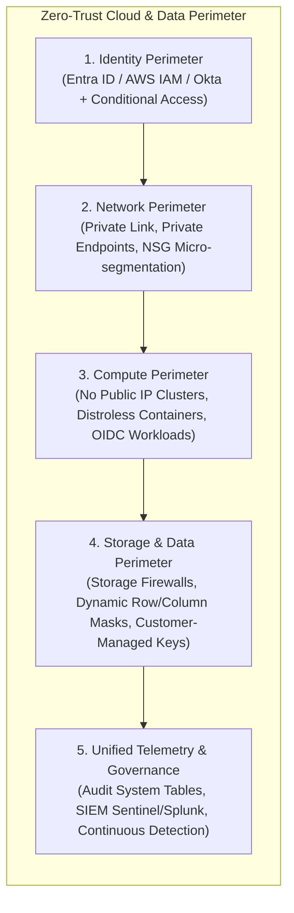
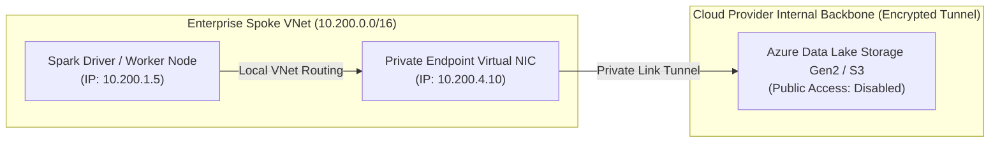

# 🏛️ Architecture Deep Dive 01: Zero-Trust Cloud & Data Perimeter Defense


> *Architectural Blueprint: [Open Table Formats Blueprint: Lakehouse Storage Engines](../docs/whiteboard_diagrams/README.md#open-table-formats-lakehouse). View full multi-persona breakdown and engine mechanisms in the master index.*

---

## 1. Deconstructing the Castle-and-Moat Perimeter

In traditional corporate networking, infrastructure relied on border firewalls and VPN concentrators to separate internal networks (trusted) from external networks (untrusted). Once an attacker or compromised laptop breached the VPN, lateral movement across internal databases, file shares, and analytics servers was virtually uninhibited.

Modern enterprise data engineering operates across multi-cloud infrastructure, SaaS integrations, distributed Spark compute clusters, and remote development teams. Under the **Zero-Trust Architecture (NIST SP 800-207)**, network locality provides **zero implicit trust**. Every request—whether originating from an internal pod or external client—must be authenticated, authorized, encrypted, and continuously audited.



---

## 2. Deep Dive: Private Link & Split-Horizon DNS Resolution

Exposing cloud data lakes (ADLS Gen2, AWS S3) or analytical query engines (Snowflake, Databricks SQL) to the public internet invites credential stuffing, DDoS attacks, and accidental data exposure.

### 2.1 The Private Link Architectural Pipeline
1. **Network Interface Virtualization**: The cloud fabric injects an elastic network interface (NIC) with a private IP (`10.200.4.10`) into the customer's private subnet.
2. **Private Link Tunneling**: Traffic destined for the cloud storage endpoint traverses the cloud provider's dedicated physical backbone network via encapsulated tunnels. Traffic never touches the public internet.
3. **Storage Firewall Enforcement**: The cloud storage account sets `publicNetworkAccess = "Disabled"`, rejecting any request whose packet headers do not originate from an approved Private Endpoint connection.



### 2.2 Split-Horizon DNS Engineering
When an application queries `https://datalakeprod.dfs.core.windows.net/orders`, the operating system's DNS resolver must resolve the private IP (`10.200.4.10`) rather than the public canonical CNAME (`datalakeprod.privatelink.dfs.core.windows.net`):
- A **Private DNS Zone** (`privatelink.dfs.core.windows.net`) is linked to the VNet.
- When compute nodes inside the VNet make DNS queries, the recursive resolver intercepts the request and returns the private IP of the Private Endpoint.
- If an attacker outside the VNet resolves the FQDN, public DNS returns public IPs that immediately drop connections at the storage firewall boundary.

---

## 3. Micro-Segmentation & Egress Lockdown

In data processing environments, worker nodes must download Python packages, query external APIs, and write data to downstream warehouses. However, unrestricted outbound internet access allows malicious packages or compromised scripts to exfiltrate database records to external command-and-control (C2) servers.

### Egress Filtering via Cloud Next-Generation Firewalls:
- **Default Route Override**: Associate a User Defined Route (UDR) with compute subnets directing all outbound traffic (`0.0.0.0/0`) to the private IP of an Azure Firewall or AWS Network Firewall.
- **Application Rule FQDN Filtering**:
  ```text
  # Permitted outbound egress destinations:
  pypi.org:443
  files.pythonhosted.org:443
  *.privatelink.blob.core.windows.net:443
  *.privatelink.dfs.core.windows.net:443
  api.databricks.com:443
  
  # Deny all other outbound HTTP/HTTPS destinations by default!
  ```
- **TLS Inspection & SNI Validation**: Firewalls inspect the Server Name Indication (SNI) in the TLS ClientHello packet, terminating connections attempting to disguise outbound traffic over port 443.
