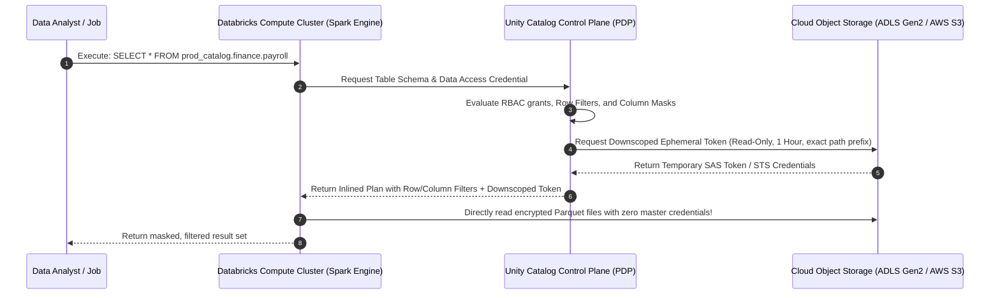
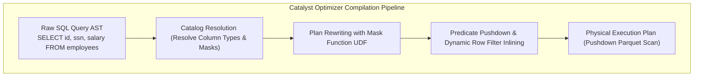

# 🏛️ Architecture Deep Dive 02: Unity Catalog & Lakehouse Governance Internals


> *Architectural Blueprint: [Lakehouse ACID Concurrency & Write Conflict Resolution Matrix](../docs/whiteboard_diagrams/README.md#lakehouse-acid-concurrency). View full multi-persona breakdown and engine mechanisms in the master index.*

---

## 1. The Death of Mount Points & Credential Passthrough

Early Apache Spark and Databricks deployments relied on mounting cloud storage containers directly to the distributed virtual filesystem (DBFS) using access keys or IAM instance profiles:
```python
# ❌ LEGACY SECURITY HAZARD: Mount points expose raw secrets to all cluster users
dbutils.fs.mount(
    source = "wasbs://data@storageaccount.blob.core.windows.net",
    mount_point = "/mnt/finance",
    extra_configs = {"fs.azure.account.key.storageaccount.blob.core.windows.net": "MASTER_STORAGE_KEY"}
)
```
### Critical Failure Modes of DBFS Mounts:
1. **Global Credential Exposure**: Any user capable of running a notebook on that cluster could execute shell commands (`os.system("cat /dbfs/...")`) or inspect cluster environment variables to extract raw cloud storage master keys.
2. **Coarse-Grained Permissions**: Permissions were applied at the mount-point filesystem level; table-level, row-level, and column-level access controls were completely impossible.
3. **Metastore Desynchronization**: Workspaces in different regions or cloud subscriptions had disconnected metastores, leading to inconsistent security policies and rogue schema alterations.

---

## 2. Unity Catalog Architecture: Decoupled Metastore & Downscoped Tokens

Databricks Unity Catalog completely separates the **Governance & Policy Decision Point (PDP)** from the **Compute & Storage Execution Tier**.



### The Downscoped Token Security Mechanism:
- Compute clusters **never** store cloud master credentials, IAM roles, or storage account keys.
- When a query executes, Unity Catalog validates the user's entitlements and contacts the cloud provider (AWS STS or Azure Entra ID) to request an **ephemeral downscoped token** (e.g. Azure Shared Access Signature - SAS, or AWS STS AssumeRole token).
- This token is strictly scoped to the exact cloud storage prefix (`abfss://data@storage.dfs.core.windows.net/finance/payroll/`) and expires within 1 hour. Even if an attacker compromises the cluster worker, the token cannot read any other bucket or directory.

---

## 3. Catalyst Optimizer Compilation of Row Filters & Column Masks

In Unity Catalog, row-level security and column-level masking are not applied as external post-query wrappers; they are compiled directly into the Spark Catalyst query execution tree:



### Dynamic Masking UDF Internals:
```sql
-- UDF compiled into the physical project operator
CREATE OR REPLACE FUNCTION mask_credit_card(cc STRING)
RETURNS STRING
RETURN CASE
    WHEN is_account_group_member('pci_compliance_auditors') THEN cc
    ELSE CONCAT('XXXX-XXXX-XXXX-', RIGHT(cc, 4))
END;

ALTER TABLE prod_sales.payments.transactions
ALTER COLUMN card_number
SET MASK mask_credit_card;
```
When an unprivileged analyst executes a query, the Spark physical plan replaces the project reference to `card_number` with the deterministic scalar expression `mask_credit_card(card_number)`. The plaintext values never enter memory buffers on the user's local driver.
