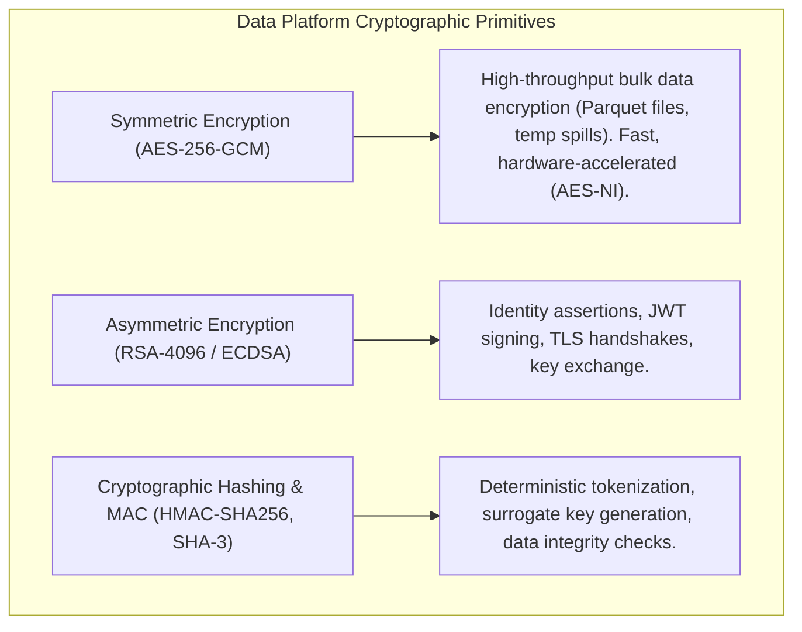
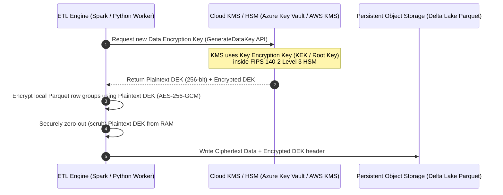

# 🏛️ Architecture Deep Dive 03: Cryptography, Envelope Encryption & Key Lifecycle


> *Architectural Blueprint: [Delta Lake vs. Apache Iceberg Storage & Metadata Architecture](../docs/whiteboard_diagrams/README.md#delta-vs-iceberg-architecture). View full multi-persona breakdown and engine mechanisms in the master index.*

---

## 1. Cryptographic Primitives for Data Platforms

Modern cloud data platforms process terabytes of data daily. Ensuring confidentiality and integrity requires selecting appropriate cryptographic primitives:



### Why AES-256-GCM (Galois/Counter Mode)?
Traditional AES cipher block chaining (CBC) modes require separate HMAC computations to detect tampering and are vulnerable to padding oracle attacks.

**AES-256-GCM is an Authenticated Encryption with Associated Data (AEAD) algorithm**:
- Encrypts plaintext into ciphertext using a counter mode stream.
- Computes an authentication tag ($\text{AuthTag}$) across ciphertext and optional unencrypted metadata (Associated Data) via Galois field polynomial multiplication.
- Guarantees both **confidentiality** (data cannot be read without key) and **authenticity** (tampering with a single bit in the ciphertext causes immediate decryption failure).

---

## 2. Envelope Encryption Architecture (DEK + KEK)

Encrypting multi-terabyte datasets directly with centralized Cloud Key Management Services (AWS KMS, Azure Key Vault, Google Cloud KMS) introduces prohibitive API latency, throttled request limits (e.g. 10,000 requests/sec limit), and severe costs.

**Envelope Encryption** resolves this by encrypting data with a local data key and encrypting that data key with a remote master key:



### Mathematical Formulation of Envelope Encryption:
$$\text{Ciphertext Data} = \text{AES-GCM-Encrypt}(\text{Plaintext Data}, \text{DEK}, \text{Nonce})$$
$$\text{Encrypted DEK} = \text{KMS-Encrypt}(\text{Plaintext DEK}, \text{KEK})$$

When reading data back:
1. The engine extracts the **Encrypted DEK** from the file header.
2. The engine calls `KMS-Decrypt(Encrypted DEK, KEK)` to retrieve the **Plaintext DEK**.
3. The engine decrypts the ciphertext data locally using hardware AES-NI CPU instructions.

---

## 3. Customer-Managed Keys (CMK / BYOK) vs. Service-Managed Keys

| Architecture Tier | Key Owner | Rotation Management | Revocation Control | Threat Model Mitigated |
| :--- | :--- | :--- | :--- | :--- |
| **Service-Managed (Default)** | Cloud Provider (AWS / Azure) | Automated by Cloud Provider | Cannot be unilaterally revoked | Protection against physical disk theft at cloud datacenter. |
| **Customer-Managed (CMK / BYOK)** | Enterprise Security Team | Customer-defined schedule (e.g. annual) | Instant unilateral key disabling | Protects against rogue cloud admins, subpoena seizures, regulatory non-compliance. |
| **Hardware Security Module (HSM)** | Dedicated Dedicated Cloud HSM (FIPS 140-2 Level 3) | Managed via PKCS#11 API | Cryptographic zeroization | Satisfies banking, defense, and top-tier compliance mandates. |

---

## 4. Cryptographic Shredding for Immutable Lakehouses

Under GDPR Article 17 (Right to Erasure), organizations must delete a user's personal data upon request. However, rewriting historical append-only Delta Lake tables across petabytes of storage is technically unviable.

**Cryptographic Shredding Architecture**:
1. At ingestion time, encrypt each user's PII attributes using a unique per-user encryption key ($\text{Key}_{U}$) stored in a secure key store.
2. Store the encrypted PII in standard immutable Parquet files.
3. Upon receiving a certified deletion request, permanently destroy $\text{Key}_{U}$ from the key store.
4. Without $\text{Key}_{U}$, the user's records in all historical files, replicas, snapshots, and backups become mathematically unrecoverable random noise, satisfying legal erasure mandates instantly at zero rewrite cost.

---

## 5. Production Python Implementation: AES-256-GCM Envelope Encryption & Shredding

```python
import os
import base64
from cryptography.hazmat.primitives.ciphers.aead import AESGCM
from cryptography.hazmat.backends import default_backend

class GDPRCryptoShredder:
    """
    Production AES-256-GCM Envelope Encryption engine with per-user key management.
    Enables instant GDPR Article 17 erasure across immutable Parquet lakehouses.
    """
    def __init__(self):
        # In production, keys are stored in Azure Key Vault / AWS KMS with HSM backing
        self._user_key_store = {}

    def get_or_create_user_key(self, user_id: str) -> bytes:
        if user_id not in self._user_key_store:
            # Generate 256-bit (32 bytes) cryptographically secure symmetric key
            self._user_key_store[user_id] = AESGCM.generate_key(bit_length=256)
        return self._user_key_store[user_id]

    def encrypt_user_pii(self, user_id: str, plaintext: str) -> dict:
        """Encrypts PII using user-specific key with 96-bit random nonce and AEAD tag."""
        key = self.get_or_create_user_key(user_id)
        aesgcm = AESGCM(key)
        nonce = os.urandom(12)  # 96-bit unique IV/nonce per encryption

        # Associated Data binds encryption to specific user identity
        associated_data = user_id.encode('utf-8')
        ciphertext = aesgcm.encrypt(nonce, plaintext.encode('utf-8'), associated_data)

        return {
            "user_id": user_id,
            "nonce_b64": base64.b64encode(nonce).decode('utf-8'),
            "ciphertext_b64": base64.b64encode(ciphertext).decode('utf-8')
        }

    def decrypt_user_pii(self, payload: dict) -> str:
        """Decrypts user PII. Raises KeyError if key was shredded."""
        user_id = payload["user_id"]
        if user_id not in self._user_key_store:
            raise KeyError(f"❌ Key for user {user_id} has been cryptographically shredded. Data is unrecoverable.")

        key = self._user_key_store[user_id]
        aesgcm = AESGCM(key)
        nonce = base64.b64decode(payload["nonce_b64"])
        ciphertext = base64.b64decode(payload["ciphertext_b64"])
        associated_data = user_id.encode('utf-8')

        decrypted_bytes = aesgcm.decrypt(nonce, ciphertext, associated_data)
        return decrypted_bytes.decode('utf-8')

    def shred_user_data(self, user_id: str) -> bool:
        """Instant GDPR erasure: Destroys encryption key permanently."""
        if user_id in self._user_key_store:
            # Overwrite memory before deletion
            self._user_key_store[user_id] = os.urandom(32)
            del self._user_key_store[user_id]
            print(f"🗑️ Successfully shredded encryption key for user {user_id}.")
            return True
        return False
```
