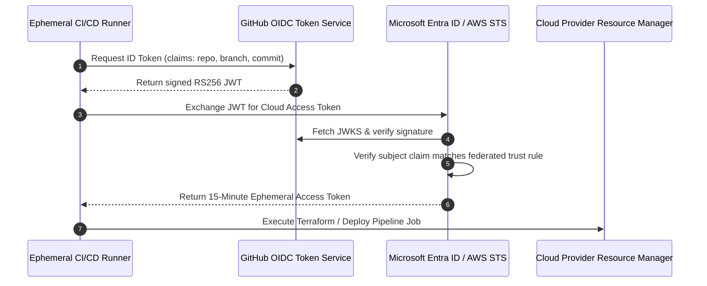

# 🏛️ Architecture Deep Dive 04: DevSecOps Pipelines & Workload Identity Federation


> *Architectural Blueprint: [Lakehouse ACID Concurrency & Write Conflict Resolution Matrix](../docs/whiteboard_diagrams/README.md#lakehouse-acid-concurrency). View full multi-persona breakdown and engine mechanisms in the master index.*

---

## 1. The Threat Model of CI/CD Data Pipelines

Continuous Integration and Continuous Deployment (CI/CD) pipelines represent the most privileged and targeted infrastructure in modern software engineering:
- CI/CD runners have direct write access to production cloud environments to deploy infrastructure, execute database migrations, and publish data transformation jobs.
- Historically, pipelines relied on **long-lived static secrets** (`AWS_ACCESS_KEY_ID`, `ARM_CLIENT_SECRET`) stored in repository secret stores.
- A single compromised developer account, rogue dependency in the build graph, or leaked log output exposes permanent master credentials to attackers.

```mermaid
flowchart TD
    subgraph LegacyAttackVector["Legacy Threat Vector (Static Secrets)"]
        Repo["Git Repository Secrets"] --> Leak["Leaked in Pull Request Logs /<br/>Rogue PR"]
        Leak --> Attacker["Attacker Obtains Permanent Cloud<br/>Master Credential"]
        Attacker --> Exfil["Exfiltrates Entire Lakehouse<br/>Dataset"]
    end

    subgraph OIDCModernSecurity["Modern Zero-Static-Secret Pipeline (OIDC<br/>Federation)"]
        Runner["Ephemeral GitHub Actions Runner"] --> OIDC["GitHub OIDC Token Service"]
        OIDC --> STS["Cloud STS (Azure Entra ID / AWS<br/>STS)"]
        STS --> Downscoped["15-Minute Ephemeral Token (Bound<br/>to repo, branch, & job)"]
        Downscoped --> Deploy["Deploy Infrastructure & Exit (Zero<br/>Residual Secrets)"]
    end
```



---

## 2. OIDC Workload Identity Federation Deep Dive

OpenID Connect (OIDC) federation establishes mutual cryptographic trust between an Identity Provider (e.g. GitHub Actions) and a Cloud Security Token Service (STS) without sharing passwords or keys.

### 2.1 The Cryptographic Handshake:
1. When a workflow job starts, the runner contacts the GitHub Actions Token Service to request an OpenID Connect (OIDC) ID token.
2. The GitHub Token Service signs a JSON Web Token (JWT) using its private asymmetric key. The JWT contains strict claims:
   - `iss`: `https://token.actions.githubusercontent.com`
   - `aud`: `api://AzureADTokenExchange` or `https://sts.amazonaws.com`
   - `sub`: `repo:santoshjammi29/data-pipelines:ref:refs/heads/main`
   - `job_workflow_ref`: The exact workflow file and git commit SHA.
3. The runner passes this JWT to Microsoft Entra ID or AWS STS.
4. The cloud provider downloads the public JSON Web Key Set (JWKS) from `https://token.actions.githubusercontent.com/.well-known/jwks` and cryptographically verifies the token signature.
5. The cloud provider evaluates federated credential trust rules:
   - Does `sub` match `repo:santoshjammi29/data-pipelines:ref:refs/heads/main`?
   - Does `aud` match the configured application registration?
6. If claims match, the cloud provider issues a short-lived (15–60 minute) temporary cloud access token.



---

## 3. Supply Chain Security: Cosign Keyless Artifact Signing

Building and deploying Docker containers for PySpark jobs or Airflow worker images requires verifying that the deployed image was built by your authorized CI/CD pipeline and has not been tampered with in the container registry.

### Keyless Signing with Sigstore Cosign:
- **No Long-Lived Private Keys**: Traditional signing required managing private GPG keys. Keyless signing uses **ephemeral certificates** issued by the Sigstore Fulcio certificate authority based on the runner's OIDC identity.
- **Transparency Log (Rekor)**: A tamper-evident, append-only cryptographic ledger records all signatures, allowing real-time detection of rogue builds.

```bash
# In CI Workflow: Sign the built container image keylessly
cosign sign --yes \
  ghcr.io/org/pyspark-job:sha-83a9f02 \
  --oidc-issuer https://token.actions.githubusercontent.com

# In Kubernetes Admission Controller / CD Gate: Enforce signature verification
cosign verify \
  --certificate-identity "https://github.com/org/pyspark-job/.github/workflows/deploy.yml@refs/heads/main" \
  --certificate-oidc-issuer "https://token.actions.githubusercontent.com" \
  ghcr.io/org/pyspark-job:sha-83a9f02
```

---

## 4. Policy-as-Code Quality & Security Gates

Before applying Infrastructure-as-Code (IaC) templates (Terraform, Bicep) to cloud environments, automated static analysis tools enforce mandatory compliance rules:

```bash
# Scan Terraform templates for compliance violations
checkov -d ./infrastructure/terraform \
  --framework terraform \
  --check CKV_AZURE_35,CKV_AZURE_41 \
  --hard-fail-on HIGH,CRITICAL
```
### Enforced Baseline Rules:
- `CKV_AZURE_35`: Ensure public network access is disabled for storage accounts.
- `CKV_AZURE_41`: Ensure storage accounts enforce minimum TLS version 1.3.
- `CKV_AZURE_109`: Ensure storage accounts enforce customer-managed keys (CMK).
