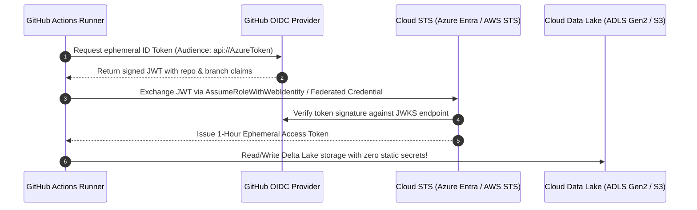

# 🔐 Module 01: Authentication, OIDC & Zero-Trust Architecture

## 1. Zero-Trust Architecture (ZTA) in Enterprise Data Platforms

Traditional enterprise network security relied on the **castle-and-moat** perimeter model: traffic inside the corporate VPN or internal network was implicitly trusted, while external traffic was untrusted. Modern cloud, lakehouse, and microservice architectures render this model obsolete.

The **Zero-Trust Architecture (NIST SP 800-207)** enforces three non-negotiable axioms:
1. **Verify Explicitly**: Authenticate and authorize continuously based on all available data points (user identity, device posture, location, data classification, and anomalous behavioral heuristics).
2. **Use Least-Privileged Access**: Limit access with Just-In-Time (JIT) and Just-Enough-Access (JEA) entitlements, adaptive risk-based policies, and data protection.
3. **Assume Breach**: Minimize the blast radius by micro-segmenting network perimeters, encrypting all traffic end-to-end (in transit and at rest), and continuously monitoring security audit trails.

```mermaid
flowchart TD
    subgraph ZeroTrustFlow["Zero-Trust Continuous Verification Engine"]
        User["Client / Service / Pipeline"] --> Context["Context Evaluator (Identity, Device, Network, Time)"]
        Context --> PDP["Policy Decision Point (IdP / Entra ID / Okta / AWS IAM)"]
        PDP -->|Validate Claims & MFA| PEP["Policy Enforcement Point (API Gateway / Envoy / Lakehouse Gateway)"]
        PEP -->|Issue Ephemeral JWT (15 min)| Resource["Protected Resource (Databricks, ADF, SQL, S3/ADLS)"]
        PEP -.-> Audit["Tamper-Evident Audit Stream (CloudTrail / Azure Monitor)"]
    end
```

---

## 2. OIDC Workload Identity Federation (Eliminating Static Secrets)

Long-lived cloud API keys, AWS IAM access keys, and Azure service principal client secrets stored in CI/CD variables are a primary vector for catastrophic data breaches.

**OpenID Connect (OIDC) Workload Identity Federation** eliminates static credentials by establishing cryptographic trust between external identity providers (e.g. GitHub Actions, GitLab CI, Kubernetes) and cloud cloud providers (Azure, AWS, GCP).

### Architecture & Handshake:
1. The CI/CD runner requests an ephemeral **OIDC ID Token** signed with the provider's private key (`oidc.token.actions.githubusercontent.com`).
2. The runner presents this JWT to the cloud Security Token Service (STS) or Microsoft Entra ID.
3. The cloud provider validates the token signature against the public JWKS endpoint, validates claims (`aud = api://AzureADTokenExchange`, `iss`, `sub = repo:org/repo:ref:refs/heads/main`).
4. The cloud provider exchanges the token for a short-lived (1-hour) cloud access token.



---

## 3. OAuth 2.0 & Token Architecture

### 3.1 OAuth 2.0 Grant Selection Matrix:
- **Client Credentials Grant (`grant_type=client_credentials`)**: Server-to-server and automated daemon pipelines (e.g., Azure Data Factory accessing Databricks REST API, Airflow triggering Spark jobs).
- **Authorization Code Flow with PKCE (`grant_type=authorization_code`)**: User-facing interactive tools, BI applications, and single-page applications (eliminates client secret exposure in browser code).

### 3.2 JSON Web Token (JWT) Security Checklist:
- [ ] **Algorithm Enforcement**: Explicitly enforce `alg: RS256` or `ES256`. Reject tokens with `alg: none` or downgrade to symmetric `HS256`.
- [ ] **Audience (`aud`) & Issuer (`iss`) Validation**: Strictly verify that `aud` matches the exact intended API service identifier and `iss` matches the trusted identity tenant.
- [ ] **Expiration (`exp`) with Clock Skew Limits**: Enforce maximum token lifetime of 15–60 minutes with a clock skew allowance of $\le 60\text{ seconds}$.
- [ ] **Refresh Token Rotation**: Issue one-time-use refresh tokens. Invalidate the entire token family upon detecting replay of an expired refresh token.
