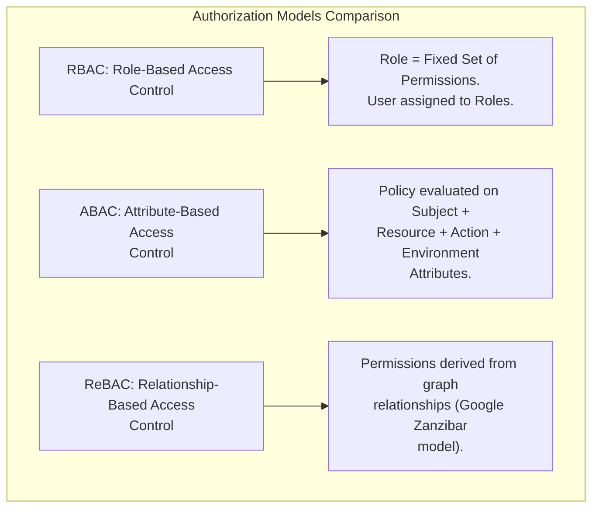
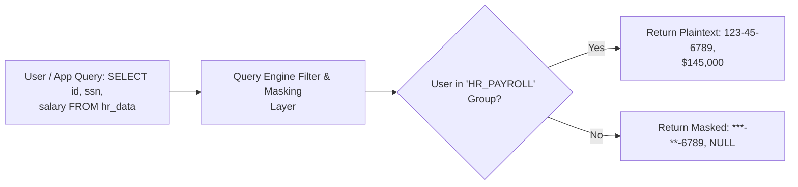

# 🛡️ Module 02: Authorization, RBAC, ABAC & Entitlement Governance

## 1. Access Control Paradigms: RBAC vs. ABAC vs. ReBAC

Enterprise authorization models determine how subjects (users, service principals) are granted permissions to perform actions on resources.



| Dimension | RBAC (Role-Based) | ABAC (Attribute-Based) | ReBAC (Relationship-Based) |
| :--- | :--- | :--- | :--- |
| **Decision Factors** | User's assigned organizational role (e.g. `DataEngineer`). | Subject (department, clearance), Resource (classification), Env (time, IP). | Object-to-subject graph relationships (e.g. `owner`, `collaborator`). |
| **Granularity** | Coarse-grained to medium. | Fine-grained (dynamic attributes and context). | Highly fine-grained (deep graph hierarchies). |
| **Complexity** | Low complexity, but prone to **Role Explosion**. | High policy complexity (XACML / OPA Rego). | Requires graph traversal engine (Zanzibar / OpenFGA). |
| **Best Used For** | General cloud infrastructure, warehouse roles. | Dynamic Row/Column lakehouse masking, regulatory compliance. | Multi-tenant SaaS sharing, nested project ownership. |

---

## 2. Principle of Least Privilege (PoLP) & Separation of Duties (SoD)

### 2.1 Toxic Combinations (SoD Violations):
A **toxic combination** occurs when an individual holds two conflicting entitlements that bypass organizational security checks.
- *Data Engineering SoD Trap*: A single developer possessing permissions to deploy data pipeline transformations to production **AND** direct `MODIFY` or `DROP` permissions on production financial ledger tables.
- *Mitigation*: Separate build/deploy entitlements from data modification roles; enforce automated CI/CD pipeline deployment where human developers have read-only access in production.

### 2.2 Just-In-Time (JIT) Privileged Access Management (PAM):
- Rather than maintaining standing administrative access (`Owner` or `Account Admin`), operators request time-bound elevation (e.g. Azure Privileged Identity Management - PIM, AWS IAM Identity Center temporary sessions).
- Elevations require multi-party approval, MFA challenge, and ticket justification (e.g. ServiceNow / Jira incident link), automatically expiring after 2–4 hours.

---

## 3. Dynamic Data Masking (DDM) & Row Filters

Data warehouses and lakehouses must protect Personally Identifiable Information (PII) and Protected Health Information (PHI) without duplicating physical datasets.



### ANSI SQL / Unity Catalog Row Filter & Column Mask Implementation:
```sql
-- Define Column Mask Function
CREATE OR REPLACE FUNCTION mask_ssn(ssn STRING)
RETURNS STRING
RETURN CASE
    WHEN is_account_group_member('hr_payroll_auditors') THEN ssn
    ELSE CONCAT('***-**-', SUBSTRING(ssn, 8, 4))
END;

-- Apply Mask to Table
ALTER TABLE prod_hr.payroll.employees
ALTER COLUMN ssn_number
SET MASK mask_ssn;

-- Define Row-Level Security Filter Function
CREATE OR REPLACE FUNCTION region_filter(region STRING)
RETURNS BOOLEAN
RETURN is_account_group_member('global_executives') OR
       is_account_group_member(CONCAT('analysts_', LOWER(region)));

-- Apply Row Filter
ALTER TABLE prod_sales.analytics.orders
SET ROW FILTER region_filter ON (sales_region);
```
