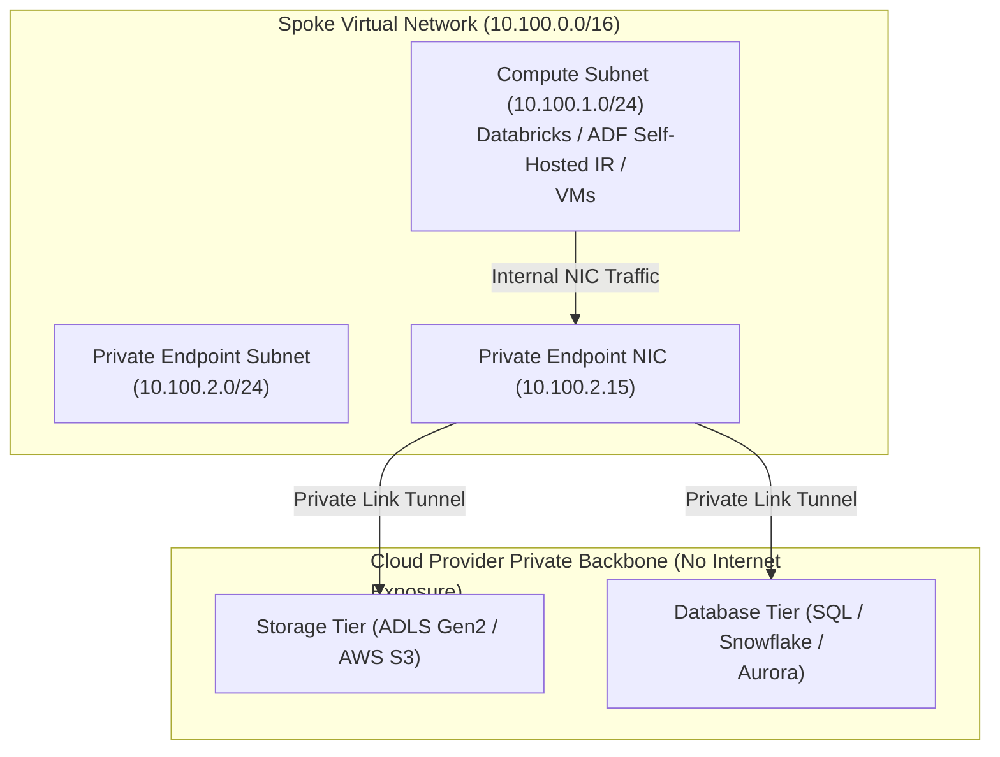
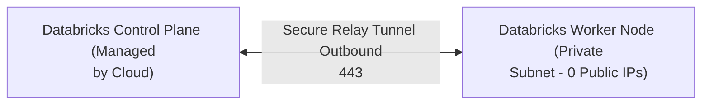

# 🌐 Module 03: Cloud Networking & Perimeter Defense

## 1. Network Boundary Isolation: Private Link & Private Endpoints

In an enterprise cloud lakehouse, **no storage account, database instance, or compute cluster should ever expose a public IP address to the public internet**.

### Key Networking Concepts:
1. **Private Endpoint**: A virtual network interface (NIC) allocated inside your private VNet with a private IP address (`10.100.2.15`). Traffic destined for the cloud service resolves to this internal IP.
2. **Private Link**: Secure, private connectivity traversing the cloud provider's dedicated fiber backbone. It eliminates traffic exposure to the public internet and prevents data exfiltration.
3. **Split-Horizon Private DNS Resolution**:
   - The public FQDN `storageprod.dfs.core.windows.net` resolves via a **Private DNS Zone** (`privatelink.dfs.core.windows.net`) to the private IP `10.100.2.15` inside the VNet, while queries from the outside world resolve to a non-routable or rejected IP.

---

## 2. Databricks Secure Cluster Connectivity (No Public IP / NPIP)

Traditional cloud clusters assigned public IP addresses to worker nodes to allow management control planes to communicate with compute nodes.

Under **Secure Cluster Connectivity (No Public IP - NPIP)**:
- Worker nodes are provisioned in private subnets with **zero public IP addresses** and **no open inbound ports**.
- The Databricks runtime daemon on each worker establishes an **outbound reverse tunnel** (port 443) back to the control plane relay.
- All cluster management commands, job definitions, and monitoring telemetry flow exclusively over this encrypted outbound tunnel.

---

## 3. Storage Account Firewall & Egress Lockdown Checklist

- [ ] **Public Network Access Disabled**: Set `publicNetworkAccess = "Disabled"` on all ADLS Gen2, Blob, and S3 buckets.
- [ ] **Enforce TLS 1.3 Minimum**: Reject all connection handshakes using TLS 1.0, 1.1, or 1.2 (`minimumTlsVersion = "TLS1_3"`).
- [ ] **Deny Cross-Tenant Replication**: Restrict storage replication targets exclusively to authorized corporate Entra ID / AWS organization tenants to eliminate covert data exfiltration.
- [ ] **Egress Firewall Rules**: Route all outbound traffic from compute subnets through a Next-Generation Cloud Firewall (Azure Firewall, AWS Network Firewall) with FQDN filtering to prevent outbound beacons to command-and-control (C2) servers.
