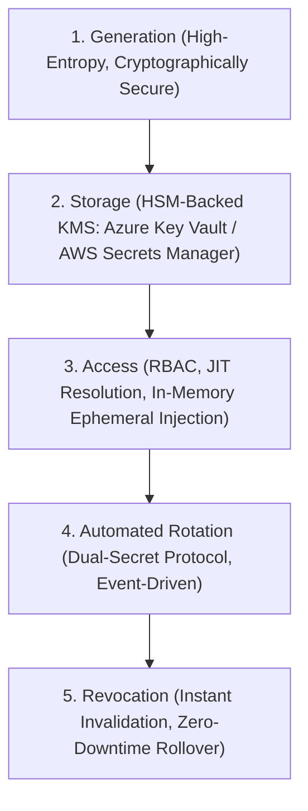
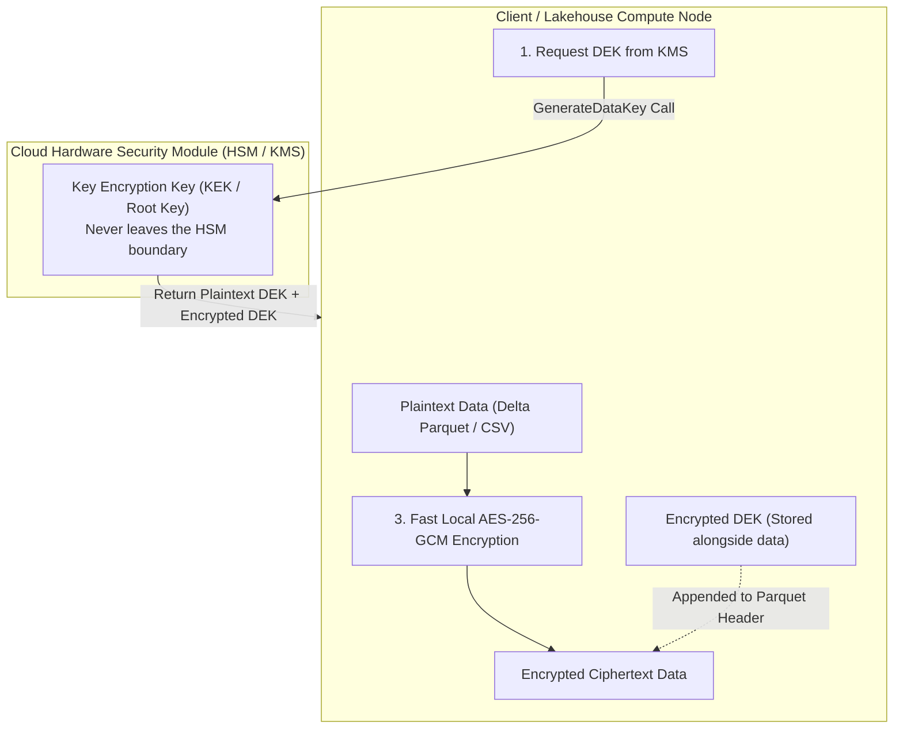
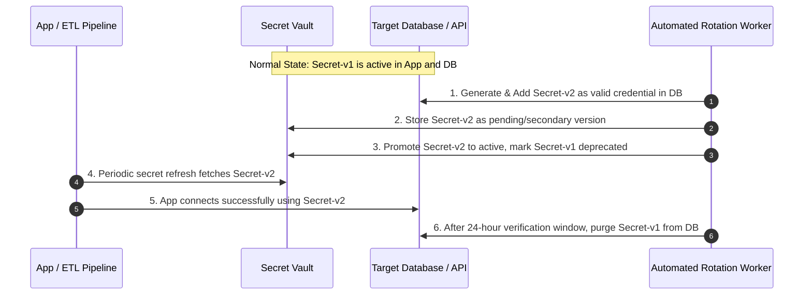

# 🔑 Module 04: Secrets Management & Encryption Architecture

## 1. Secrets Management Hierarchy & Lifecycle

Hardcoded database connection strings, plain-text API tokens, and static passwords in pipeline scripts are catastrophic vulnerabilities. A production secrets management architecture adheres to a strict 5-stage lifecycle:

---

## 2. Envelope Encryption Architecture (DEK + KEK)

Encrypting large multi-terabyte lakehouse files directly with asymmetric KMS keys introduces prohibitive network latency and cost. Enterprise data platforms utilize **Envelope Encryption**:

### Encryption Key Classification:
1. **Data Encryption Key (DEK)**: A symmetric key (AES-256) generated locally for a specific file or batch of rows. Encrypts and decrypts data at high throughput.
2. **Key Encryption Key (KEK)**: An asymmetric or symmetric root master key stored inside a FIPS 140-2 Level 3 Hardware Security Module (HSM). The KEK is used exclusively to encrypt and decrypt the DEK. The KEK never leaves the HSM.

---

## 3. Dual-Secret Zero-Downtime Rotation Protocol

Rotating database credentials or API secrets without downtime requires supporting two valid secrets concurrently during the rollover window:

---

## 4. Databricks Secret Scopes: AKV-Backed vs. Databricks-Managed

- **Azure Key Vault-Backed Secret Scope**:
  - The secret scope acts as a real-time pointer to an Azure Key Vault instance.
  - Secrets are never stored or cached inside Databricks control plane storage.
  - Access is governed by Azure Key Vault access policies and Entra ID RBAC.
  - In code: `dbutils.secrets.get(scope = "akv-prod-scope", key = "postgres-connection-string")`
- **Security Rule**: Never print or serialize secret values to driver logs, console output, or table metadata. Databricks automatically redacts values retrieved via `dbutils.secrets.get` in notebook cell outputs with `[REDACTED]`.
