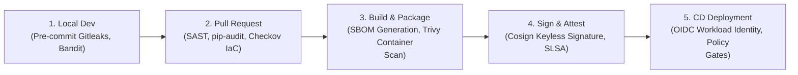

# ⚙️ Module 05: DevSecOps, CI/CD & Supply Chain Security

## 1. Shift-Left Security in Modern Data Engineering

DevSecOps integrates automated security controls into every stage of the software and data pipeline delivery lifecycle, preventing vulnerabilities before code reaches production environments.



---

## 2. Supply Chain Security & SLSA Framework

Recent cyberattacks (e.g. SolarWinds, Codecov) targeted build pipelines and third-party dependencies rather than runtime infrastructure.

### The SLSA (Supply-chain Levels for Software Artifacts) Standard:
- **Level 1 (Scripted Build)**: Builds are automated via code, producing provenance metadata.
- **Level 2 (Hosted Build)**: Build runs on an isolated, tamper-resistant hosted service (GitHub Actions / GitLab CI).
- **Level 3 (Hardened Isolated Environments)**: Build runs in ephemeral virtual environments, preventing tampering across builds, with cryptographically verifiable provenance attestations.

### Container & Artifact Cryptographic Signing with Cosign:
```bash
# Generate keyless cryptographic signature via OIDC identity
cosign sign --yes \
  --oidc-issuer https://token.actions.githubusercontent.com \
  ghcr.io/org/data-transform-job:v1.4.0

# Verify container signature prior to cluster deployment
cosign verify \
  --certificate-identity-regexp "https://github.com/org/data-pipelines/.*" \
  --certificate-oidc-issuer https://token.actions.githubusercontent.com \
  ghcr.io/org/data-transform-job:v1.4.0
```

---

## 3. Hardened Multi-Stage Dockerfile for Data Jobs

Container images running Python ETL or Spark drivers must adhere to minimal attack surface standards:

```dockerfile
# Stage 1: Build & Dependency Resolution
FROM python:3.11-slim AS builder

WORKDIR /app
RUN apt-get update && apt-get install -y --no-install-recommends gcc build-essential && rm -rf /var/lib/apt/lists/*

COPY requirements.txt .
RUN pip install --no-cache-dir --user -r requirements.txt

# Stage 2: Distroless / Hardened Runtime
FROM gcr.io/distroless/python3-debian12:nonroot

WORKDIR /app
# Copy installed wheels from builder to nonroot home
COPY --from=builder /root/.local /home/nonroot/.local
COPY --chown=nonroot:nonroot src/ /app/src/

ENV PATH=/home/nonroot/.local/bin:$PATH
USER nonroot

ENTRYPOINT ["python", "src/main.py"]
```
- **Why Non-Root?** Prevents container breakout attacks where an attacker obtaining remote code execution acquires root privileges on the underlying host node.
- **Why Distroless?** Removes package managers (`apt`, `apk`), shells (`/bin/sh`, `/bin/bash`), and compilation tools, depriving attackers of post-exploitation utilities.
