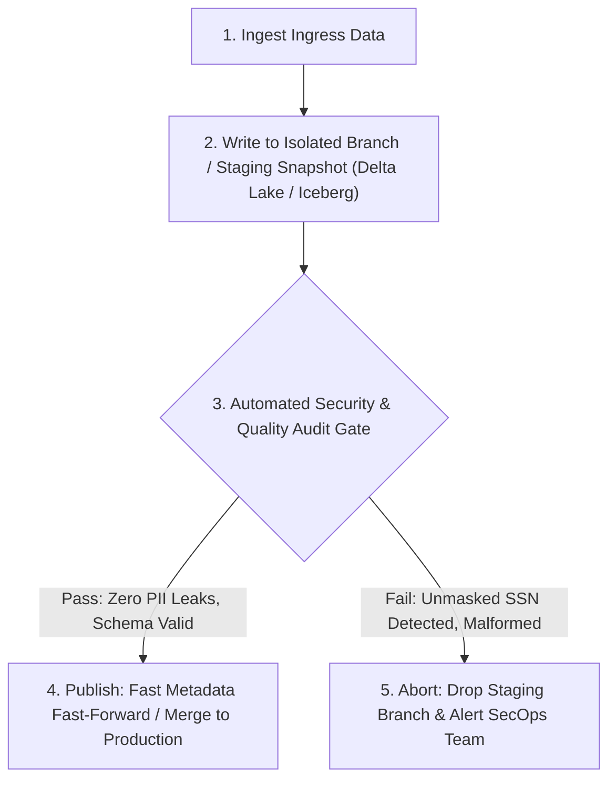
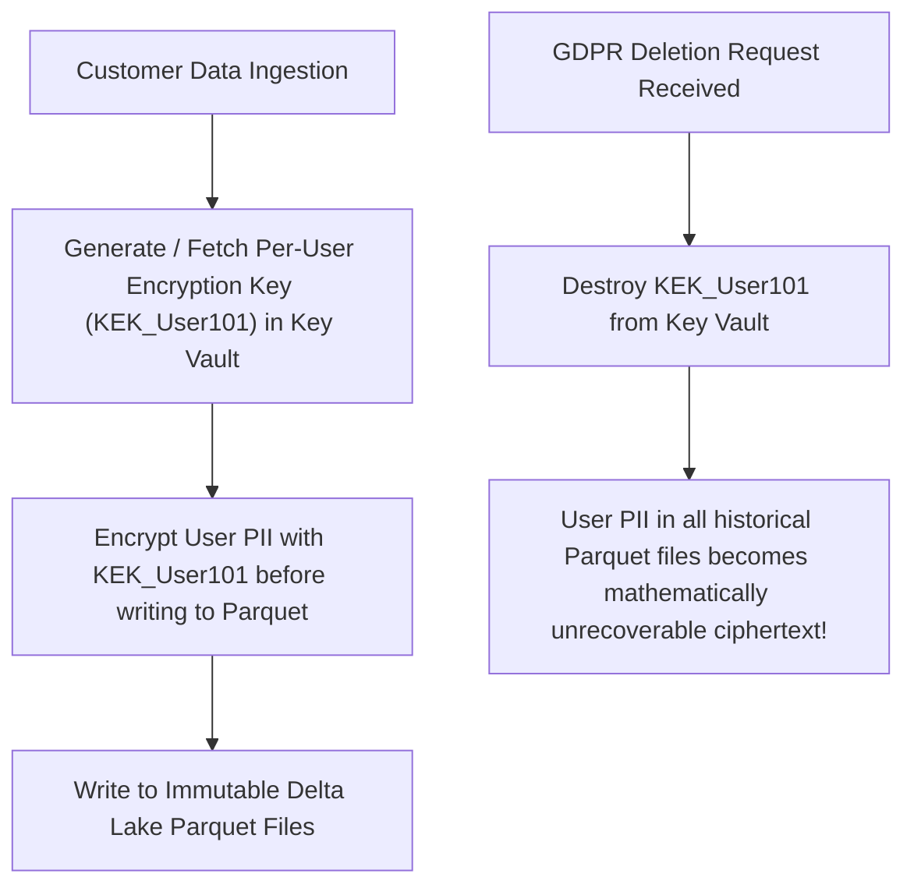

# 🔄 Module 07: ETL, ELT & Data Pipeline Security

## 1. The Write-Audit-Publish (WAP) Pattern with Security Gating

In traditional ETL pipelines, data is written directly to production tables (`INSERT INTO prod.orders`), creating data corruption or compliance violations if data quality or privacy assertions fail.

The **Write-Audit-Publish (WAP)** pattern decouples data writing from production publishing:

### Security Audit Assertions:
1. **PII Leak Detection**: Automated scans ensuring no plaintext credit cards, unmasked social security numbers, or API tokens were ingested into non-confidential tables.
2. **Schema Invariant Enforcement**: Verify non-nullable columns, permitted ranges, and cryptographic checksums.
3. **Volume Anomaly Verification**: Ensure anomalous bulk additions or bulk deletions (e.g. unexpected 90% drops indicating ransomware or pipeline bugs) halt execution.

---

## 2. Crypto-Shredding: GDPR Right to Be Forgotten in Immutable Lakehouses

In distributed lakehouses (Delta Lake, Apache Iceberg), historical data is written into immutable, compressed Parquet files distributed across thousands of storage paths. Re-writing petabytes of historical Parquet files to delete a single customer's record to satisfy GDPR/CCPA Article 17 is prohibitively expensive and triggers severe write conflict errors.

**Cryptographic Shredding** solves this challenge elegantly:

### Advantages of Crypto-Shredding:
- **Instantaneous Compliance**: Deletion of the user's specific cryptographic key renders their data unreadable across all backups, checkpoints, and historical snapshots immediately.
- **Zero I/O Rewrite Cost**: Bypasses the need to re-write historical Parquet files or re-compact Delta Lake tables.

---

## 3. Data Tokenization: Preserving Referential Integrity

Tokenization replaces sensitive attributes with non-sensitive surrogate tokens.

### Deterministic Tokenization vs Random Tokenization:
- **Random Tokenization**: Generates a random UUID per record. Guarantees zero leakage, but breaks relational joins across distinct tables.
- **Deterministic Tokenization (HMAC / AES-SIV)**: Generates identical tokens for identical plaintext values using a secret pepper key:
  $$\text{Token} = \text{HMAC-SHA256}(\text{Raw SSN}, \text{Secret Tokenization Key})$$
  - *Benefit*: Allows analytics pipelines to perform `JOIN` and `COUNT(DISTINCT)` operations across disparate datasets without decrypting the underlying sensitive values.
