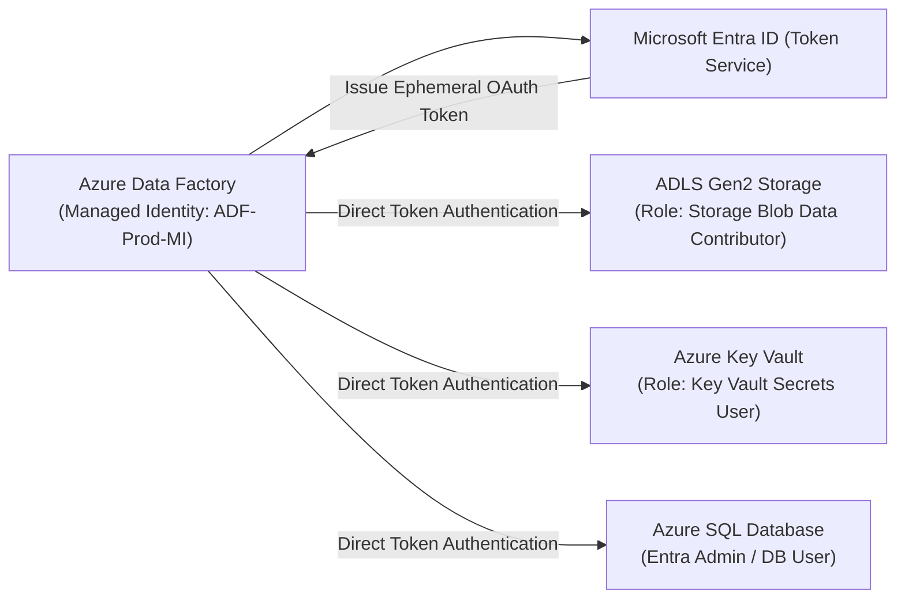
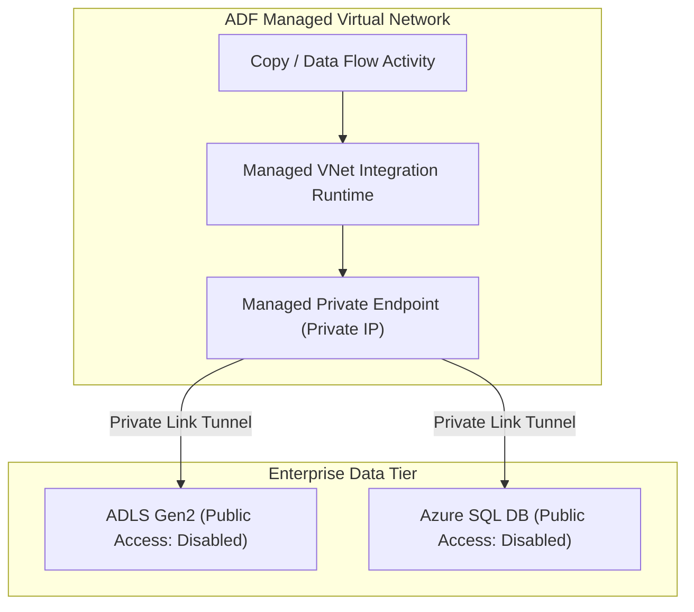

# 🏭 Module 08: Azure Data Factory (ADF) & Managed Integration Security

## 1. Managed Identity Integration (Eliminating Passwords in Pipelines)

Connecting Azure Data Factory (ADF) to storage accounts, databases, and compute clusters using raw connection strings or embedded passwords exposes credentials in pipeline JSON definitions and Azure Monitor logs.

### System-Assigned vs. User-Assigned Managed Identity:
- **System-Assigned**: Tied directly to the lifecycle of the ADF instance. Automatically deleted if ADF is deleted. Ideal for single-factory architectures.
- **User-Assigned**: Standalone Azure resource assigned across multiple ADF instances or Synapse workspaces. Simplifies RBAC management across dev/stage/prod environments.

---

## 2. Managed Virtual Network Integration Runtime & Private Endpoints

By default, the Azure AutoResolveIntegrationRuntime executes on multi-tenant public infrastructure, routing traffic over public endpoints.

Enterprise architectures mandate **Managed VNet Integration Runtime**:
- Azure provisions an isolated, dedicated Virtual Network managed exclusively for your data factory.
- Communication with target sinks and sources (ADLS Gen2, Azure SQL, Snowflake, Databricks) occurs through **Managed Private Endpoints**.
- Disables public internet routing and enforces strict approval workflows on the target resource.

---

## 3. Secure Input & Secure Output: Preventing Log Leakage

Pipeline activities that interact with REST APIs, authentication endpoints, or Key Vault frequently process access tokens or connection strings.

### The Log Exposure Vulnerability:
If activity outputs contain secrets, they are written in plaintext to:
1. ADF Pipeline Run Execution History (accessible by anyone with `Reader` role).
2. Azure Monitor / Log Analytics diagnostic workspaces.
3. Alert webhooks and notifications.

### The Remediation:
In every activity processing sensitive payloads (Web, Lookup, Function activities):
- Navigate to the **General** tab in ADF.
- Enable **Secure Input**: Masks data passed into the activity.
- Enable **Secure Output**: Masks the activity's return payload with `******` across all monitoring logs and telemetry streams.
