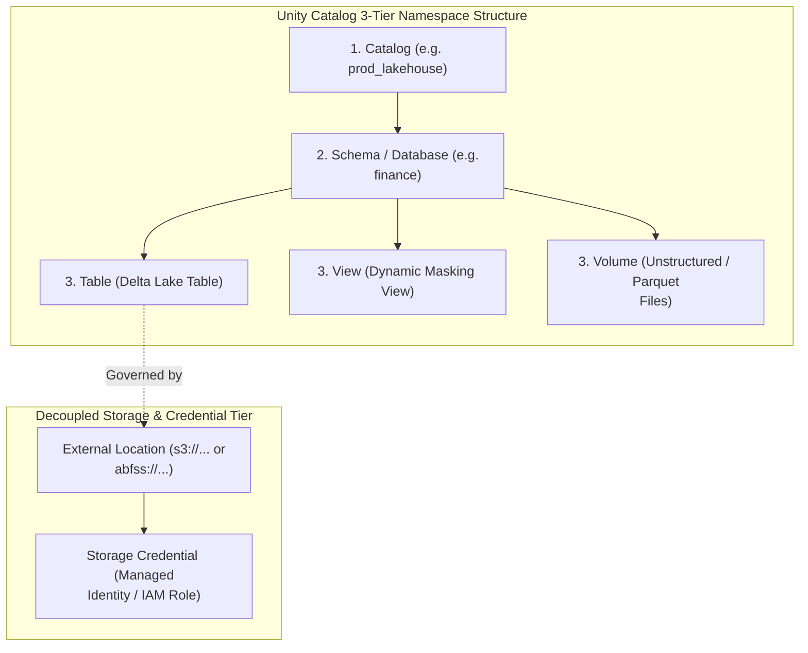

# 🧱 Module 09: Databricks & Lakehouse Security Mastery

## 1. Unity Catalog 3-Tier Namespace & Governance Architecture

Legacy Databricks deployments relied on root DBFS mounts (`/mnt/...`), AWS IAM instance profiles, or Azure storage keys mounted directly into the cluster filesystem. This architecture suffered from severe vulnerabilities: any cluster user with shell access could read all storage keys directly from root disk.

**Databricks Unity Catalog (UC)** enforces centralized, identity-governed access across all workspaces:

### The Security Advantages of Unity Catalog:
1. **Centralized Metastore**: One metastore spans multiple Databricks workspaces across regions and cloud subscriptions.
2. **Zero Direct Cloud Storage Credentials**: Compute clusters never hold raw AWS IAM keys or Azure Storage Account Keys. The Unity Catalog control plane acts as the gatekeeper, negotiating short-lived Downscoped Tokens directly with the cloud storage provider on the worker's behalf.
3. **Auditing & Lineage**: Automatically captures column-level and table-level lineage for all SQL and Python DataFrame operations.

---

## 2. Cluster Access Modes & Workload Isolation

To enforce Unity Catalog permissions, compute clusters must be provisioned with the appropriate access mode:

| Cluster Access Mode | Unity Catalog Enforced? | Multiple Concurrent Users? | Languages Supported | Best Use Case |
| :--- | :---: | :---: | :---: | :--- |
| **Shared (Standard)** | ✅ Yes | ✅ Yes (Multi-tenant) | SQL, Python | Collaborative BI, interactive ad-hoc analytics, shared developer clusters. Enforces user isolation. |
| **Single User** | ✅ Yes | ❌ No (Dedicated) | SQL, Python, Scala, R | Machine Learning training, custom native binaries, GPU workloads requiring single-user isolation. |
| **No Isolation Shared (Deprecated)** | ❌ No | ✅ Yes | SQL, Python, Scala, R | Legacy non-UC clusters. Prohibited in enterprise production due to credential leakage risks. |

---

## 3. Personal Access Token (PAT) Lockdown & Service Principal OAuth

Personal Access Tokens (PATs) assigned to individual employees present severe security risks:
- Often generated with unlimited or multi-year lifespans.
- Cannot be rotated automatically without breaking production pipelines.
- Persist in developer configuration files (`~/.databrickscfg`) and local git repositories.

### Enterprise PAT Governance Checklist:
1. **Disable PAT Generation for Regular Users**: Restrict token creation privileges strictly to Workspace Administrators via Workspace Settings.
2. **Enforce Maximum Lifetime**: Restrict token validity to a maximum of **30 days** (`maxTokenLifetimeDays = 30`).
3. **Migrate Production Pipelines to Service Principal OAuth**:
   - Create a dedicated Service Principal in Microsoft Entra ID or AWS IAM Identity Center.
   - Authorize the Service Principal inside Databricks Account Console.
   - Use OAuth 2.0 Machine-to-Machine (M2M) authentication with short-lived tokens in Databricks Asset Bundles (DABs) and CI/CD pipelines.
