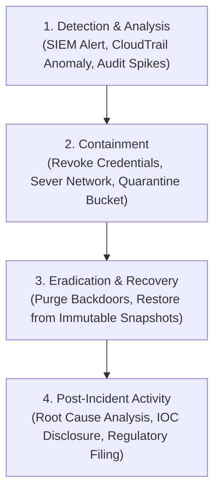

# 🚨 Module 10: Security Incident Triage, Auditing & Compliance

## 1. The NIST Security Incident Response Lifecycle

When a security event occurs in a cloud lakehouse (e.g. leaked credentials, unauthorized table export, ransomware encryption), engineering and SecOps teams execute the standardized **NIST SP 800-61r2** incident response framework:



### Critical Severity Triage Protocol:
- **Phase 1: Immediate Containment ($< 15\text{ minutes}$)**:
  1. Revoke the active compromised token / service principal secret immediately.
  2. Block source IP or subnet on cloud edge firewalls.
  3. Set affected storage containers to read-only or disable network routing to prevent ongoing exfiltration.
- **Phase 2: Forensic Scope Isolation ($< 2\text{ hours}$)**:
  1. Query centralized audit logs (`system.access.audit` / CloudTrail) for the compromised principal's actions over the preceding 30 days.
  2. Isolate exactly which tables, files, or customer records were accessed, read, or mutated.
- **Phase 3: Regulatory Compliance ($< 72\text{ hours}$)**:
  1. If confirmed PII was exfiltrated, trigger GDPR Article 33 notification within 72 hours to regulatory authorities.

---

## 2. Forensic Auditing with Databricks System Tables

Databricks Unity Catalog automatically streams audit logs directly into queryable Delta Lake tables under the `system.access` catalog:

```sql
-- Forensic Query: Identify all data exported by a compromised Service Principal
SELECT 
    event_time,
    user_identity.email AS principal_email,
    action_name,
    request_params.table_full_name AS accessed_table,
    source_ip_address,
    user_agent,
    response.status_code AS http_status
FROM system.access.audit
WHERE user_identity.email = 'sp-compromised-etl@corp.com'
  AND event_time >= NOW() - INTERVAL 14 DAYS
  AND action_name IN ('getTable', 'commandSubmit', 'downloadResult')
ORDER BY event_time DESC;
```

---

## 3. Compliance Frameworks & Security Controls Mapping

| Compliance Framework | Primary Mandate | Technical Lakehouse Implementation |
| :--- | :--- | :--- |
| **SOC 2 Type II** | Trust Services Criteria: Security, Availability, Confidentiality. | Centralized IAM, automated CI/CD branch protection, encryption at rest/transit. |
| **HIPAA Security Rule** | Protection of electronic Protected Health Information (ePHI). | Column-level masking of health attributes, audit logging of all table queries, BAA with cloud providers. |
| **GDPR (Articles 17 & 32)** | Right to erasure (Right to be Forgotten) & State-of-the-art encryption. | Crypto-shredding per customer key, envelope encryption (AES-256-GCM), pseudonymization. |
| **PCI-DSS v4.0** | Payment Card Industry data security standards. | Tokenization of Primary Account Numbers (PAN), zero plaintext CVV/PAN in lakehouse storage, strict network segmentation. |
