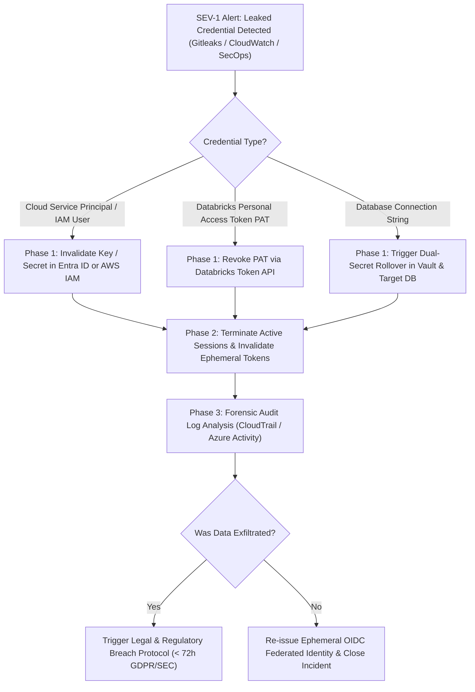

# ⚡ Production Runbook 01: Compromised Credential & Secret Revocation Triage

> **Incident Severity**: SEV-1 (Critical Security Breach)  
> **Target Systems**: Microsoft Entra ID, AWS IAM, Azure Key Vault, AWS Secrets Manager, GitHub Actions  
> **Objective**: Immediately contain, revoke, and remediate leaked API keys, service principal client secrets, or cloud IAM credentials.

---

## 1. Emergency Decision Tree



---

## 2. Emergency Remediation & Containment Protocol

### Step 1: Immediate Credential Invalidation ($< 5\text{ minutes}$)

#### Azure Entra ID Service Principal Client Secret:
```bash
# Delete the compromised client secret immediately
az ad app credential delete \
  --id <APPLICATION_CLIENT_ID> \
  --key-id <COMPROMISED_KEY_ID>

# Revoke all active refresh tokens and user/service sessions
az rest --method POST \
  --uri "https://graph.microsoft.com/v1.0/servicePrincipals/<OBJECT_ID>/revokeSignInSessions"
```

#### AWS IAM Access Key:
```bash
# Deactivate the compromised access key immediately
aws iam update-access-key \
  --user-name <IAM_USER_NAME> \
  --access-key-id <COMPROMISED_ACCESS_KEY_ID> \
  --status Inactive

# Delete the access key after verifying no critical dependencies
aws iam delete-access-key \
  --user-name <IAM_USER_NAME> \
  --access-key-id <COMPROMISED_ACCESS_KEY_ID>
```

### Step 2: Automated Emergency Secret Invalidation & Session Revocation (Python)
```python
import os
import sys
import boto3
from azure.identity import DefaultAzureCredential
from azure.mgmt.authorization import AuthorizationManagementClient
import requests

def emergency_revoke_aws_access_key(username: str, access_key_id: str):
    """Immediately deactivates and invalidates an exposed AWS IAM access key."""
    iam = boto3.client('iam')
    print(f"🚨 Revoking AWS Access Key {access_key_id} for user {username}...")
    iam.update_access_key(
        UserName=username,
        AccessKeyId=access_key_id,
        Status='Inactive'
    )
    print("✅ Key deactivated. Revoking active AWS federated sessions...")

def emergency_revoke_azure_sp_sessions(tenant_id: str, client_id: str, object_id: str, bearer_token: str):
    """Revokes active refresh tokens and user/service sessions in Microsoft Entra ID."""
    headers = {"Authorization": f"Bearer {bearer_token}", "Content-Type": "application/json"}
    url = f"https://graph.microsoft.com/v1.0/servicePrincipals/{object_id}/revokeSignInSessions"
    res = requests.post(url, headers=headers)
    if res.status_code in [200, 204]:
        print("✅ Azure Entra ID sessions successfully terminated.")
    else:
        print(f"⚠️ Session revocation returned: {res.status_code} - {res.text}")

if __name__ == "__main__":
    if len(sys.argv) < 3:
        print("Usage: python emergency_revoke.py <aws|azure> <id>")
        sys.exit(1)
```

---

## 3. Forensic Scope & Impact Recovery

### Step 2: Query CloudTrail / Azure Activity Log for Malicious Actions
Isolate all API operations executed by the compromised identity over the prior 30 days:

```bash
# AWS CloudTrail: Find all S3 GetObject and IAM calls made by the compromised key
aws cloudtrail lookup-events \
  --lookup-attributes AttributeKey=AccessKeyId,AttributeValue=<COMPROMISED_ACCESS_KEY_ID> \
  --start-time $(date -v-14d +%s) \
  --query 'Events[*].{Time:EventTime,Name:EventName,IP:SourceIPAddress,UserAgent:UserAgent}' \
  --output table
```

### Step 3: Forensic Checklist
- [ ] Were any new IAM users, access keys, or role trust relationships created? (Check for persistence backdoors).
- [ ] Were any S3 buckets, ADLS containers, or databases made public or downloaded from anomalous IP addresses?
- [ ] Were any compute clusters or virtual machines provisioned? (Check for cryptojacking).

---

## 4. Root Cause Eradication & Post-Mortem Action Items
1. Migrate the offending workflow to **OIDC Workload Identity Federation** (zero static secrets).
2. Install pre-commit hooks (`gitleaks protect --staged`) across developer workstations.
3. Enable GitHub secret scanning and push protection on all organizational repositories.
