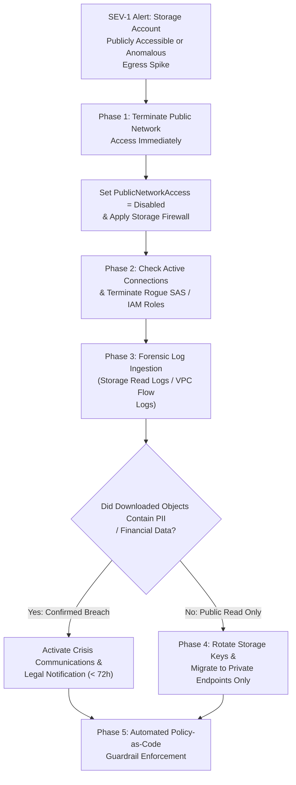

# ⚡ Production Runbook 02: Storage Account Exposure & Data Exfiltration Triage

> **Incident Severity**: SEV-1 (Critical Data Exposure)  
> **Target Systems**: Azure Storage (ADLS Gen2 / Blob), AWS S3, Google Cloud Storage  
> **Objective**: Immediately terminate public access to cloud storage, contain active data exfiltration, and assess the blast radius of exposed lakehouse files.

---

## 1. Emergency Decision Tree



---

## 2. Immediate Remediation & Emergency Containment

### Step 1: Disable Public Access on Storage ($< 2\text{ minutes}$)

#### Azure Data Lake Storage Gen2 / Blob:
```bash
# Disable all public network access to the storage account
az storage account update \
  --name <STORAGE_ACCOUNT_NAME> \
  --resource-group <RESOURCE_GROUP> \
  --public-network-access Disabled \
  --allow-blob-public-access false

# Enforce minimum TLS 1.3
az storage account update \
  --name <STORAGE_ACCOUNT_NAME> \
  --resource-group <RESOURCE_GROUP> \
  --min-tls-version TLS1_3
```

#### AWS S3:
```bash
# Apply S3 Block Public Access to the bucket immediately
aws s3api put-public-access-block \
  --bucket <BUCKET_NAME> \
  --public-access-block-configuration \
    "BlockPublicAcls=true,IgnorePublicAcls=true,BlockPublicPolicy=true,RestrictPublicBuckets=true"

# Enforce HTTPS-only bucket policy
aws s3api put-bucket-policy \
  --bucket <BUCKET_NAME> \
  --policy '{
    "Version": "2012-10-17",
    "Statement": [{
      "Sid": "EnforceTLSRequestsOnly",
      "Effect": "Deny",
      "Principal": "*",
      "Action": "s3:*",
      "Resource": "arn:aws:s3:::<BUCKET_NAME>/*",
      "Condition": {
        "Bool": { "aws:SecureTransport": "false" }
      }
    }]
  }'
```

---

## 3. Forensic Blast Radius Recovery & Egress Analysis

### Step 2: Query Azure Storage Analytics / AWS S3 Server Access Logs
Identify what IP addresses accessed the bucket and total bytes exfiltrated:

```sql
-- Azure Log Analytics / Synapse Serverless Query over Storage Read Logs
SELECT
    TimeGenerated,
    CallerIpAddress,
    Uri,
    HttpStatusCode,
    ROUND(ResponseBodySize / (1024.0 * 1024.0), 2) AS exfiltrated_mb,
    UserAgentHeader
FROM StorageBlobLogs
WHERE StorageAccount = '<STORAGE_ACCOUNT_NAME>'
  AND AuthenticationType = 'Anonymous'
  AND OperationName IN ('GetBlob', 'ListBlobs')
  AND TimeGenerated >= NOW() - INTERVAL '7 DAYS'
ORDER BY TimeGenerated DESC;
```

---

## 4. Remediation & Long-Term Prevention Controls
1. **Azure Policy / AWS SCP Enforcement**: Apply an enterprise-wide guardrail policy that denies the creation of any storage account or S3 bucket unless `publicNetworkAccess = "Disabled"`.
2. **Private Endpoint Requirement**: Route all authorized lakehouse compute access through dedicated Private Endpoints inside private VNet/VPC subnets.
3. **Data Loss Prevention (DLP) Alarms**: Configure cloud metrics alarms for anomalous egress bandwidth (e.g. alert if outbound egress exceeds $100\text{GB/hour}$).
