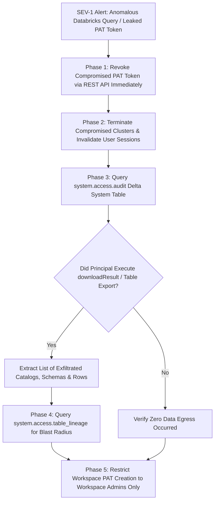

# ⚡ Production Runbook 03: Databricks Unauthorized Access & PAT Breach Triage

> **Incident Severity**: SEV-1 (Lakehouse Security Breach)  
> **Target Systems**: Databricks Workspaces, Unity Catalog, Delta Lake, Personal Access Tokens (PAT)  
> **Objective**: Isolate and revoke compromised Databricks tokens, terminate unauthorized compute clusters, and assess the blast radius of exfiltrated lakehouse tables.

---

## 1. Emergency Decision Tree



---

## 2. Emergency Remediation: Immediate Token Revocation ($< 5\text{ minutes}$)

### Step 1: Revoke the Compromised Personal Access Token
```bash
# Revoke token by Token ID using Databricks CLI
databricks tokens revoke <COMPROMISED_TOKEN_ID>

# Revoke all tokens assigned to the compromised user identity
databricks users delete <USER_EMAIL>
```

### Step 2: Terminate Active Clusters Running under the Compromised Identity
```bash
# List and kill active clusters running under the compromised user
databricks clusters list --output json | jq -r \
  '.[] | select(.creator_user_name=="<USER_EMAIL>") | .cluster_id' | \
  xargs -I {} databricks clusters permanent-delete --cluster-id {}
```

---

## 3. Forensic Blast Radius Recovery: System Tables

### Step 3: Query `system.access.audit` for All Tables Accessed by the Token
```sql
-- Forensic Audit: Identify every query and table read by the compromised identity
SELECT 
    event_time,
    user_identity.email AS principal_email,
    action_name,
    request_params.table_full_name AS accessed_table,
    source_ip_address,
    user_agent,
    response.status_code AS http_status
FROM system.access.audit
WHERE user_identity.email = '<USER_EMAIL>'
  AND event_time >= NOW() - INTERVAL 14 DAYS
  AND action_name IN ('getTable', 'commandSubmit', 'downloadResult', 'read')
ORDER BY event_time DESC;
```

---

## 4. Remediation & Long-Term Policy Hardening
1. **Disable User PAT Creation Globally**:
   ```bash
   # Restrict PAT creation permissions strictly to Workspace Administrators
   databricks workspace-conf set-status --json '{"enableTokensConfig": "false"}'
   ```
2. **Migrate Automated Pipelines to Service Principal OAuth**:
   - Decommission all developer personal tokens used in scheduled workflows.
   - Enforce OAuth 2.0 Machine-to-Machine (M2M) authentication with short-lived tokens.
3. **Enforce IP Access Lists (IPAL)**:
   - Configure Workspace IP Access Lists to restrict Databricks Web UI and API access exclusively to trusted corporate network CIDRs and VPN exit gateways.
