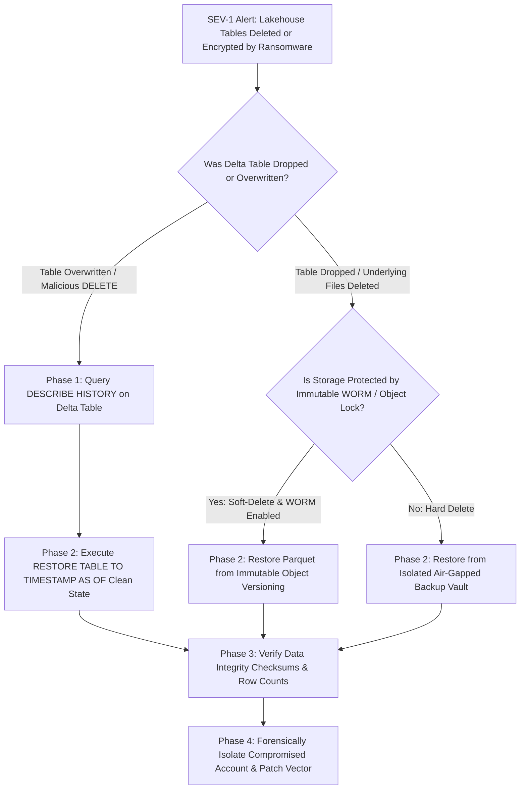

# ⚡ Production Runbook 05: Ransomware & Tampered Lakehouse Disaster Recovery

> **Incident Severity**: SEV-1 (Catastrophic Data Loss / Corruption)  
> **Target Systems**: Delta Lake, Apache Iceberg, Azure Storage (Immutable WORM), AWS S3 (Object Lock)  
> **Objective**: Recover lakehouse tables from malicious tampering, ransomware encryption, or rogue `DROP TABLE` deletions using Delta Time Travel and immutable storage backups.

---

## 1. Emergency Decision Tree



---

## 2. Emergency Remediation: Delta Lake Time Travel Restoration

If an attacker executed a malicious `DELETE FROM prod.financial_ledger WHERE 1=1;` or overrode table files without dropping the Delta log:

### Step 1: Inspect Table Commit History
```sql
-- Identify the exact commit version prior to the malicious transaction
DESCRIBE HISTORY prod.financial_ledger;
```

### Step 2: Instant Rollback via Delta RESTORE TABLE
```sql
-- Restore table instantly to the version preceding the attack
RESTORE TABLE prod.financial_ledger TO VERSION AS OF 104;

-- Alternatively, restore to exact wall-clock timestamp prior to incident
RESTORE TABLE prod.financial_ledger TO TIMESTAMP AS OF '2026-11-20 02:00:00';
```
*Why this works*: Delta Lake writes are append-only. Existing Parquet files are never mutated in place; commits merely update the atomic JSON transaction log (`_delta_log/`). Restoring to a previous commit points the table metadata back to the uncorrupted files instantly ($\approx 1\text{ second}$).

---

## 3. Storage Layer Recovery: Immutable WORM & Object Lock

If the attacker had cloud storage delete permissions and attempted to purge the `_delta_log/` and Parquet files directly from storage:

### Step 1: Immutable Storage Protection (Defense Mechanism)
- **AWS S3 Object Lock (Compliance Mode)**: Enforces Write-Once-Read-Many (WORM). No user—including the AWS root account—can overwrite or delete objects during the retention window.
- **Azure Immutable Blob Storage**: Enforces time-based retention policies preventing blob deletion or container destruction.

### Step 2: Recovery from S3 Versioning / Azure Soft Delete
```bash
# Azure CLI: Undelete dropped container or blobs
az storage blob undelete \
  --container-name finance-data \
  --name "orders/_delta_log/00000000000000000104.json" \
  --account-name <STORAGE_ACCOUNT>
```

---

## 4. Remediation Checklist & Future Hardening
1. **Enable S3 Object Lock / Azure Immutable Policies**: Apply 30-day WORM retention to all Bronze and Silver raw lakehouse tiers.
2. **Revoke Delete Permissions from ETL Roles**: Service principals only require `Write` and `Read` permissions; `Delete` permissions must be restricted to automated lifecycle management rules.
3. **Configure VACUUM Retention Ceilings**: Enforce `SET spark.databricks.delta.vacuum.parallelDelete.enabled = false` and reject `VACUUM` commands with retention periods $< 7\text{ days}$.
