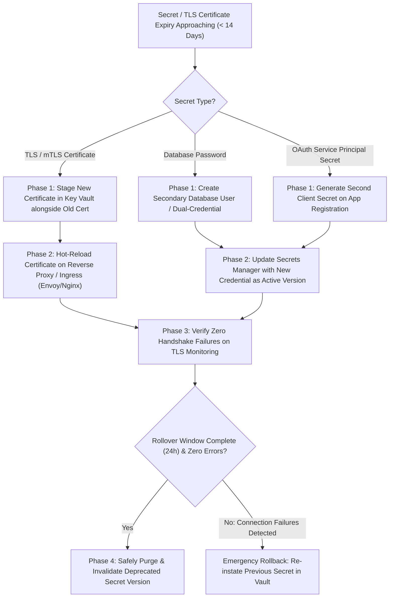

# ⚡ Production Runbook 06: Zero-Downtime Certificate & Secret Rotation

> **Incident Severity**: SEV-2 / Planned High-Risk Maintenance  
> **Target Systems**: TLS/mTLS Certificates, Azure Key Vault, AWS Secrets Manager, Relational Databases, OAuth Client Secrets  
> **Objective**: Execute zero-downtime rotation of cryptographic certificates and database credentials across active production microservices and data pipelines.

---

## 1. Emergency Decision Tree



---

## 2. The Dual-Secret Zero-Downtime Database Rotation Protocol

Rotating a database password in a single atomic update creates a synchronization race condition: if you update the database first, existing application pods fail with authentication errors; if you update the secret vault first, newly launched pods fail until the database is updated.

### Step-by-Step Production Protocol:

#### Step 1: Provision Dual Active Passwords in Database
Modern databases (e.g. MySQL 8.0 `DUAL PASSWORD`, PostgreSQL multiple role memberships) allow an identity to hold two valid concurrent credentials:
```sql
-- MySQL 8.0+: Retain existing password while introducing secondary password
ALTER USER 'etl_worker'@'%' IDENTIFIED BY 'NewSecurePassw0rd_v2!' RETAIN CURRENT PASSWORD;
```

#### Step 2: Update Secret Manager with New Version
```bash
# Push the new credential to Azure Key Vault as the active secret version
az keyvault secret set \
  --vault-name kv-prod-lakehouse \
  --name db-etl-password \
  --value "NewSecurePassw0rd_v2!"
```

#### Step 3: Rolling Restart / Refresh Applications
Application pods dynamically fetch the new secret via Secrets Store CSI Driver or in-memory secret cache refresh. During the transition, pods using `v1` and pods using `v2` both authenticate successfully!

#### Step 4: Discard Deprecated Password After Verification Window
After 24 hours of stable metrics and zero authentication errors in database logs:
```sql
-- Discard the previous secondary password permanently
ALTER USER 'etl_worker'@'%' DISCARD OLD PASSWORD;
```

---

## 3. Automated TLS Certificate Zero-Downtime Rollover

For mTLS ingress controllers and API gateways (Envoy, Traefik, Nginx):
1. Renew certificate via Let's Encrypt / DigiCert / AWS Certificate Manager (ACM).
2. ACM automatically binds renewed certificates to CloudFront, ALBs, and API Gateways with zero dropped TCP connections.
3. For custom containers, mount certificates via Kubernetes Secret and configure Envoy **Secret Discovery Service (SDS)** to hot-reload certificates in memory without restarting worker pods.

---

## 4. Rollback & Emergency Recovery
If downstream pipelines report authentication failures (`ORA-01017`, `28P01: password authentication failed`):
- Revert the secret in Key Vault back to the previous version immediately:
  ```bash
  az keyvault secret set-attributes \
    --vault-name kv-prod-lakehouse \
    --name db-etl-password \
    --version <PREVIOUS_VERSION_ID> \
    --enabled true
  ```
- Trigger an emergency restart of affected application pods.
